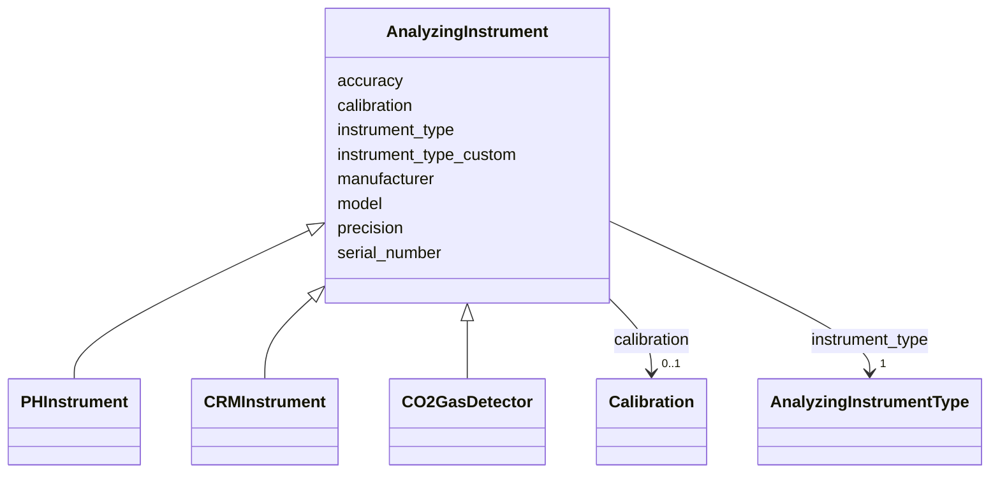

# Class: AnalyzingInstrument


_Base class for scientific instruments used in analyzing samples for measurement._


URI: [oae:AnalyzingInstrument](https://schema.oaedata.org/AnalyzingInstrument)





## Inheritance
* **AnalyzingInstrument**
    * [PHInstrument](PHInstrument.md)
    * [CRMInstrument](CRMInstrument.md)
    * [CO2GasDetector](CO2GasDetector.md)


## Slots

| Name | Cardinality and Range | Description | Inheritance |
| ---  | --- | --- | --- |
| [manufacturer](manufacturer.md) | 0..1 <br/> [String](String.md) | Manufacturer name of the instrument | direct |
| [model](model.md) | 0..1 <br/> [String](String.md) | Model number or name of the instrument | direct |
| [instrument_type](instrument_type.md) | 1 <br/> [AnalyzingInstrumentType](AnalyzingInstrumentType.md) | Type of instrument used to analyze samples or measure continuously | direct |
| [instrument_type_custom](instrument_type_custom.md) | 0..1 <br/> [String](String.md) |  | direct |
| [serial_number](serial_number.md) | 0..1 <br/> [String](String.md) | Serial number of the instrument | direct |
| [precision](precision.md) | 0..1 <br/> [String](String.md) | Precision of the instrument measurements | direct |
| [accuracy](accuracy.md) | 1 <br/> [String](String.md) | Accuracy of the instrument measurements | direct |
| [calibration](calibration.md) | 0..1 <br/> [Calibration](Calibration.md) | Calibration information for this instrument | direct |


## Usages

| used by | used in | type | used |
| ---  | --- | --- | --- |
| [MeasuredVariable](MeasuredVariable.md) | [analyzing_instrument](analyzing_instrument.md) | range | [AnalyzingInstrument](AnalyzingInstrument.md) |
| [DiscreteMeasuredVariable](DiscreteMeasuredVariable.md) | [analyzing_instrument](analyzing_instrument.md) | range | [AnalyzingInstrument](AnalyzingInstrument.md) |
| [ContinuousMeasuredVariable](ContinuousMeasuredVariable.md) | [analyzing_instrument](analyzing_instrument.md) | range | [AnalyzingInstrument](AnalyzingInstrument.md) |
| [ContinuousPHVariable](ContinuousPHVariable.md) | [analyzing_instrument](analyzing_instrument.md) | range | [AnalyzingInstrument](AnalyzingInstrument.md) |
| [ContinuousTAVariable](ContinuousTAVariable.md) | [analyzing_instrument](analyzing_instrument.md) | range | [AnalyzingInstrument](AnalyzingInstrument.md) |
| [ContinuousDICVariable](ContinuousDICVariable.md) | [analyzing_instrument](analyzing_instrument.md) | range | [AnalyzingInstrument](AnalyzingInstrument.md) |
| [ContinuousSedimentVariable](ContinuousSedimentVariable.md) | [analyzing_instrument](analyzing_instrument.md) | range | [AnalyzingInstrument](AnalyzingInstrument.md) |
| [DiscreteSedimentVariable](DiscreteSedimentVariable.md) | [analyzing_instrument](analyzing_instrument.md) | range | [AnalyzingInstrument](AnalyzingInstrument.md) |
| [HPLCVariable](HPLCVariable.md) | [analyzing_instrument](analyzing_instrument.md) | range | [AnalyzingInstrument](AnalyzingInstrument.md) |
| [DiscretePhysiologicalVariable](DiscretePhysiologicalVariable.md) | [analyzing_instrument](analyzing_instrument.md) | range | [AnalyzingInstrument](AnalyzingInstrument.md) |
| [ContinuousPhysiologicalVariable](ContinuousPhysiologicalVariable.md) | [analyzing_instrument](analyzing_instrument.md) | range | [AnalyzingInstrument](AnalyzingInstrument.md) |


## Identifier and Mapping Information


### Schema Source


* from schema: https://schema.oaedata.org/OAEDataSchema


## Mappings

| Mapping Type | Mapped Value |
| ---  | ---  |
| self | oae:AnalyzingInstrument |
| native | oae:AnalyzingInstrument |


## LinkML Source

<!-- TODO: investigate https://stackoverflow.com/questions/37606292/how-to-create-tabbed-code-blocks-in-mkdocs-or-sphinx -->

### Direct

<details>
```yaml
name: AnalyzingInstrument
description: Base class for scientific instruments used in analyzing samples for measurement.
from_schema: https://schema.oaedata.org/OAEDataSchema
slots:
- manufacturer
- model
attributes:
  instrument_type:
    name: instrument_type
    description: Type of instrument used to analyze samples or measure continuously.
    title: Instrument type
    from_schema: Instrument
    rank: 1000
    domain_of:
    - AnalyzingInstrument
    range: AnalyzingInstrumentType
    required: true
  instrument_type_custom:
    name: instrument_type_custom
    title: Instrument type (custom)
    from_schema: Instrument
    rank: 1000
    domain_of:
    - AnalyzingInstrument
    range: string
  serial_number:
    name: serial_number
    description: Serial number of the instrument.
    title: Serial number
    from_schema: Instrument
    rank: 1000
    domain_of:
    - AnalyzingInstrument
    - GenericSensor
    range: string
  precision:
    name: precision
    description: Precision of the instrument measurements.
    title: Precision
    from_schema: Instrument
    rank: 1000
    domain_of:
    - AnalyzingInstrument
    - GenericSensor
    range: string
  accuracy:
    name: accuracy
    description: Accuracy of the instrument measurements.
    title: Accuracy
    from_schema: Instrument
    rank: 1000
    domain_of:
    - AnalyzingInstrument
    - GenericSensor
    range: string
    required: true
  calibration:
    name: calibration
    description: Calibration information for this instrument.
    title: Calibration
    from_schema: Instrument
    rank: 1000
    domain_of:
    - AnalyzingInstrument
    - PHInstrument
    - CRMInstrument
    - CO2GasDetector
    - ContinuousCO2GasDetector
    - GenericSensor
    range: Calibration

```
</details>

### Induced

<details>
```yaml
name: AnalyzingInstrument
description: Base class for scientific instruments used in analyzing samples for measurement.
from_schema: https://schema.oaedata.org/OAEDataSchema
attributes:
  instrument_type:
    name: instrument_type
    description: Type of instrument used to analyze samples or measure continuously.
    title: Instrument type
    from_schema: Instrument
    rank: 1000
    alias: instrument_type
    owner: AnalyzingInstrument
    domain_of:
    - AnalyzingInstrument
    range: AnalyzingInstrumentType
    required: true
  instrument_type_custom:
    name: instrument_type_custom
    title: Instrument type (custom)
    from_schema: Instrument
    rank: 1000
    alias: instrument_type_custom
    owner: AnalyzingInstrument
    domain_of:
    - AnalyzingInstrument
    range: string
  serial_number:
    name: serial_number
    description: Serial number of the instrument.
    title: Serial number
    from_schema: Instrument
    rank: 1000
    alias: serial_number
    owner: AnalyzingInstrument
    domain_of:
    - AnalyzingInstrument
    - GenericSensor
    range: string
  precision:
    name: precision
    description: Precision of the instrument measurements.
    title: Precision
    from_schema: Instrument
    rank: 1000
    alias: precision
    owner: AnalyzingInstrument
    domain_of:
    - AnalyzingInstrument
    - GenericSensor
    range: string
  accuracy:
    name: accuracy
    description: Accuracy of the instrument measurements.
    title: Accuracy
    from_schema: Instrument
    rank: 1000
    alias: accuracy
    owner: AnalyzingInstrument
    domain_of:
    - AnalyzingInstrument
    - GenericSensor
    range: string
    required: true
  calibration:
    name: calibration
    description: Calibration information for this instrument.
    title: Calibration
    from_schema: Instrument
    rank: 1000
    alias: calibration
    owner: AnalyzingInstrument
    domain_of:
    - AnalyzingInstrument
    - PHInstrument
    - CRMInstrument
    - CO2GasDetector
    - ContinuousCO2GasDetector
    - GenericSensor
    range: Calibration
  manufacturer:
    name: manufacturer
    description: Manufacturer name of the instrument.
    title: Manufacturer
    from_schema: https://schema.oaedata.org/OAEDataSchema
    rank: 1000
    alias: manufacturer
    owner: AnalyzingInstrument
    domain_of:
    - StandardGas
    - AnalyzingInstrument
    - GenericSensor
    range: string
  model:
    name: model
    description: Model number or name of the instrument.
    title: Model
    from_schema: https://schema.oaedata.org/OAEDataSchema
    rank: 1000
    alias: model
    owner: AnalyzingInstrument
    domain_of:
    - AnalyzingInstrument
    - GenericSensor
    range: string

```
</details>