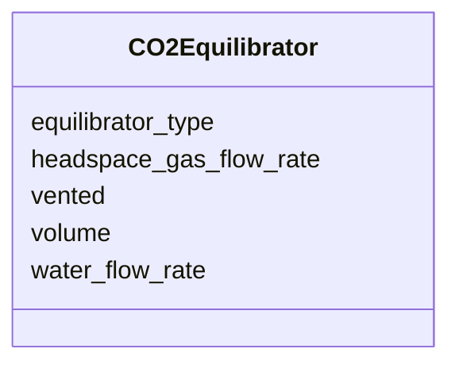

# Class: CO2Equilibrator


_Equilibrator used for continuous CO2 measurement._


URI: [oae:CO2Equilibrator](https://schema.oaedata.org/CO2Equilibrator)





<!-- no inheritance hierarchy -->


## Slots

| Name | Cardinality and Range | Description | Inheritance |
| ---  | --- | --- | --- |
| [equilibrator_type](equilibrator_type.md) | 0..1 <br/> [String](String.md) | Type of the equilibrator for the CO2 measurement | direct |
| [volume](volume.md) | 0..1 <br/> [Float](Float.md) | The total volume (in liters) of the CO2 equilibrator | direct |
| [vented](vented.md) | 0..1 <br/> [Boolean](Boolean.md) | Is the equilibrator vented or not? | direct |
| [water_flow_rate](water_flow_rate.md) | 0..1 <br/> [Float](Float.md) | Flow rate (in L/min) of the flow through seawater | direct |
| [headspace_gas_flow_rate](headspace_gas_flow_rate.md) | 0..1 <br/> [Float](Float.md) | Flow rate (in L/min) of the gas from the equilibrator to the CO2 analyzer | direct |


## Usages

| used by | used in | type | used |
| ---  | --- | --- | --- |
| [ContinuousCO2Variable](ContinuousCO2Variable.md) | [equilibrator](equilibrator.md) | range | [CO2Equilibrator](CO2Equilibrator.md) |


## Identifier and Mapping Information


### Schema Source


* from schema: https://schema.oaedata.org/OAEDataSchema


## Mappings

| Mapping Type | Mapped Value |
| ---  | ---  |
| self | oae:CO2Equilibrator |
| native | oae:CO2Equilibrator |


## LinkML Source

<!-- TODO: investigate https://stackoverflow.com/questions/37606292/how-to-create-tabbed-code-blocks-in-mkdocs-or-sphinx -->

### Direct

<details>
```yaml
name: CO2Equilibrator
description: Equilibrator used for continuous CO2 measurement.
from_schema: https://schema.oaedata.org/OAEDataSchema
attributes:
  equilibrator_type:
    name: equilibrator_type
    description: Type of the equilibrator for the CO2 measurement.
    title: Equilibrator type
    from_schema: Instrument
    rank: 1000
    domain_of:
    - CO2Equilibrator
    range: string
  volume:
    name: volume
    description: The total volume (in liters) of the CO2 equilibrator.
    title: Equilibrator volume (L)
    from_schema: Instrument
    rank: 1000
    domain_of:
    - CO2Equilibrator
    - SamplePreservation
    range: float
  vented:
    name: vented
    description: Is the equilibrator vented or not?
    title: Vented or not
    from_schema: Instrument
    rank: 1000
    domain_of:
    - CO2Equilibrator
    range: boolean
  water_flow_rate:
    name: water_flow_rate
    description: Flow rate (in L/min) of the flow through seawater.
    title: Water flow rate (L/min)
    from_schema: Instrument
    rank: 1000
    domain_of:
    - CO2Equilibrator
    range: float
  headspace_gas_flow_rate:
    name: headspace_gas_flow_rate
    description: Flow rate (in L/min) of the gas from the equilibrator to the CO2
      analyzer.
    title: Headspace gas flow rate (L/min)
    from_schema: Instrument
    rank: 1000
    domain_of:
    - CO2Equilibrator
    range: float

```
</details>

### Induced

<details>
```yaml
name: CO2Equilibrator
description: Equilibrator used for continuous CO2 measurement.
from_schema: https://schema.oaedata.org/OAEDataSchema
attributes:
  equilibrator_type:
    name: equilibrator_type
    description: Type of the equilibrator for the CO2 measurement.
    title: Equilibrator type
    from_schema: Instrument
    rank: 1000
    alias: equilibrator_type
    owner: CO2Equilibrator
    domain_of:
    - CO2Equilibrator
    range: string
  volume:
    name: volume
    description: The total volume (in liters) of the CO2 equilibrator.
    title: Equilibrator volume (L)
    from_schema: Instrument
    rank: 1000
    alias: volume
    owner: CO2Equilibrator
    domain_of:
    - CO2Equilibrator
    - SamplePreservation
    range: float
  vented:
    name: vented
    description: Is the equilibrator vented or not?
    title: Vented or not
    from_schema: Instrument
    rank: 1000
    alias: vented
    owner: CO2Equilibrator
    domain_of:
    - CO2Equilibrator
    range: boolean
  water_flow_rate:
    name: water_flow_rate
    description: Flow rate (in L/min) of the flow through seawater.
    title: Water flow rate (L/min)
    from_schema: Instrument
    rank: 1000
    alias: water_flow_rate
    owner: CO2Equilibrator
    domain_of:
    - CO2Equilibrator
    range: float
  headspace_gas_flow_rate:
    name: headspace_gas_flow_rate
    description: Flow rate (in L/min) of the gas from the equilibrator to the CO2
      analyzer.
    title: Headspace gas flow rate (L/min)
    from_schema: Instrument
    rank: 1000
    alias: headspace_gas_flow_rate
    owner: CO2Equilibrator
    domain_of:
    - CO2Equilibrator
    range: float

```
</details>