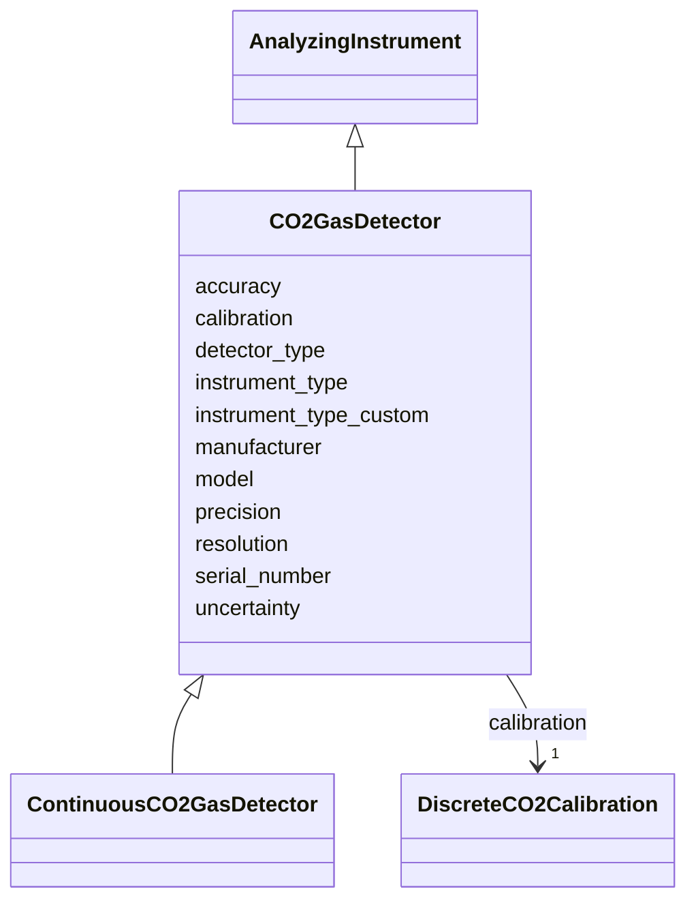

# Class: CO2GasDetector


_CO2 gas detector with standard gas calibration._


URI: [oae:CO2GasDetector](https://schema.oaedata.org/CO2GasDetector)





## Inheritance
* [AnalyzingInstrument](AnalyzingInstrument.md)
    * **CO2GasDetector**
        * [ContinuousCO2GasDetector](ContinuousCO2GasDetector.md)


## Slots

| Name | Cardinality and Range | Description | Inheritance |
| ---  | --- | --- | --- |
| [detector_type](detector_type.md) | 1 <br/> [String](String.md) | Type of the CO2 gas detector (E | direct |
| [calibration](calibration.md) | 1 <br/> [DiscreteCO2Calibration](DiscreteCO2Calibration.md) | CO2 calibration information for this instrument | direct |
| [resolution](resolution.md) | 0..1 <br/> [String](String.md) | Resolution of the CO2 sensor | direct |
| [uncertainty](uncertainty.md) | 0..1 <br/> [String](String.md) | Uncertainty of the CO2 sensor | direct |
| [manufacturer](manufacturer.md) | 1 <br/> [String](String.md) | Manufacture of the CO2 sensor | [AnalyzingInstrument](AnalyzingInstrument.md) |
| [model](model.md) | 0..1 <br/> [String](String.md) | Model number of the CO2 sensor, e | [AnalyzingInstrument](AnalyzingInstrument.md) |
| [instrument_type](instrument_type.md) | 1 <br/> [String](String.md) | Type of instrument used to analyze samples or measure continuously | [AnalyzingInstrument](AnalyzingInstrument.md) |
| [instrument_type_custom](instrument_type_custom.md) | 0..1 <br/> [String](String.md) |  | [AnalyzingInstrument](AnalyzingInstrument.md) |
| [serial_number](serial_number.md) | 0..1 <br/> [String](String.md) | Serial number of the instrument | [AnalyzingInstrument](AnalyzingInstrument.md) |
| [precision](precision.md) | 0..1 <br/> [String](String.md) | Precision of the instrument measurements | [AnalyzingInstrument](AnalyzingInstrument.md) |
| [accuracy](accuracy.md) | 1 <br/> [String](String.md) | Accuracy of the instrument measurements | [AnalyzingInstrument](AnalyzingInstrument.md) |


## Usages

| used by | used in | type | used |
| ---  | --- | --- | --- |
| [DiscreteCO2Variable](DiscreteCO2Variable.md) | [analyzing_instrument](analyzing_instrument.md) | range | [CO2GasDetector](CO2GasDetector.md) |


## Identifier and Mapping Information


### Schema Source


* from schema: https://schema.oaedata.org/OAEDataSchema


## Mappings

| Mapping Type | Mapped Value |
| ---  | ---  |
| self | oae:CO2GasDetector |
| native | oae:CO2GasDetector |


## LinkML Source

<!-- TODO: investigate https://stackoverflow.com/questions/37606292/how-to-create-tabbed-code-blocks-in-mkdocs-or-sphinx -->

### Direct

<details>
```yaml
name: CO2GasDetector
description: CO2 gas detector with standard gas calibration.
from_schema: https://schema.oaedata.org/OAEDataSchema
is_a: AnalyzingInstrument
slot_usage:
  instrument_type:
    name: instrument_type
    range: string
    equals_string: gas_analyzer
  manufacturer:
    name: manufacturer
    description: Manufacture of the CO2 sensor
    required: true
  model:
    name: model
    description: Model number of the CO2 sensor, e.g., 6262
attributes:
  detector_type:
    name: detector_type
    description: Type of the CO2 gas detector (E.g., Infrared)
    title: Detector Type
    from_schema: Instrument
    rank: 1000
    domain_of:
    - CO2GasDetector
    range: string
    required: true
  calibration:
    name: calibration
    description: CO2 calibration information for this instrument.
    title: Calibration
    from_schema: Instrument
    domain_of:
    - AnalyzingInstrument
    - PHInstrument
    - CRMInstrument
    - CO2GasDetector
    - ContinuousCO2GasDetector
    - GenericSensor
    range: DiscreteCO2Calibration
    required: true
  resolution:
    name: resolution
    description: Resolution of the CO2 sensor.
    title: Resolution
    from_schema: Instrument
    rank: 1000
    domain_of:
    - CO2GasDetector
    range: string
  uncertainty:
    name: uncertainty
    description: Uncertainty of the CO2 sensor.
    title: Uncertainty
    from_schema: Instrument
    domain_of:
    - StandardGas
    - CO2GasDetector
    - QCFields
    range: string

```
</details>

### Induced

<details>
```yaml
name: CO2GasDetector
description: CO2 gas detector with standard gas calibration.
from_schema: https://schema.oaedata.org/OAEDataSchema
is_a: AnalyzingInstrument
slot_usage:
  instrument_type:
    name: instrument_type
    range: string
    equals_string: gas_analyzer
  manufacturer:
    name: manufacturer
    description: Manufacture of the CO2 sensor
    required: true
  model:
    name: model
    description: Model number of the CO2 sensor, e.g., 6262
attributes:
  detector_type:
    name: detector_type
    description: Type of the CO2 gas detector (E.g., Infrared)
    title: Detector Type
    from_schema: Instrument
    rank: 1000
    alias: detector_type
    owner: CO2GasDetector
    domain_of:
    - CO2GasDetector
    range: string
    required: true
  calibration:
    name: calibration
    description: CO2 calibration information for this instrument.
    title: Calibration
    from_schema: Instrument
    alias: calibration
    owner: CO2GasDetector
    domain_of:
    - AnalyzingInstrument
    - PHInstrument
    - CRMInstrument
    - CO2GasDetector
    - ContinuousCO2GasDetector
    - GenericSensor
    range: DiscreteCO2Calibration
    required: true
  resolution:
    name: resolution
    description: Resolution of the CO2 sensor.
    title: Resolution
    from_schema: Instrument
    rank: 1000
    alias: resolution
    owner: CO2GasDetector
    domain_of:
    - CO2GasDetector
    range: string
  uncertainty:
    name: uncertainty
    description: Uncertainty of the CO2 sensor.
    title: Uncertainty
    from_schema: Instrument
    alias: uncertainty
    owner: CO2GasDetector
    domain_of:
    - StandardGas
    - CO2GasDetector
    - QCFields
    range: string
  manufacturer:
    name: manufacturer
    description: Manufacture of the CO2 sensor
    title: Manufacturer
    from_schema: https://schema.oaedata.org/OAEDataSchema
    rank: 1000
    alias: manufacturer
    owner: CO2GasDetector
    domain_of:
    - StandardGas
    - AnalyzingInstrument
    - GenericSensor
    range: string
    required: true
  model:
    name: model
    description: Model number of the CO2 sensor, e.g., 6262
    title: Model
    from_schema: https://schema.oaedata.org/OAEDataSchema
    rank: 1000
    alias: model
    owner: CO2GasDetector
    domain_of:
    - AnalyzingInstrument
    - GenericSensor
    range: string
  instrument_type:
    name: instrument_type
    description: Type of instrument used to analyze samples or measure continuously.
    title: Instrument type
    from_schema: Instrument
    rank: 1000
    alias: instrument_type
    owner: CO2GasDetector
    domain_of:
    - AnalyzingInstrument
    range: string
    required: true
    equals_string: gas_analyzer
  instrument_type_custom:
    name: instrument_type_custom
    title: Instrument type (custom)
    from_schema: Instrument
    rank: 1000
    alias: instrument_type_custom
    owner: CO2GasDetector
    domain_of:
    - AnalyzingInstrument
    range: string
  serial_number:
    name: serial_number
    description: Serial number of the instrument.
    title: Serial number
    from_schema: Instrument
    rank: 1000
    alias: serial_number
    owner: CO2GasDetector
    domain_of:
    - AnalyzingInstrument
    - GenericSensor
    range: string
  precision:
    name: precision
    description: Precision of the instrument measurements.
    title: Precision
    from_schema: Instrument
    rank: 1000
    alias: precision
    owner: CO2GasDetector
    domain_of:
    - AnalyzingInstrument
    - GenericSensor
    range: string
  accuracy:
    name: accuracy
    description: Accuracy of the instrument measurements.
    title: Accuracy
    from_schema: Instrument
    rank: 1000
    alias: accuracy
    owner: CO2GasDetector
    domain_of:
    - AnalyzingInstrument
    - GenericSensor
    range: string
    required: true

```
</details>