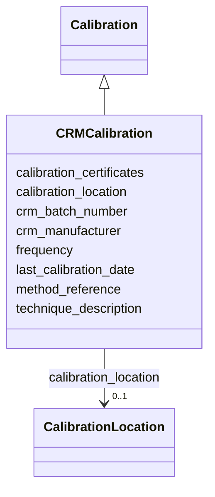

# Class: CRMCalibration


_Calibration using Certified Reference Materials, used for DIC and TA instruments._


URI: [oae:CRMCalibration](https://schema.oaedata.org/CRMCalibration)





## Inheritance
* [Calibration](Calibration.md)
    * **CRMCalibration**


## Slots

| Name | Cardinality and Range | Description | Inheritance |
| ---  | --- | --- | --- |
| [crm_manufacturer](crm_manufacturer.md) | 1 <br/> [String](String.md) | Manufacturer of the Certified Reference Material (e | direct |
| [crm_batch_number](crm_batch_number.md) | 1 <br/> [String](String.md) | Batch number of the Certified Reference Material | direct |
| [calibration_location](calibration_location.md) | 0..1 <br/> [CalibrationLocation](CalibrationLocation.md) | Factory calibration, lab calibration, or field calibration | [Calibration](Calibration.md) |
| [technique_description](technique_description.md) | 1 <br/> [String](String.md) | Details of the calibration technique used | [Calibration](Calibration.md) |
| [method_reference](method_reference.md) | 0..1 <br/> [String](String.md) | Citation or reference for the calibration method | [Calibration](Calibration.md) |
| [frequency](frequency.md) | 0..1 <br/> [String](String.md) | How often the instrument was calibrated | [Calibration](Calibration.md) |
| [last_calibration_date](last_calibration_date.md) | 0..1 <br/> [Datetime](Datetime.md) | Date and time of most recent calibration in UTC | [Calibration](Calibration.md) |
| [calibration_certificates](calibration_certificates.md) | 0..1 <br/> [String](String.md) | Information about calibration certificates | [Calibration](Calibration.md) |


## Usages

| used by | used in | type | used |
| ---  | --- | --- | --- |
| [CRMInstrument](CRMInstrument.md) | [calibration](calibration.md) | range | [CRMCalibration](CRMCalibration.md) |


## Identifier and Mapping Information


### Schema Source


* from schema: https://schema.oaedata.org/OAEDataSchema


## Mappings

| Mapping Type | Mapped Value |
| ---  | ---  |
| self | oae:CRMCalibration |
| native | oae:CRMCalibration |


## LinkML Source

<!-- TODO: investigate https://stackoverflow.com/questions/37606292/how-to-create-tabbed-code-blocks-in-mkdocs-or-sphinx -->

### Direct

<details>
```yaml
name: CRMCalibration
description: Calibration using Certified Reference Materials, used for DIC and TA
  instruments.
from_schema: https://schema.oaedata.org/OAEDataSchema
is_a: Calibration
attributes:
  crm_manufacturer:
    name: crm_manufacturer
    description: Manufacturer of the Certified Reference Material (e.g., Scripps,
      JAMSTEC).
    title: CRM manufacturer
    from_schema: Calibration
    rank: 1000
    domain_of:
    - CRMCalibration
    range: string
    required: true
  crm_batch_number:
    name: crm_batch_number
    description: Batch number of the Certified Reference Material.
    title: CRM batch number
    from_schema: Calibration
    rank: 1000
    domain_of:
    - CRMCalibration
    range: string
    required: true

```
</details>

### Induced

<details>
```yaml
name: CRMCalibration
description: Calibration using Certified Reference Materials, used for DIC and TA
  instruments.
from_schema: https://schema.oaedata.org/OAEDataSchema
is_a: Calibration
attributes:
  crm_manufacturer:
    name: crm_manufacturer
    description: Manufacturer of the Certified Reference Material (e.g., Scripps,
      JAMSTEC).
    title: CRM manufacturer
    from_schema: Calibration
    rank: 1000
    alias: crm_manufacturer
    owner: CRMCalibration
    domain_of:
    - CRMCalibration
    range: string
    required: true
  crm_batch_number:
    name: crm_batch_number
    description: Batch number of the Certified Reference Material.
    title: CRM batch number
    from_schema: Calibration
    rank: 1000
    alias: crm_batch_number
    owner: CRMCalibration
    domain_of:
    - CRMCalibration
    range: string
    required: true
  calibration_location:
    name: calibration_location
    description: Factory calibration, lab calibration, or field calibration.
    title: Calibration location
    from_schema: https://schema.oaedata.org/OAEDataSchema
    rank: 1000
    alias: calibration_location
    owner: CRMCalibration
    domain_of:
    - Calibration
    range: CalibrationLocation
  technique_description:
    name: technique_description
    description: Details of the calibration technique used.
    title: Calibration technique description
    from_schema: Calibration
    rank: 1000
    alias: technique_description
    owner: CRMCalibration
    domain_of:
    - Calibration
    range: string
    required: true
  method_reference:
    name: method_reference
    description: Citation or reference for the calibration method.
    title: Calibration method reference
    from_schema: Calibration
    rank: 1000
    alias: method_reference
    owner: CRMCalibration
    domain_of:
    - Calibration
    - InSituVariable
    range: string
  frequency:
    name: frequency
    description: How often the instrument was calibrated.
    title: Frequency of calibration
    from_schema: Calibration
    rank: 1000
    alias: frequency
    owner: CRMCalibration
    domain_of:
    - Calibration
    range: string
  last_calibration_date:
    name: last_calibration_date
    description: Date and time of most recent calibration in UTC.
    title: Last calibration date (UTC)
    from_schema: Calibration
    rank: 1000
    alias: last_calibration_date
    owner: CRMCalibration
    domain_of:
    - Calibration
    range: datetime
  calibration_certificates:
    name: calibration_certificates
    description: Information about calibration certificates. Ideally, the certificate
      should be made available in a PDF file with filename listed here.
    title: Calibration certificate information
    from_schema: Calibration
    rank: 1000
    alias: calibration_certificates
    owner: CRMCalibration
    domain_of:
    - Calibration
    range: string

```
</details>