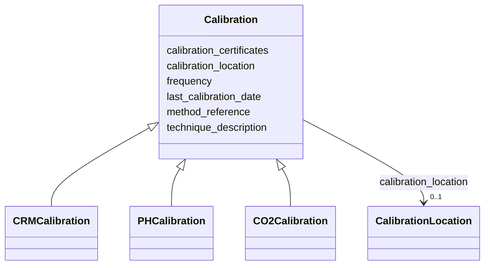

# Class: Calibration


_Base calibration information for instruments._


URI: [oae:Calibration](https://schema.oaedata.org/Calibration)





## Inheritance
* **Calibration**
    * [CRMCalibration](CRMCalibration.md)
    * [PHCalibration](PHCalibration.md)
    * [CO2Calibration](CO2Calibration.md)


## Slots

| Name | Cardinality and Range | Description | Inheritance |
| ---  | --- | --- | --- |
| [calibration_location](calibration_location.md) | 0..1 <br/> [CalibrationLocation](CalibrationLocation.md) | Factory calibration, lab calibration, or field calibration | direct |
| [technique_description](technique_description.md) | 1 <br/> [String](String.md) | Details of the calibration technique used | direct |
| [method_reference](method_reference.md) | 0..1 <br/> [String](String.md) | Citation or reference for the calibration method | direct |
| [frequency](frequency.md) | 0..1 <br/> [String](String.md) | How often the instrument was calibrated | direct |
| [last_calibration_date](last_calibration_date.md) | 0..1 <br/> [Datetime](Datetime.md) | Date and time of most recent calibration in UTC | direct |
| [calibration_certificates](calibration_certificates.md) | 0..1 <br/> [String](String.md) | Information about calibration certificates | direct |


## Usages

| used by | used in | type | used |
| ---  | --- | --- | --- |
| [AnalyzingInstrument](AnalyzingInstrument.md) | [calibration](calibration.md) | range | [Calibration](Calibration.md) |


## Identifier and Mapping Information


### Schema Source


* from schema: https://schema.oaedata.org/OAEDataSchema


## Mappings

| Mapping Type | Mapped Value |
| ---  | ---  |
| self | oae:Calibration |
| native | oae:Calibration |


## LinkML Source

<!-- TODO: investigate https://stackoverflow.com/questions/37606292/how-to-create-tabbed-code-blocks-in-mkdocs-or-sphinx -->

### Direct

<details>
```yaml
name: Calibration
description: Base calibration information for instruments.
from_schema: https://schema.oaedata.org/OAEDataSchema
slots:
- calibration_location
attributes:
  technique_description:
    name: technique_description
    description: Details of the calibration technique used.
    title: Calibration technique description
    from_schema: Calibration
    rank: 1000
    domain_of:
    - Calibration
    range: string
    required: true
  method_reference:
    name: method_reference
    description: Citation or reference for the calibration method.
    title: Calibration method reference
    from_schema: Calibration
    rank: 1000
    domain_of:
    - Calibration
    - InSituVariable
    range: string
  frequency:
    name: frequency
    description: How often the instrument was calibrated.
    title: Frequency of calibration
    from_schema: Calibration
    rank: 1000
    domain_of:
    - Calibration
    range: string
  last_calibration_date:
    name: last_calibration_date
    description: Date and time of most recent calibration in UTC.
    title: Last calibration date (UTC)
    from_schema: Calibration
    rank: 1000
    domain_of:
    - Calibration
    range: datetime
  calibration_certificates:
    name: calibration_certificates
    description: Information about calibration certificates. Ideally, the certificate
      should be made available in a PDF file with filename listed here.
    title: Calibration certificate information
    from_schema: Calibration
    rank: 1000
    domain_of:
    - Calibration
    range: string

```
</details>

### Induced

<details>
```yaml
name: Calibration
description: Base calibration information for instruments.
from_schema: https://schema.oaedata.org/OAEDataSchema
attributes:
  technique_description:
    name: technique_description
    description: Details of the calibration technique used.
    title: Calibration technique description
    from_schema: Calibration
    rank: 1000
    alias: technique_description
    owner: Calibration
    domain_of:
    - Calibration
    range: string
    required: true
  method_reference:
    name: method_reference
    description: Citation or reference for the calibration method.
    title: Calibration method reference
    from_schema: Calibration
    rank: 1000
    alias: method_reference
    owner: Calibration
    domain_of:
    - Calibration
    - InSituVariable
    range: string
  frequency:
    name: frequency
    description: How often the instrument was calibrated.
    title: Frequency of calibration
    from_schema: Calibration
    rank: 1000
    alias: frequency
    owner: Calibration
    domain_of:
    - Calibration
    range: string
  last_calibration_date:
    name: last_calibration_date
    description: Date and time of most recent calibration in UTC.
    title: Last calibration date (UTC)
    from_schema: Calibration
    rank: 1000
    alias: last_calibration_date
    owner: Calibration
    domain_of:
    - Calibration
    range: datetime
  calibration_certificates:
    name: calibration_certificates
    description: Information about calibration certificates. Ideally, the certificate
      should be made available in a PDF file with filename listed here.
    title: Calibration certificate information
    from_schema: Calibration
    rank: 1000
    alias: calibration_certificates
    owner: Calibration
    domain_of:
    - Calibration
    range: string
  calibration_location:
    name: calibration_location
    description: Factory calibration, lab calibration, or field calibration.
    title: Calibration location
    from_schema: https://schema.oaedata.org/OAEDataSchema
    rank: 1000
    alias: calibration_location
    owner: Calibration
    domain_of:
    - Calibration
    range: CalibrationLocation

```
</details>