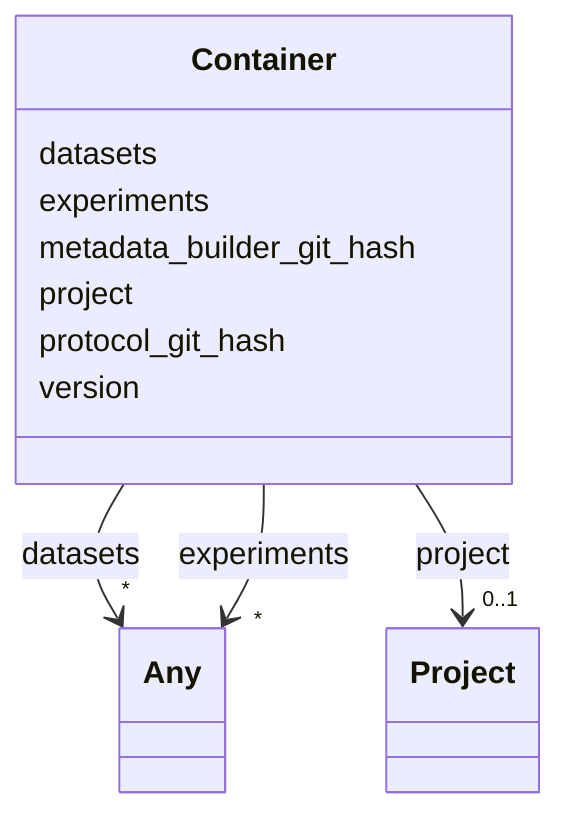

# Class: Container


URI: [oae:Container](https://schema.oaedata.org/Container)





<!-- no inheritance hierarchy -->


## Slots

| Name | Cardinality and Range | Description | Inheritance |
| ---  | --- | --- | --- |
| [project](project.md) | 0..1 <br/> [Project](Project.md) |  | direct |
| [experiments](experiments.md) | * <br/> [Any](Any.md)&nbsp;or&nbsp;<br />[Experiment](Experiment.md)&nbsp;or&nbsp;<br />[InSituExperiment](InSituExperiment.md)&nbsp;or&nbsp;<br />[Model](Model.md)&nbsp;or&nbsp;<br />[Intervention](Intervention.md)&nbsp;or&nbsp;<br />[Tracer](Tracer.md)&nbsp;or&nbsp;<br />[InterventionWithTracer](InterventionWithTracer.md) |  | direct |
| [datasets](datasets.md) | * <br/> [Any](Any.md)&nbsp;or&nbsp;<br />[Dataset](Dataset.md)&nbsp;or&nbsp;<br />[FieldDataset](FieldDataset.md)&nbsp;or&nbsp;<br />[ModelOutputDataset](ModelOutputDataset.md) |  | direct |
| [version](version.md) | 0..1 <br/> [String](String.md) | Version of the oae-data-protocol | direct |
| [protocol_git_hash](protocol_git_hash.md) | 0..1 <br/> [String](String.md) | Git commit hash of the oae-data-protocol | direct |
| [metadata_builder_git_hash](metadata_builder_git_hash.md) | 0..1 <br/> [String](String.md) | Git commit hash of the metadata-builder UI | direct |


## Identifier and Mapping Information


### Schema Source


* from schema: https://schema.oaedata.org/OAEDataSchema


## Mappings

| Mapping Type | Mapped Value |
| ---  | ---  |
| self | oae:Container |
| native | oae:Container |


## LinkML Source

<!-- TODO: investigate https://stackoverflow.com/questions/37606292/how-to-create-tabbed-code-blocks-in-mkdocs-or-sphinx -->

### Direct

<details>
```yaml
name: Container
from_schema: https://schema.oaedata.org/OAEDataSchema
attributes:
  project:
    name: project
    from_schema: https://schema.oaedata.org/OAEDataSchema
    rank: 1000
    domain_of:
    - Container
    range: Project
  experiments:
    name: experiments
    from_schema: https://schema.oaedata.org/OAEDataSchema
    rank: 1000
    domain_of:
    - Container
    range: Any
    multivalued: true
    any_of:
    - range: Experiment
    - range: InSituExperiment
    - range: Model
    - range: Intervention
    - range: Tracer
    - range: InterventionWithTracer
  datasets:
    name: datasets
    from_schema: https://schema.oaedata.org/OAEDataSchema
    rank: 1000
    domain_of:
    - Container
    range: Any
    multivalued: true
    any_of:
    - range: Dataset
    - range: FieldDataset
    - range: ModelOutputDataset
  version:
    name: version
    description: Version of the oae-data-protocol
    from_schema: https://schema.oaedata.org/OAEDataSchema
    rank: 1000
    domain_of:
    - Container
    - ModelComponent
    range: string
    required: false
  protocol_git_hash:
    name: protocol_git_hash
    description: Git commit hash of the oae-data-protocol
    from_schema: https://schema.oaedata.org/OAEDataSchema
    rank: 1000
    domain_of:
    - Container
    range: string
    required: false
  metadata_builder_git_hash:
    name: metadata_builder_git_hash
    description: Git commit hash of the metadata-builder UI
    from_schema: https://schema.oaedata.org/OAEDataSchema
    rank: 1000
    domain_of:
    - Container
    range: string
    required: false
tree_root: true

```
</details>

### Induced

<details>
```yaml
name: Container
from_schema: https://schema.oaedata.org/OAEDataSchema
attributes:
  project:
    name: project
    from_schema: https://schema.oaedata.org/OAEDataSchema
    rank: 1000
    alias: project
    owner: Container
    domain_of:
    - Container
    range: Project
  experiments:
    name: experiments
    from_schema: https://schema.oaedata.org/OAEDataSchema
    rank: 1000
    alias: experiments
    owner: Container
    domain_of:
    - Container
    range: Any
    multivalued: true
    any_of:
    - range: Experiment
    - range: InSituExperiment
    - range: Model
    - range: Intervention
    - range: Tracer
    - range: InterventionWithTracer
  datasets:
    name: datasets
    from_schema: https://schema.oaedata.org/OAEDataSchema
    rank: 1000
    alias: datasets
    owner: Container
    domain_of:
    - Container
    range: Any
    multivalued: true
    any_of:
    - range: Dataset
    - range: FieldDataset
    - range: ModelOutputDataset
  version:
    name: version
    description: Version of the oae-data-protocol
    from_schema: https://schema.oaedata.org/OAEDataSchema
    rank: 1000
    alias: version
    owner: Container
    domain_of:
    - Container
    - ModelComponent
    range: string
    required: false
  protocol_git_hash:
    name: protocol_git_hash
    description: Git commit hash of the oae-data-protocol
    from_schema: https://schema.oaedata.org/OAEDataSchema
    rank: 1000
    alias: protocol_git_hash
    owner: Container
    domain_of:
    - Container
    range: string
    required: false
  metadata_builder_git_hash:
    name: metadata_builder_git_hash
    description: Git commit hash of the metadata-builder UI
    from_schema: https://schema.oaedata.org/OAEDataSchema
    rank: 1000
    alias: metadata_builder_git_hash
    owner: Container
    domain_of:
    - Container
    range: string
    required: false
tree_root: true

```
</details>