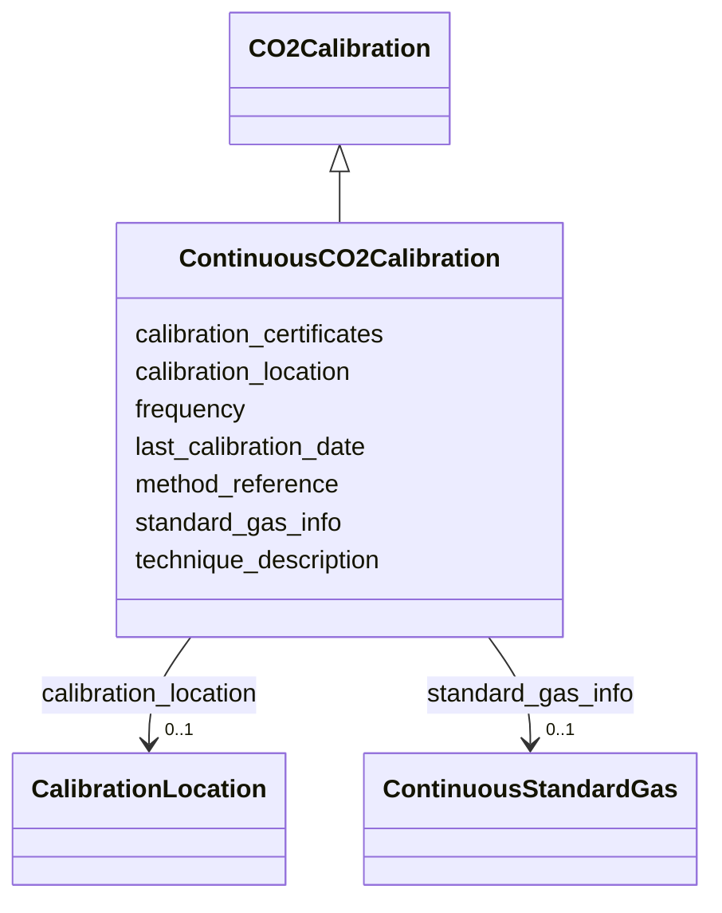

# Class: ContinuousCO2Calibration


_CO2 calibration for continuous measurements, with extended standard gas details._


URI: [oae:ContinuousCO2Calibration](https://schema.oaedata.org/ContinuousCO2Calibration)





## Inheritance
* [Calibration](Calibration.md)
    * [CO2Calibration](CO2Calibration.md)
        * **ContinuousCO2Calibration**


## Slots

| Name | Cardinality and Range | Description | Inheritance |
| ---  | --- | --- | --- |
| [standard_gas_info](standard_gas_info.md) | 0..1 <br/> [ContinuousStandardGas](ContinuousStandardGas.md) | Standard gases used for calibration | direct |
| [calibration_location](calibration_location.md) | 0..1 <br/> [CalibrationLocation](CalibrationLocation.md) | Factory calibration, lab calibration, or field calibration | [Calibration](Calibration.md) |
| [technique_description](technique_description.md) | 1 <br/> [String](String.md) | Details of the calibration technique used | [Calibration](Calibration.md) |
| [method_reference](method_reference.md) | 0..1 <br/> [String](String.md) | Citation or reference for the calibration method | [Calibration](Calibration.md) |
| [frequency](frequency.md) | 0..1 <br/> [String](String.md) | How often the instrument was calibrated | [Calibration](Calibration.md) |
| [last_calibration_date](last_calibration_date.md) | 0..1 <br/> [Datetime](Datetime.md) | Date and time of most recent calibration in UTC | [Calibration](Calibration.md) |
| [calibration_certificates](calibration_certificates.md) | 0..1 <br/> [String](String.md) | Information about calibration certificates | [Calibration](Calibration.md) |


## Usages

| used by | used in | type | used |
| ---  | --- | --- | --- |
| [ContinuousCO2GasDetector](ContinuousCO2GasDetector.md) | [calibration](calibration.md) | range | [ContinuousCO2Calibration](ContinuousCO2Calibration.md) |


## Identifier and Mapping Information


### Schema Source


* from schema: https://schema.oaedata.org/OAEDataSchema


## Mappings

| Mapping Type | Mapped Value |
| ---  | ---  |
| self | oae:ContinuousCO2Calibration |
| native | oae:ContinuousCO2Calibration |


## LinkML Source

<!-- TODO: investigate https://stackoverflow.com/questions/37606292/how-to-create-tabbed-code-blocks-in-mkdocs-or-sphinx -->

### Direct

<details>
```yaml
name: ContinuousCO2Calibration
description: CO2 calibration for continuous measurements, with extended standard gas
  details.
from_schema: https://schema.oaedata.org/OAEDataSchema
is_a: CO2Calibration
attributes:
  standard_gas_info:
    name: standard_gas_info
    description: Standard gases used for calibration.
    title: Standard gas information
    from_schema: Calibration
    domain_of:
    - CO2Calibration
    - ContinuousCO2Calibration
    range: ContinuousStandardGas

```
</details>

### Induced

<details>
```yaml
name: ContinuousCO2Calibration
description: CO2 calibration for continuous measurements, with extended standard gas
  details.
from_schema: https://schema.oaedata.org/OAEDataSchema
is_a: CO2Calibration
attributes:
  standard_gas_info:
    name: standard_gas_info
    description: Standard gases used for calibration.
    title: Standard gas information
    from_schema: Calibration
    alias: standard_gas_info
    owner: ContinuousCO2Calibration
    domain_of:
    - CO2Calibration
    - ContinuousCO2Calibration
    range: ContinuousStandardGas
  calibration_location:
    name: calibration_location
    description: Factory calibration, lab calibration, or field calibration.
    title: Calibration location
    from_schema: https://schema.oaedata.org/OAEDataSchema
    rank: 1000
    alias: calibration_location
    owner: ContinuousCO2Calibration
    domain_of:
    - Calibration
    range: CalibrationLocation
  technique_description:
    name: technique_description
    description: Details of the calibration technique used.
    title: Calibration technique description
    from_schema: Calibration
    rank: 1000
    alias: technique_description
    owner: ContinuousCO2Calibration
    domain_of:
    - Calibration
    range: string
    required: true
  method_reference:
    name: method_reference
    description: Citation or reference for the calibration method.
    title: Calibration method reference
    from_schema: Calibration
    rank: 1000
    alias: method_reference
    owner: ContinuousCO2Calibration
    domain_of:
    - Calibration
    - InSituVariable
    range: string
  frequency:
    name: frequency
    description: How often the instrument was calibrated.
    title: Frequency of calibration
    from_schema: Calibration
    rank: 1000
    alias: frequency
    owner: ContinuousCO2Calibration
    domain_of:
    - Calibration
    range: string
  last_calibration_date:
    name: last_calibration_date
    description: Date and time of most recent calibration in UTC.
    title: Last calibration date (UTC)
    from_schema: Calibration
    rank: 1000
    alias: last_calibration_date
    owner: ContinuousCO2Calibration
    domain_of:
    - Calibration
    range: datetime
  calibration_certificates:
    name: calibration_certificates
    description: Information about calibration certificates. Ideally, the certificate
      should be made available in a PDF file with filename listed here.
    title: Calibration certificate information
    from_schema: Calibration
    rank: 1000
    alias: calibration_certificates
    owner: ContinuousCO2Calibration
    domain_of:
    - Calibration
    range: string

```
</details>