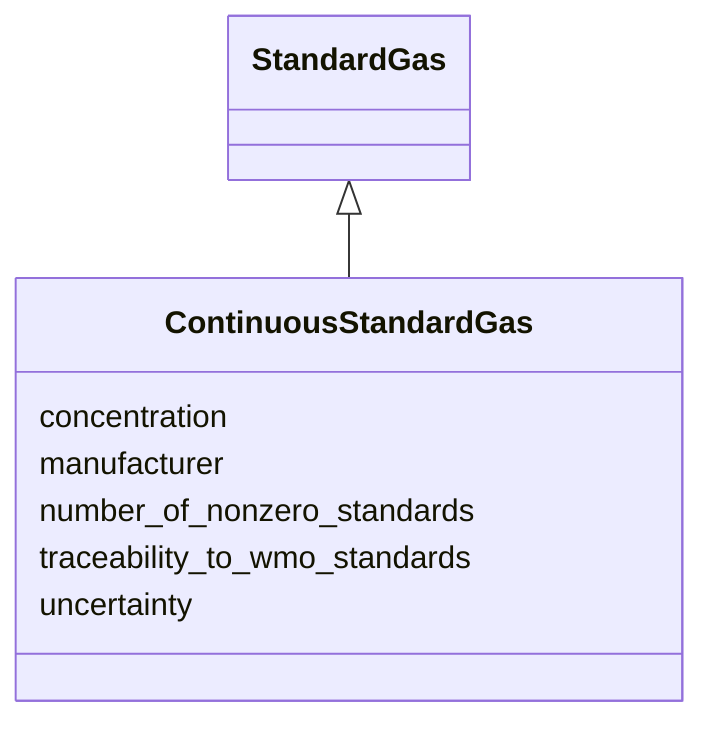

# Class: ContinuousStandardGas


_Standard gas used for continuous CO2 calibration, with additional traceability and count information._


URI: [oae:ContinuousStandardGas](https://schema.oaedata.org/ContinuousStandardGas)





## Inheritance
* [StandardGas](StandardGas.md)
    * **ContinuousStandardGas**


## Slots

| Name | Cardinality and Range | Description | Inheritance |
| ---  | --- | --- | --- |
| [number_of_nonzero_standards](number_of_nonzero_standards.md) | 0..1 <br/> [Integer](Integer.md) | How many non-zero gas standards were used for the calibration | direct |
| [traceability_to_wmo_standards](traceability_to_wmo_standards.md) | 0..1 <br/> [String](String.md) | Information about traceability of standard gases to WMO standards | direct |
| [manufacturer](manufacturer.md) | 0..1 <br/> [String](String.md) | Manufacturer of the standard gas | [StandardGas](StandardGas.md) |
| [concentration](concentration.md) | 0..1 <br/> [String](String.md) | Concentrations of the CO2 standard gases that are used to calibrate the CO2 s... | [StandardGas](StandardGas.md) |
| [uncertainty](uncertainty.md) | 0..1 <br/> [String](String.md) | Uncertainties of the CO2 standard gas, e | [StandardGas](StandardGas.md) |


## Usages

| used by | used in | type | used |
| ---  | --- | --- | --- |
| [ContinuousCO2Calibration](ContinuousCO2Calibration.md) | [standard_gas_info](standard_gas_info.md) | range | [ContinuousStandardGas](ContinuousStandardGas.md) |


## Identifier and Mapping Information


### Schema Source


* from schema: https://schema.oaedata.org/OAEDataSchema


## Mappings

| Mapping Type | Mapped Value |
| ---  | ---  |
| self | oae:ContinuousStandardGas |
| native | oae:ContinuousStandardGas |


## LinkML Source

<!-- TODO: investigate https://stackoverflow.com/questions/37606292/how-to-create-tabbed-code-blocks-in-mkdocs-or-sphinx -->

### Direct

<details>
```yaml
name: ContinuousStandardGas
description: Standard gas used for continuous CO2 calibration, with additional traceability
  and count information.
from_schema: https://schema.oaedata.org/OAEDataSchema
is_a: StandardGas
attributes:
  number_of_nonzero_standards:
    name: number_of_nonzero_standards
    description: How many non-zero gas standards were used for the calibration.
    title: Number of non-zero gas standards
    from_schema: Calibration
    rank: 1000
    domain_of:
    - ContinuousStandardGas
    range: integer
  traceability_to_wmo_standards:
    name: traceability_to_wmo_standards
    description: Information about traceability of standard gases to WMO standards.
    title: Traceability to WMO standards
    from_schema: Calibration
    rank: 1000
    domain_of:
    - ContinuousStandardGas
    range: string

```
</details>

### Induced

<details>
```yaml
name: ContinuousStandardGas
description: Standard gas used for continuous CO2 calibration, with additional traceability
  and count information.
from_schema: https://schema.oaedata.org/OAEDataSchema
is_a: StandardGas
attributes:
  number_of_nonzero_standards:
    name: number_of_nonzero_standards
    description: How many non-zero gas standards were used for the calibration.
    title: Number of non-zero gas standards
    from_schema: Calibration
    rank: 1000
    alias: number_of_nonzero_standards
    owner: ContinuousStandardGas
    domain_of:
    - ContinuousStandardGas
    range: integer
  traceability_to_wmo_standards:
    name: traceability_to_wmo_standards
    description: Information about traceability of standard gases to WMO standards.
    title: Traceability to WMO standards
    from_schema: Calibration
    rank: 1000
    alias: traceability_to_wmo_standards
    owner: ContinuousStandardGas
    domain_of:
    - ContinuousStandardGas
    range: string
  manufacturer:
    name: manufacturer
    description: Manufacturer of the standard gas.
    title: Standard Gas Manufacturer
    from_schema: Calibration
    alias: manufacturer
    owner: ContinuousStandardGas
    domain_of:
    - StandardGas
    - AnalyzingInstrument
    - GenericSensor
    range: string
  concentration:
    name: concentration
    description: Concentrations of the CO2 standard gases that are used to calibrate
      the CO2 sensor, e.g., 260, 350, 510ppm.
    title: Standard Gas Concentration
    from_schema: Calibration
    rank: 1000
    alias: concentration
    owner: ContinuousStandardGas
    domain_of:
    - StandardGas
    range: string
  uncertainty:
    name: uncertainty
    description: Uncertainties of the CO2 standard gas, e.g., 0.5%.
    title: Standard Gas Uncertainty
    from_schema: Calibration
    alias: uncertainty
    owner: ContinuousStandardGas
    domain_of:
    - StandardGas
    - CO2GasDetector
    - QCFields
    range: string

```
</details>