# Class: DiscreteCO2Variable


_CO2 discrete (bottle) measured variable (pCO2/fCO2). Reference: OAPMetadata XSD variables.xsd - co2_discrete_


URI: [oae:DiscreteCO2Variable](https://schema.oaedata.org/DiscreteCO2Variable)

```mermaid
 classDiagram
    class DiscreteCO2Variable
    click DiscreteCO2Variable href "../DiscreteCO2Variable"
      MeasuredCO2Fields <|-- DiscreteCO2Variable
        click MeasuredCO2Fields href "../MeasuredCO2Fields"
      DiscreteMeasuredVariable <|-- DiscreteCO2Variable
        click DiscreteMeasuredVariable href "../DiscreteMeasuredVariable"
      
      DiscreteCO2Variable : analyzing_instrument
        
          
    
    
    DiscreteCO2Variable --> "1" CO2GasDetector : analyzing_instrument
    click CO2GasDetector href "../CO2GasDetector"

        
      DiscreteCO2Variable : analyzing_method
        
      DiscreteCO2Variable : appropriate_use_quality
        
          
    
    
    DiscreteCO2Variable --> "0..1" AppropriateUseQuality : appropriate_use_quality
    click AppropriateUseQuality href "../AppropriateUseQuality"

        
      DiscreteCO2Variable : dataset_variable_name
        
      DiscreteCO2Variable : dataset_variable_name_qc_flag
        
      DiscreteCO2Variable : dataset_variable_name_raw
        
      DiscreteCO2Variable : field_replicate_information
        
      DiscreteCO2Variable : genesis
        
      DiscreteCO2Variable : headspace_volume
        
      DiscreteCO2Variable : long_name
        
      DiscreteCO2Variable : measurement_researcher
        
          
    
    
    DiscreteCO2Variable --> "0..1" Person : measurement_researcher
    click Person href "../Person"

        
      DiscreteCO2Variable : measurement_temperature
        
      DiscreteCO2Variable : method_reference
        
      DiscreteCO2Variable : missing_value_indicators
        
      DiscreteCO2Variable : observation_type
        
          
    
    
    DiscreteCO2Variable --> "1" ObservationType : observation_type
    click ObservationType href "../ObservationType"

        
      DiscreteCO2Variable : other_detailed_information
        
      DiscreteCO2Variable : pco2_reported_temperature
        
      DiscreteCO2Variable : qc_researcher
        
      DiscreteCO2Variable : qc_researcher_institution
        
      DiscreteCO2Variable : qc_steps_taken
        
      DiscreteCO2Variable : sampling
        
      DiscreteCO2Variable : sampling_instrument_type
        
          
    
    
    DiscreteCO2Variable --> "1" SamplingInstrumentType : sampling_instrument_type
    click SamplingInstrumentType href "../SamplingInstrumentType"

        
      DiscreteCO2Variable : sampling_instrument_type_custom
        
      DiscreteCO2Variable : sampling_method
        
      DiscreteCO2Variable : schema_class
        
      DiscreteCO2Variable : seawater_volume
        
      DiscreteCO2Variable : standard_identifier
        
          
    
    
    DiscreteCO2Variable --> "0..1" VocabularyItemReference : standard_identifier
    click VocabularyItemReference href "../VocabularyItemReference"

        
      DiscreteCO2Variable : storage_method
        
      DiscreteCO2Variable : temperature_correction_method
        
      DiscreteCO2Variable : uncertainty
        
      DiscreteCO2Variable : uncertainty_definition
        
      DiscreteCO2Variable : units
        
      DiscreteCO2Variable : variable_type
        
      DiscreteCO2Variable : water_vapor_correction_method
        
      
```





## Inheritance
* [Variable](Variable.md)
    * [FieldVariable](FieldVariable.md)
        * [InSituVariable](InSituVariable.md)
            * [MeasuredVariable](MeasuredVariable.md) [ [QCFields](QCFields.md)]
                * [DiscreteMeasuredVariable](DiscreteMeasuredVariable.md)
                    * **DiscreteCO2Variable** [ [MeasuredCO2Fields](MeasuredCO2Fields.md)]


## Slots

| Name | Cardinality and Range | Description | Inheritance |
| ---  | --- | --- | --- |
| [storage_method](storage_method.md) | 1 <br/> [String](String.md) | How the samples were stored before the measurement | direct |
| [seawater_volume](seawater_volume.md) | 0..1 <br/> [Float](Float.md) | Volume (in mL) of seawater in the flask | direct |
| [headspace_volume](headspace_volume.md) | 0..1 <br/> [Float](Float.md) | Volume (in mL) of headspace (water displaced in the flask plus volume of the ... | direct |
| [measurement_temperature](measurement_temperature.md) | 1 <br/> [Float](Float.md) | Temperature at which the samples were analyzed in Celsius | direct |
| [appropriate_use_quality](appropriate_use_quality.md) | 0..1 <br/> [AppropriateUseQuality](AppropriateUseQuality.md) | Climate quality is defined as measurements of quality sufficient to assess lo... | [MeasuredCO2Fields](MeasuredCO2Fields.md) |
| [pco2_reported_temperature](pco2_reported_temperature.md) | 1 <br/> [String](String.md) | In Celsius | [MeasuredCO2Fields](MeasuredCO2Fields.md) |
| [water_vapor_correction_method](water_vapor_correction_method.md) | 0..1 <br/> [String](String.md) | How the water vapor pressure inside the equilibrator was determined | [MeasuredCO2Fields](MeasuredCO2Fields.md) |
| [temperature_correction_method](temperature_correction_method.md) | 0..1 <br/> [String](String.md) | How the temperature effect was corrected | [MeasuredCO2Fields](MeasuredCO2Fields.md) |
| [analyzing_instrument](analyzing_instrument.md) | 1 <br/> [CO2GasDetector](CO2GasDetector.md) | CO2 gas detector with standard gas calibration | [MeasuredVariable](MeasuredVariable.md) |
| [sampling_method](sampling_method.md) | 1 <br/> [String](String.md) | Method used to collect samples | [MeasuredVariable](MeasuredVariable.md) |
| [field_replicate_information](field_replicate_information.md) | 0..1 <br/> [String](String.md) | Repetition of sample collection and measurement, e | [MeasuredVariable](MeasuredVariable.md) |
| [analyzing_method](analyzing_method.md) | 1 <br/> [String](String.md) | Additional information describing how the sample was analyzed | [MeasuredVariable](MeasuredVariable.md) |
| [observation_type](observation_type.md) | 1 <br/> [ObservationType](ObservationType.md) |  | [MeasuredVariable](MeasuredVariable.md) |
| [sampling](sampling.md) | 1 <br/> [String](String.md) |  | [MeasuredVariable](MeasuredVariable.md) |
| [sampling_instrument_type](sampling_instrument_type.md) | 1 <br/> [SamplingInstrumentType](SamplingInstrumentType.md) |  | [MeasuredVariable](MeasuredVariable.md) |
| [sampling_instrument_type_custom](sampling_instrument_type_custom.md) | 0..1 <br/> [String](String.md) |  | [MeasuredVariable](MeasuredVariable.md) |
| [qc_steps_taken](qc_steps_taken.md) | 1 <br/> [String](String.md) | Describe what QC steps have been taken to improve the quality of the data (e | [QCFields](QCFields.md) |
| [uncertainty](uncertainty.md) | 1 <br/> [String](String.md) | It is recommended to provide uncertainty for each data point in the data file | [QCFields](QCFields.md) |
| [uncertainty_definition](uncertainty_definition.md) | 1 <br/> [String](String.md) | A description of the uncertainties involved in this method | [QCFields](QCFields.md) |
| [missing_value_indicators](missing_value_indicators.md) | 1 <br/> [String](String.md) | The indicator used to represent missing values in the data file, e | [QCFields](QCFields.md) |
| [qc_researcher](qc_researcher.md) | 0..1 <br/> [String](String.md) | The name of the PI whose research team QCed this parameter | [QCFields](QCFields.md) |
| [qc_researcher_institution](qc_researcher_institution.md) | 0..1 <br/> [String](String.md) | The institution of the PI whose research team QCed this parameter | [QCFields](QCFields.md) |
| [genesis](genesis.md) | 1 <br/> [String](String.md) |  | [InSituVariable](InSituVariable.md) |
| [dataset_variable_name_qc_flag](dataset_variable_name_qc_flag.md) | 0..1 <br/> [String](String.md) | If applicable, the column header name used for the quality control flag corre... | [InSituVariable](InSituVariable.md) |
| [dataset_variable_name_raw](dataset_variable_name_raw.md) | 0..1 <br/> [String](String.md) | If applicable, the column header name used for the raw data corresponding to ... | [InSituVariable](InSituVariable.md) |
| [other_detailed_information](other_detailed_information.md) | 0..1 <br/> [String](String.md) | Any additional information about this variable | [InSituVariable](InSituVariable.md) |
| [method_reference](method_reference.md) | 0..1 <br/> [String](String.md) | Citation for the method used | [InSituVariable](InSituVariable.md) |
| [measurement_researcher](measurement_researcher.md) | 0..1 <br/> [Person](Person.md) | The name of the PI whose research team measured or derived this parameter | [InSituVariable](InSituVariable.md) |
| [units](units.md) | 1 <br/> [String](String.md) | Unit of measurement for this variable | [Variable](Variable.md) |
| [variable_type](variable_type.md) | 1 <br/> [String](String.md) | High-level classification of the variable | [Variable](Variable.md) |
| [schema_class](schema_class.md) | 1 <br/> [String](String.md) | The schema class name for this variable (e | [Variable](Variable.md) |
| [standard_identifier](standard_identifier.md) | 0..1 <br/> [VocabularyItemReference](VocabularyItemReference.md) | A term from a community vocabulary that identifies this variable | [Variable](Variable.md) |
| [dataset_variable_name](dataset_variable_name.md) | 1 <br/> [String](String.md) | The name for the variable as it is identified in the dataset data file | [Variable](Variable.md) |
| [long_name](long_name.md) | 1 <br/> [String](String.md) | Full descriptive name of the variable | [Variable](Variable.md) |


## Identifier and Mapping Information


### Schema Source


* from schema: https://schema.oaedata.org/OAEDataSchema


## Mappings

| Mapping Type | Mapped Value |
| ---  | ---  |
| self | oae:DiscreteCO2Variable |
| native | oae:DiscreteCO2Variable |


## LinkML Source

<!-- TODO: investigate https://stackoverflow.com/questions/37606292/how-to-create-tabbed-code-blocks-in-mkdocs-or-sphinx -->

### Direct

<details>
```yaml
name: DiscreteCO2Variable
description: 'CO2 discrete (bottle) measured variable (pCO2/fCO2). Reference: OAPMetadata
  XSD variables.xsd - co2_discrete'
from_schema: https://schema.oaedata.org/OAEDataSchema
is_a: DiscreteMeasuredVariable
mixins:
- MeasuredCO2Fields
slot_usage:
  variable_type:
    name: variable_type
    range: string
    equals_string: co2
  analyzing_instrument:
    name: analyzing_instrument
    description: CO2 gas detector with standard gas calibration.
    range: CO2GasDetector
attributes:
  storage_method:
    name: storage_method
    description: How the samples were stored before the measurement.
    title: Storage method
    from_schema: Variable
    rank: 1000
    domain_of:
    - DiscreteCO2Variable
    range: string
    required: true
  seawater_volume:
    name: seawater_volume
    description: Volume (in mL) of seawater in the flask.
    title: Seawater volume (mL)
    from_schema: Variable
    rank: 1000
    domain_of:
    - DiscreteCO2Variable
    range: float
  headspace_volume:
    name: headspace_volume
    description: Volume (in mL) of headspace (water displaced in the flask plus volume
      of the tubing).
    title: Headspace volume (mL)
    from_schema: Variable
    rank: 1000
    domain_of:
    - DiscreteCO2Variable
    range: float
  measurement_temperature:
    name: measurement_temperature
    description: Temperature at which the samples were analyzed in Celsius.
    title: Temperature of measurement (°C)
    from_schema: Variable
    domain_of:
    - DiscretePHVariable
    - DiscreteCO2Variable
    range: float
    required: true

```
</details>

### Induced

<details>
```yaml
name: DiscreteCO2Variable
description: 'CO2 discrete (bottle) measured variable (pCO2/fCO2). Reference: OAPMetadata
  XSD variables.xsd - co2_discrete'
from_schema: https://schema.oaedata.org/OAEDataSchema
is_a: DiscreteMeasuredVariable
mixins:
- MeasuredCO2Fields
slot_usage:
  variable_type:
    name: variable_type
    range: string
    equals_string: co2
  analyzing_instrument:
    name: analyzing_instrument
    description: CO2 gas detector with standard gas calibration.
    range: CO2GasDetector
attributes:
  storage_method:
    name: storage_method
    description: How the samples were stored before the measurement.
    title: Storage method
    from_schema: Variable
    rank: 1000
    alias: storage_method
    owner: DiscreteCO2Variable
    domain_of:
    - DiscreteCO2Variable
    range: string
    required: true
  seawater_volume:
    name: seawater_volume
    description: Volume (in mL) of seawater in the flask.
    title: Seawater volume (mL)
    from_schema: Variable
    rank: 1000
    alias: seawater_volume
    owner: DiscreteCO2Variable
    domain_of:
    - DiscreteCO2Variable
    range: float
  headspace_volume:
    name: headspace_volume
    description: Volume (in mL) of headspace (water displaced in the flask plus volume
      of the tubing).
    title: Headspace volume (mL)
    from_schema: Variable
    rank: 1000
    alias: headspace_volume
    owner: DiscreteCO2Variable
    domain_of:
    - DiscreteCO2Variable
    range: float
  measurement_temperature:
    name: measurement_temperature
    description: Temperature at which the samples were analyzed in Celsius.
    title: Temperature of measurement (°C)
    from_schema: Variable
    alias: measurement_temperature
    owner: DiscreteCO2Variable
    domain_of:
    - DiscretePHVariable
    - DiscreteCO2Variable
    range: float
    required: true
  appropriate_use_quality:
    name: appropriate_use_quality
    description: 'Climate quality is defined as measurements of quality sufficient
      to assess long term trends with a defined level of confidence. Weather quality
      is defined as measurements of quality sufficient to identify relative spatial
      patterns and short term variation.

      For more details, refer to Newton J.A., Feely R. A., Jewett E. B., Williamson
      P. & Mathis J., 2015. Global Ocean Acidification Observing Network: Requirements
      and Governance Plan. Second Edition, GOA-ON, http://www.goa-on.org/docs/GOA-ON_plan_print.pdf.'
    title: Weather or climate quality
    from_schema: https://schema.oaedata.org/OAEDataSchema
    rank: 1000
    alias: appropriate_use_quality
    owner: DiscreteCO2Variable
    domain_of:
    - MeasuredTAFields
    - MeasuredDICFields
    - MeasuredPHFields
    - MeasuredCO2Fields
    range: AppropriateUseQuality
  pco2_reported_temperature:
    name: pco2_reported_temperature
    description: In Celsius. The input could be a constant temperature value, or something
      like, in-situ temperature, temperature of analysis, etc.
    title: Temperature at which pCO2 was reported
    from_schema: Variable
    rank: 1000
    alias: pco2_reported_temperature
    owner: DiscreteCO2Variable
    domain_of:
    - MeasuredCO2Fields
    range: string
    required: true
  water_vapor_correction_method:
    name: water_vapor_correction_method
    description: How the water vapor pressure inside the equilibrator was determined.
    title: Water vapor correction method
    from_schema: Variable
    rank: 1000
    alias: water_vapor_correction_method
    owner: DiscreteCO2Variable
    domain_of:
    - MeasuredCO2Fields
    range: string
  temperature_correction_method:
    name: temperature_correction_method
    description: How the temperature effect was corrected.
    title: Temperature correction method
    from_schema: Variable
    alias: temperature_correction_method
    owner: DiscreteCO2Variable
    domain_of:
    - DiscretePHVariable
    - MeasuredCO2Fields
    range: string
  analyzing_instrument:
    name: analyzing_instrument
    description: CO2 gas detector with standard gas calibration.
    title: Analyzing instrument
    from_schema: https://schema.oaedata.org/OAEDataSchema
    rank: 1000
    alias: analyzing_instrument
    owner: DiscreteCO2Variable
    domain_of:
    - MeasuredVariable
    range: CO2GasDetector
    required: true
  sampling_method:
    name: sampling_method
    description: Method used to collect samples.
    title: Sampling Method
    from_schema: Variable
    rank: 1000
    alias: sampling_method
    owner: DiscreteCO2Variable
    domain_of:
    - MeasuredVariable
    range: string
    required: true
  field_replicate_information:
    name: field_replicate_information
    description: Repetition of sample collection and measurement, e.g., triplicate
      samples.
    title: Field replicate information
    from_schema: Variable
    rank: 1000
    alias: field_replicate_information
    owner: DiscreteCO2Variable
    domain_of:
    - MeasuredVariable
    range: string
  analyzing_method:
    name: analyzing_method
    description: Additional information describing how the sample was analyzed. DOIs
      provided as applicable.
    title: Analyzing Method
    from_schema: Variable
    rank: 1000
    alias: analyzing_method
    owner: DiscreteCO2Variable
    domain_of:
    - MeasuredVariable
    range: string
    required: true
  observation_type:
    name: observation_type
    title: Observation Type
    from_schema: Variable
    rank: 1000
    alias: observation_type
    owner: DiscreteCO2Variable
    domain_of:
    - MeasuredVariable
    range: ObservationType
    required: true
  sampling:
    name: sampling
    from_schema: Variable
    rank: 1000
    alias: sampling
    owner: DiscreteCO2Variable
    domain_of:
    - MeasuredVariable
    range: string
    required: true
    equals_string: discrete
  sampling_instrument_type:
    name: sampling_instrument_type
    title: Sampling instrument type
    from_schema: Variable
    rank: 1000
    alias: sampling_instrument_type
    owner: DiscreteCO2Variable
    domain_of:
    - MeasuredVariable
    range: SamplingInstrumentType
    required: true
  sampling_instrument_type_custom:
    name: sampling_instrument_type_custom
    title: Sampling instrument type (custom)
    from_schema: Variable
    rank: 1000
    alias: sampling_instrument_type_custom
    owner: DiscreteCO2Variable
    domain_of:
    - MeasuredVariable
    range: string
  qc_steps_taken:
    name: qc_steps_taken
    description: 'Describe what QC steps have been taken to improve the quality of
      the data (e.g., DOI, software and settings used, outlier removal, etc.).

      If quality control procedures are described in a separate document uploaded
      with the data, provide the name of the document here.'
    title: QC steps taken
    from_schema: https://schema.oaedata.org/OAEDataSchema
    rank: 1000
    alias: qc_steps_taken
    owner: DiscreteCO2Variable
    domain_of:
    - QCFields
    range: string
    required: true
  uncertainty:
    name: uncertainty
    description: 'It is recommended to provide uncertainty for each data point in
      the data file. Else provide a single value representative of the dataset.

      If uncertainty is provided as a variable, please list the column header name
      here.'
    title: Uncertainty
    from_schema: https://schema.oaedata.org/OAEDataSchema
    rank: 1000
    alias: uncertainty
    owner: DiscreteCO2Variable
    domain_of:
    - StandardGas
    - CO2GasDetector
    - QCFields
    range: string
    required: true
  uncertainty_definition:
    name: uncertainty_definition
    description: A description of the uncertainties involved in this method.
    title: How was the uncertainty defined
    from_schema: https://schema.oaedata.org/OAEDataSchema
    rank: 1000
    alias: uncertainty_definition
    owner: DiscreteCO2Variable
    domain_of:
    - QCFields
    range: string
    required: true
  missing_value_indicators:
    name: missing_value_indicators
    description: The indicator used to represent missing values in the data file,
      e.g., -999, NaN, etc.
    title: Missing value indicators
    from_schema: https://schema.oaedata.org/OAEDataSchema
    rank: 1000
    alias: missing_value_indicators
    owner: DiscreteCO2Variable
    domain_of:
    - QCFields
    range: string
    required: true
  qc_researcher:
    name: qc_researcher
    description: The name of the PI whose research team QCed this parameter.
    title: Researcher who QCed this variable
    from_schema: Variable
    rank: 1000
    alias: qc_researcher
    owner: DiscreteCO2Variable
    domain_of:
    - QCFields
    range: string
  qc_researcher_institution:
    name: qc_researcher_institution
    description: The institution of the PI whose research team QCed this parameter.
    title: QC Researcher Institution
    from_schema: Variable
    rank: 1000
    alias: qc_researcher_institution
    owner: DiscreteCO2Variable
    domain_of:
    - QCFields
    range: string
  genesis:
    name: genesis
    from_schema: Variable
    rank: 1000
    alias: genesis
    owner: DiscreteCO2Variable
    domain_of:
    - InSituVariable
    range: string
    required: true
    equals_string: measured
  dataset_variable_name_qc_flag:
    name: dataset_variable_name_qc_flag
    description: If applicable, the column header name used for the quality control
      flag corresponding to this variable.
    title: Dataset variable name (Quality Flag)
    from_schema: Variable
    rank: 1000
    alias: dataset_variable_name_qc_flag
    owner: DiscreteCO2Variable
    domain_of:
    - InSituVariable
    range: string
  dataset_variable_name_raw:
    name: dataset_variable_name_raw
    description: If applicable, the column header name used for the raw data corresponding
      to this variable.
    title: Dataset variable name (raw)
    from_schema: Variable
    rank: 1000
    alias: dataset_variable_name_raw
    owner: DiscreteCO2Variable
    domain_of:
    - InSituVariable
    range: string
  other_detailed_information:
    name: other_detailed_information
    description: Any additional information about this variable.
    title: Other Detailed Information
    from_schema: Variable
    rank: 1000
    alias: other_detailed_information
    owner: DiscreteCO2Variable
    domain_of:
    - InSituVariable
    range: string
  method_reference:
    name: method_reference
    description: Citation for the method used.
    title: Method Reference
    from_schema: Variable
    alias: method_reference
    owner: DiscreteCO2Variable
    domain_of:
    - Calibration
    - InSituVariable
    range: string
  measurement_researcher:
    name: measurement_researcher
    description: The name of the PI whose research team measured or derived this parameter.
    title: Researcher who measured the variable
    from_schema: Variable
    rank: 1000
    alias: measurement_researcher
    owner: DiscreteCO2Variable
    domain_of:
    - InSituVariable
    range: Person
  units:
    name: units
    description: Unit of measurement for this variable.
    title: Unit
    from_schema: https://schema.oaedata.org/OAEDataSchema
    rank: 1000
    alias: units
    owner: DiscreteCO2Variable
    domain_of:
    - Variable
    range: string
    required: true
  variable_type:
    name: variable_type
    description: High-level classification of the variable. Determines which standard
      identifiers are available and, combined with genesis and sampling, which schema
      class to use.
    title: Variable Type
    from_schema: https://schema.oaedata.org/OAEDataSchema
    rank: 1000
    alias: variable_type
    owner: DiscreteCO2Variable
    domain_of:
    - Variable
    range: string
    required: true
    equals_string: co2
  schema_class:
    name: schema_class
    description: The schema class name for this variable (e.g., "DiscretePHVariable").
      Auto-populated by the metadata builder.
    from_schema: Variable
    rank: 1000
    designates_type: true
    alias: schema_class
    owner: DiscreteCO2Variable
    domain_of:
    - Variable
    range: string
    required: true
  standard_identifier:
    name: standard_identifier
    description: A term from a community vocabulary that identifies this variable.
      CF standard names (NERC P07) are recommended.
    from_schema: Variable
    rank: 1000
    alias: standard_identifier
    owner: DiscreteCO2Variable
    domain_of:
    - Variable
    range: VocabularyItemReference
  dataset_variable_name:
    name: dataset_variable_name
    description: The name for the variable as it is identified in the dataset data
      file. This could be the column header in a CSV or the variable name in a NetCDF
      file. Standard common recommended column header names can be found in protocol
      documentation [here](https://www.carbontosea.org/oae-data-protocol/1-0-0/#column-header-name).
    title: Dataset variable name
    from_schema: Variable
    rank: 1000
    alias: dataset_variable_name
    owner: DiscreteCO2Variable
    domain_of:
    - Variable
    range: string
    required: true
  long_name:
    name: long_name
    description: Full descriptive name of the variable.
    title: Variable full name
    from_schema: Variable
    rank: 1000
    alias: long_name
    owner: DiscreteCO2Variable
    domain_of:
    - Variable
    range: string
    required: true

```
</details>