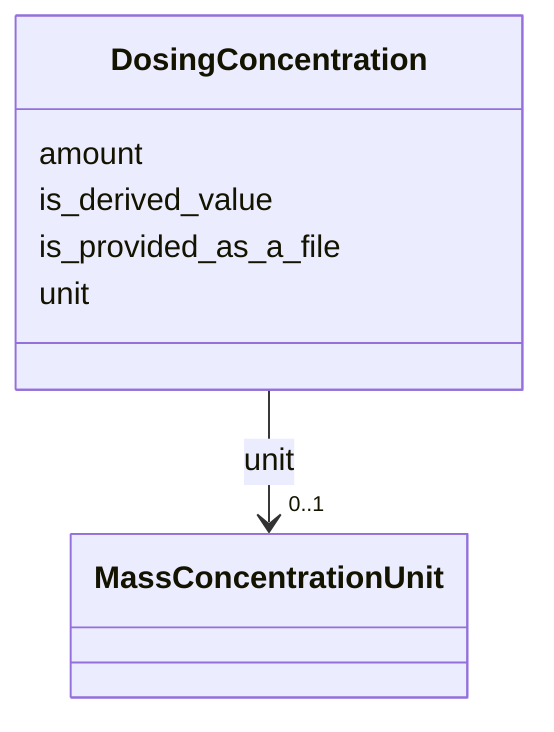

# Class: DosingConcentration


_Details of tracer concentration information_


URI: [oae:DosingConcentration](https://schema.oaedata.org/DosingConcentration)





<!-- no inheritance hierarchy -->


## Slots

| Name | Cardinality and Range | Description | Inheritance |
| ---  | --- | --- | --- |
| [is_derived_value](is_derived_value.md) | 1 <br/> [Boolean](Boolean.md) | Indicates that the field in question is a derived value as opposed to one mea... | direct |
| [is_provided_as_a_file](is_provided_as_a_file.md) | 1 <br/> [Boolean](Boolean.md) | Select ‘Variable’ if the concentration varies over time, or ‘Fixed Value’ if ... | direct |
| [amount](amount.md) | 0..1 <br/> [Float](Float.md) |  | direct |
| [unit](unit.md) | 0..1 <br/> [MassConcentrationUnit](MassConcentrationUnit.md) |  | direct |


## Usages

| used by | used in | type | used |
| ---  | --- | --- | --- |
| [Intervention](Intervention.md) | [alkalinity_dosing_effluent_density](alkalinity_dosing_effluent_density.md) | range | [DosingConcentration](DosingConcentration.md) |
| [Tracer](Tracer.md) | [tracer_concentration](tracer_concentration.md) | range | [DosingConcentration](DosingConcentration.md) |
| [InterventionWithTracer](InterventionWithTracer.md) | [tracer_concentration](tracer_concentration.md) | range | [DosingConcentration](DosingConcentration.md) |
| [InterventionWithTracer](InterventionWithTracer.md) | [alkalinity_dosing_effluent_density](alkalinity_dosing_effluent_density.md) | range | [DosingConcentration](DosingConcentration.md) |
| [InterventionDetails](InterventionDetails.md) | [alkalinity_dosing_effluent_density](alkalinity_dosing_effluent_density.md) | range | [DosingConcentration](DosingConcentration.md) |
| [TracerDetails](TracerDetails.md) | [tracer_concentration](tracer_concentration.md) | range | [DosingConcentration](DosingConcentration.md) |


## Identifier and Mapping Information


### Schema Source


* from schema: https://schema.oaedata.org/OAEDataSchema


## Mappings

| Mapping Type | Mapped Value |
| ---  | ---  |
| self | oae:DosingConcentration |
| native | oae:DosingConcentration |


## LinkML Source

<!-- TODO: investigate https://stackoverflow.com/questions/37606292/how-to-create-tabbed-code-blocks-in-mkdocs-or-sphinx -->

### Direct

<details>
```yaml
name: DosingConcentration
description: Details of tracer concentration information
from_schema: https://schema.oaedata.org/OAEDataSchema
slots:
- is_derived_value
- is_provided_as_a_file
slot_usage:
  is_provided_as_a_file:
    name: is_provided_as_a_file
    description: 'Select ‘Variable’ if the concentration varies over time, or ‘Fixed
      Value’ if it is constant. Note: Variable concentrations must be provided in
      a data file.'
attributes:
  amount:
    name: amount
    from_schema: Experiment
    rank: 1000
    domain_of:
    - DosingConcentration
    range: float
  unit:
    name: unit
    from_schema: Experiment
    rank: 1000
    domain_of:
    - DosingConcentration
    range: MassConcentrationUnit

```
</details>

### Induced

<details>
```yaml
name: DosingConcentration
description: Details of tracer concentration information
from_schema: https://schema.oaedata.org/OAEDataSchema
slot_usage:
  is_provided_as_a_file:
    name: is_provided_as_a_file
    description: 'Select ‘Variable’ if the concentration varies over time, or ‘Fixed
      Value’ if it is constant. Note: Variable concentrations must be provided in
      a data file.'
attributes:
  amount:
    name: amount
    from_schema: Experiment
    rank: 1000
    alias: amount
    owner: DosingConcentration
    domain_of:
    - DosingConcentration
    range: float
  unit:
    name: unit
    from_schema: Experiment
    rank: 1000
    alias: unit
    owner: DosingConcentration
    domain_of:
    - DosingConcentration
    range: MassConcentrationUnit
  is_derived_value:
    name: is_derived_value
    description: Indicates that the field in question is a derived value as opposed
      to one measured directly.
    from_schema: https://schema.oaedata.org/OAEDataSchema
    rank: 1000
    alias: is_derived_value
    owner: DosingConcentration
    domain_of:
    - DosingConcentration
    range: boolean
    required: true
  is_provided_as_a_file:
    name: is_provided_as_a_file
    description: 'Select ‘Variable’ if the concentration varies over time, or ‘Fixed
      Value’ if it is constant. Note: Variable concentrations must be provided in
      a data file.'
    from_schema: https://schema.oaedata.org/OAEDataSchema
    rank: 1000
    alias: is_provided_as_a_file
    owner: DosingConcentration
    domain_of:
    - DosingConcentration
    range: boolean
    required: true

```
</details>