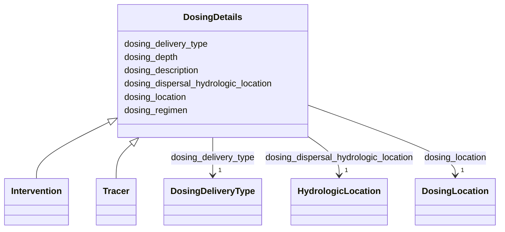

# Class: DosingDetails


_An abstract class (used as a mixin, not implemented directly) for detailing the required fields that are specific to an Experiment with active dosing (e.g. type "Tracer", "Intervention", or "InterventionWithDosing")_


URI: [oae:DosingDetails](https://schema.oaedata.org/DosingDetails)





<!-- no inheritance hierarchy -->


## Slots

| Name | Cardinality and Range | Description | Inheritance |
| ---  | --- | --- | --- |
| [dosing_delivery_type](dosing_delivery_type.md) | 1 <br/> [DosingDeliveryType](DosingDeliveryType.md) | Type of dosing delivery method | direct |
| [dosing_location](dosing_location.md) | 1 <br/> [DosingLocation](DosingLocation.md) | Provide latitude and longitude in decimal degrees | direct |
| [dosing_dispersal_hydrologic_location](dosing_dispersal_hydrologic_location.md) | 1 <br/> [HydrologicLocation](HydrologicLocation.md) | Descriptive dosing location | direct |
| [dosing_depth](dosing_depth.md) | 1 <br/> [String](String.md) | Depth in meters | direct |
| [dosing_regimen](dosing_regimen.md) | 1 <br/> [String](String.md) | A human readable summary description of the dosing regimen / frequency | direct |
| [dosing_description](dosing_description.md) | 1 <br/> [String](String.md) | Please be descriptive | direct |


## Mixin Usage

| mixed into | description |
| --- | --- |
| [Intervention](Intervention.md) | Additional metadata that applies to experiments where an intervention, such a... |
| [Tracer](Tracer.md) | Additional metadata that applies to experiments where a tracer study was cond... |


## Identifier and Mapping Information


### Schema Source


* from schema: https://schema.oaedata.org/OAEDataSchema


## Mappings

| Mapping Type | Mapped Value |
| ---  | ---  |
| self | oae:DosingDetails |
| native | oae:DosingDetails |


## LinkML Source

<!-- TODO: investigate https://stackoverflow.com/questions/37606292/how-to-create-tabbed-code-blocks-in-mkdocs-or-sphinx -->

### Direct

<details>
```yaml
name: DosingDetails
description: An abstract class (used as a mixin, not implemented directly) for detailing
  the required fields that are specific to an Experiment with active dosing (e.g.
  type "Tracer", "Intervention", or "InterventionWithDosing")
from_schema: https://schema.oaedata.org/OAEDataSchema
mixin: true
attributes:
  dosing_delivery_type:
    name: dosing_delivery_type
    description: Type of dosing delivery method. See Controlled Vocabularies for definitions.
    title: Dosing Delivery Type
    from_schema: Experiment
    rank: 1000
    domain_of:
    - DosingDetails
    range: DosingDeliveryType
    required: true
  dosing_location:
    name: dosing_location
    description: Provide latitude and longitude in decimal degrees. Depending on your
      method of dispersal, this information may be provided as a point source, vector,
      or bounding box. If provided as a vector, the latitude and longitude values
      should be included in the dosing data file.
    title: Dosing Location
    from_schema: Experiment
    rank: 1000
    domain_of:
    - DosingDetails
    range: DosingLocation
    required: true
  dosing_dispersal_hydrologic_location:
    name: dosing_dispersal_hydrologic_location
    description: Descriptive dosing location
    title: Dosing Dispersal Hydrologic Location
    from_schema: Experiment
    rank: 1000
    domain_of:
    - DosingDetails
    range: HydrologicLocation
    required: true
  dosing_depth:
    name: dosing_depth
    description: Depth in meters. If this is variable, please include the schedule
      of depth changes and depths, or as a vector in meters with the data.
    title: Dosing Depth
    from_schema: Experiment
    rank: 1000
    domain_of:
    - DosingDetails
    range: string
    required: true
  dosing_regimen:
    name: dosing_regimen
    description: A human readable summary description of the dosing regimen / frequency.
      Exact details must be provided in the corresponding dosing file with exact timestamps
      for dosing on/off schedule.
    title: Dosing Regimen
    from_schema: Experiment
    rank: 1000
    domain_of:
    - DosingDetails
    range: string
    required: true
  dosing_description:
    name: dosing_description
    description: 'Please be descriptive. Information about the dosing mechanism must
      be included (outflow from pipe, diffuser, doser, manual placement)

      E.g., outflow from existing facility pipe directly to ocean, manual riverine
      introduction, coastal distribution at three separate 30 meter long sections,
      pier-based diffuser to intercoastal bay, distributed from stationary barge 10
      miles offshore.'
    title: Dosing Description
    from_schema: Experiment
    rank: 1000
    domain_of:
    - DosingDetails
    range: string
    required: true

```
</details>

### Induced

<details>
```yaml
name: DosingDetails
description: An abstract class (used as a mixin, not implemented directly) for detailing
  the required fields that are specific to an Experiment with active dosing (e.g.
  type "Tracer", "Intervention", or "InterventionWithDosing")
from_schema: https://schema.oaedata.org/OAEDataSchema
mixin: true
attributes:
  dosing_delivery_type:
    name: dosing_delivery_type
    description: Type of dosing delivery method. See Controlled Vocabularies for definitions.
    title: Dosing Delivery Type
    from_schema: Experiment
    rank: 1000
    alias: dosing_delivery_type
    owner: DosingDetails
    domain_of:
    - DosingDetails
    range: DosingDeliveryType
    required: true
  dosing_location:
    name: dosing_location
    description: Provide latitude and longitude in decimal degrees. Depending on your
      method of dispersal, this information may be provided as a point source, vector,
      or bounding box. If provided as a vector, the latitude and longitude values
      should be included in the dosing data file.
    title: Dosing Location
    from_schema: Experiment
    rank: 1000
    alias: dosing_location
    owner: DosingDetails
    domain_of:
    - DosingDetails
    range: DosingLocation
    required: true
  dosing_dispersal_hydrologic_location:
    name: dosing_dispersal_hydrologic_location
    description: Descriptive dosing location
    title: Dosing Dispersal Hydrologic Location
    from_schema: Experiment
    rank: 1000
    alias: dosing_dispersal_hydrologic_location
    owner: DosingDetails
    domain_of:
    - DosingDetails
    range: HydrologicLocation
    required: true
  dosing_depth:
    name: dosing_depth
    description: Depth in meters. If this is variable, please include the schedule
      of depth changes and depths, or as a vector in meters with the data.
    title: Dosing Depth
    from_schema: Experiment
    rank: 1000
    alias: dosing_depth
    owner: DosingDetails
    domain_of:
    - DosingDetails
    range: string
    required: true
  dosing_regimen:
    name: dosing_regimen
    description: A human readable summary description of the dosing regimen / frequency.
      Exact details must be provided in the corresponding dosing file with exact timestamps
      for dosing on/off schedule.
    title: Dosing Regimen
    from_schema: Experiment
    rank: 1000
    alias: dosing_regimen
    owner: DosingDetails
    domain_of:
    - DosingDetails
    range: string
    required: true
  dosing_description:
    name: dosing_description
    description: 'Please be descriptive. Information about the dosing mechanism must
      be included (outflow from pipe, diffuser, doser, manual placement)

      E.g., outflow from existing facility pipe directly to ocean, manual riverine
      introduction, coastal distribution at three separate 30 meter long sections,
      pier-based diffuser to intercoastal bay, distributed from stationary barge 10
      miles offshore.'
    title: Dosing Description
    from_schema: Experiment
    rank: 1000
    alias: dosing_description
    owner: DosingDetails
    domain_of:
    - DosingDetails
    range: string
    required: true

```
</details>