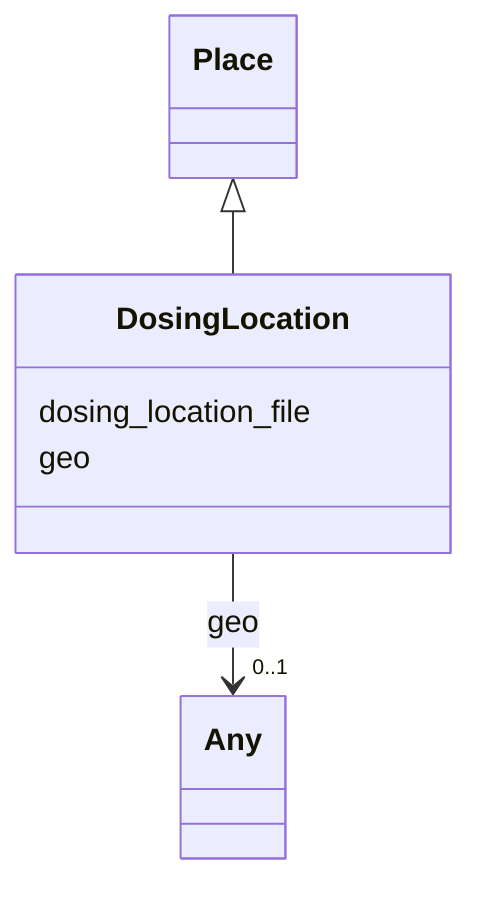

# Class: DosingLocation


_A specific location of dosing for an OAE intervention and/or tracer study. Can be a point, line, or bounding box_


URI: [oae:DosingLocation](https://schema.oaedata.org/DosingLocation)





## Inheritance
* [Place](Place.md)
    * **DosingLocation**


## Slots

| Name | Cardinality and Range | Description | Inheritance |
| ---  | --- | --- | --- |
| [dosing_location_file](dosing_location_file.md) | 0..1 <br/> [String](String.md) | Exact filename, URL and/or DOI to access the location file | direct |
| [geo](geo.md) | 0..1 <br/> [Any](Any.md)&nbsp;or&nbsp;<br />[GeoShape](GeoShape.md)&nbsp;or&nbsp;<br />[GeoCoordinates](GeoCoordinates.md) | Entities that have a somewhat fixed, physical extension | [Place](Place.md) |


## Usages

| used by | used in | type | used |
| ---  | --- | --- | --- |
| [Intervention](Intervention.md) | [dosing_location](dosing_location.md) | range | [DosingLocation](DosingLocation.md) |
| [Tracer](Tracer.md) | [dosing_location](dosing_location.md) | range | [DosingLocation](DosingLocation.md) |
| [InterventionWithTracer](InterventionWithTracer.md) | [dosing_location](dosing_location.md) | range | [DosingLocation](DosingLocation.md) |
| [DosingDetails](DosingDetails.md) | [dosing_location](dosing_location.md) | range | [DosingLocation](DosingLocation.md) |


## Identifier and Mapping Information


### Schema Source


* from schema: https://schema.oaedata.org/OAEDataSchema


## Mappings

| Mapping Type | Mapped Value |
| ---  | ---  |
| self | oae:DosingLocation |
| native | oae:DosingLocation |


## LinkML Source

<!-- TODO: investigate https://stackoverflow.com/questions/37606292/how-to-create-tabbed-code-blocks-in-mkdocs-or-sphinx -->

### Direct

<details>
```yaml
name: DosingLocation
description: A specific location of dosing for an OAE intervention and/or tracer study.
  Can be a point, line, or bounding box
from_schema: https://schema.oaedata.org/OAEDataSchema
is_a: Place
attributes:
  dosing_location_file:
    name: dosing_location_file
    description: Exact filename, URL and/or DOI to access the location file. Format
      should be one of GeoJSON or Shapefile.
    from_schema: Core
    rank: 1000
    domain_of:
    - DosingLocation
    range: string

```
</details>

### Induced

<details>
```yaml
name: DosingLocation
description: A specific location of dosing for an OAE intervention and/or tracer study.
  Can be a point, line, or bounding box
from_schema: https://schema.oaedata.org/OAEDataSchema
is_a: Place
attributes:
  dosing_location_file:
    name: dosing_location_file
    description: Exact filename, URL and/or DOI to access the location file. Format
      should be one of GeoJSON or Shapefile.
    from_schema: Core
    rank: 1000
    alias: dosing_location_file
    owner: DosingLocation
    domain_of:
    - DosingLocation
    range: string
  geo:
    name: geo
    description: Entities that have a somewhat fixed, physical extension. (imported
      from schema.org)
    from_schema: https://schema.oaedata.org/OAEDataSchema
    rank: 1000
    alias: geo
    owner: DosingLocation
    domain_of:
    - Place
    range: Any
    any_of:
    - range: GeoShape
    - range: GeoCoordinates

```
</details>