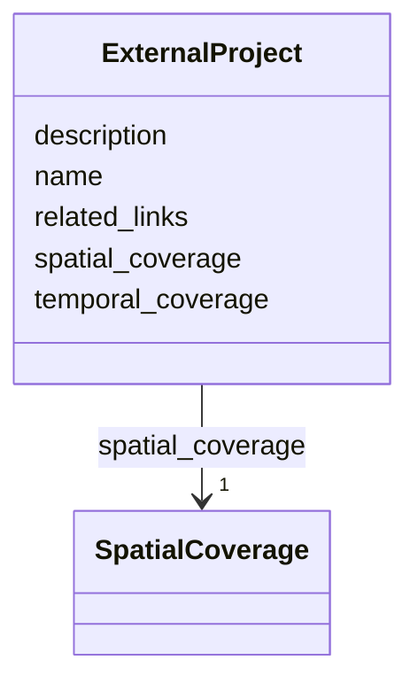

# Class: ExternalProject


_A research project that is not directly managed by the OAE project, but whose location is proximal to the OAE project and whose data may be relevant to understanding the context or impacts of OAE activities._


URI: [oae:ExternalProject](https://schema.oaedata.org/ExternalProject)





<!-- no inheritance hierarchy -->


## Slots

| Name | Cardinality and Range | Description | Inheritance |
| ---  | --- | --- | --- |
| [temporal_coverage](temporal_coverage.md) | 1 <br/> [String](String.md) | Start date and end date (if known) of the project in ISO-8601 interval format... | direct |
| [spatial_coverage](spatial_coverage.md) | 1 <br/> [SpatialCoverage](SpatialCoverage.md) | Latitude/longitude bounds of project site (e | direct |
| [name](name.md) | 1 <br/> [String](String.md) | The name of the external research project | direct |
| [description](description.md) | 0..1 <br/> [String](String.md) | A brief description of the external research project | direct |
| [related_links](related_links.md) | * <br/> [uri](uri.md) | Links to websites or documents related to the external research project | direct |


## Usages

| used by | used in | type | used |
| ---  | --- | --- | --- |
| [Project](Project.md) | [previous_or_ongoing_colocated_research](previous_or_ongoing_colocated_research.md) | range | [ExternalProject](ExternalProject.md) |


## Identifier and Mapping Information


### Schema Source


* from schema: https://schema.oaedata.org/OAEDataSchema


## Mappings

| Mapping Type | Mapped Value |
| ---  | ---  |
| self | oae:ExternalProject |
| native | oae:ExternalProject |


## LinkML Source

<!-- TODO: investigate https://stackoverflow.com/questions/37606292/how-to-create-tabbed-code-blocks-in-mkdocs-or-sphinx -->

### Direct

<details>
```yaml
name: ExternalProject
description: A research project that is not directly managed by the OAE project, but
  whose location is proximal to the OAE project and whose data may be relevant to
  understanding the context or impacts of OAE activities.
from_schema: https://schema.oaedata.org/OAEDataSchema
slots:
- temporal_coverage
- spatial_coverage
attributes:
  name:
    name: name
    description: The name of the external research project.
    title: Name
    from_schema: ExternalProject
    domain_of:
    - Organization
    - Project
    - NamedLink
    - ExternalProject
    - MonetaryGrant
    - Experiment
    - Person
    - Dataset
    - Platform
    - ModelComponent
    range: string
    required: true
  description:
    name: description
    description: A brief description of the external research project.
    title: Description
    from_schema: ExternalProject
    domain_of:
    - Project
    - ExternalProject
    - Experiment
    - PublicComment
    - VocabularyItemReference
    - Dataset
    - ModelComponent
    range: string
  related_links:
    name: related_links
    description: Links to websites or documents related to the external research project.
    title: Related Links
    from_schema: ExternalProject
    rank: 1000
    domain_of:
    - ExternalProject
    range: uri
    multivalued: true

```
</details>

### Induced

<details>
```yaml
name: ExternalProject
description: A research project that is not directly managed by the OAE project, but
  whose location is proximal to the OAE project and whose data may be relevant to
  understanding the context or impacts of OAE activities.
from_schema: https://schema.oaedata.org/OAEDataSchema
attributes:
  name:
    name: name
    description: The name of the external research project.
    title: Name
    from_schema: ExternalProject
    alias: name
    owner: ExternalProject
    domain_of:
    - Organization
    - Project
    - NamedLink
    - ExternalProject
    - MonetaryGrant
    - Experiment
    - Person
    - Dataset
    - Platform
    - ModelComponent
    range: string
    required: true
  description:
    name: description
    description: A brief description of the external research project.
    title: Description
    from_schema: ExternalProject
    alias: description
    owner: ExternalProject
    domain_of:
    - Project
    - ExternalProject
    - Experiment
    - PublicComment
    - VocabularyItemReference
    - Dataset
    - ModelComponent
    range: string
  related_links:
    name: related_links
    description: Links to websites or documents related to the external research project.
    title: Related Links
    from_schema: ExternalProject
    rank: 1000
    alias: related_links
    owner: ExternalProject
    domain_of:
    - ExternalProject
    range: uri
    multivalued: true
  temporal_coverage:
    name: temporal_coverage
    description: Start date and end date (if known) of the project in ISO-8601 interval
      format (YYYY-MM-DD/YYY-MM-DD). If the end date is not known, use open-ended
      format YYYY-MM-DD/..
    title: Temporal Coverage
    from_schema: https://schema.oaedata.org/OAEDataSchema
    rank: 1000
    slot_uri: schema:temporalCoverage
    alias: temporal_coverage
    owner: ExternalProject
    domain_of:
    - Project
    - ExternalProject
    - FieldDataset
    range: string
    required: true
    pattern: ^\d{4}-\d{2}-\d{2}/(\d{4}-\d{2}-\d{2}|\.\.)$
  spatial_coverage:
    name: spatial_coverage
    description: Latitude/longitude bounds of project site (e.g., boundary domain
      of observations or relevant activities), expressed as a schema.org GeoShape
      bounding box.
    title: Spatial Coverage
    from_schema: https://schema.oaedata.org/OAEDataSchema
    rank: 1000
    slot_uri: schema:spatialCoverage
    alias: spatial_coverage
    owner: ExternalProject
    domain_of:
    - Project
    - ExternalProject
    - Experiment
    - ModelGrid
    range: SpatialCoverage
    required: true

```
</details>