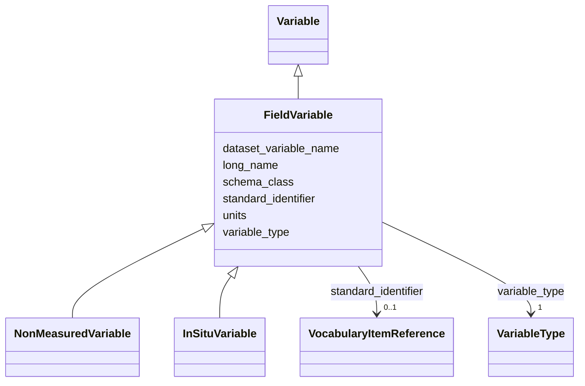

# Class: FieldVariable


_Abstract root for every variable that can appear in a FieldDataset — measured, calculated or contextual. Exists so FieldDataset.variables can range over exactly these classes: ranging over Variable would also admit ModelOutputVariable, which belongs only to a ModelOutputDataset._


* __NOTE__: this is an abstract class and should not be instantiated directly


URI: [oae:FieldVariable](https://schema.oaedata.org/FieldVariable)





## Inheritance
* [Variable](Variable.md)
    * **FieldVariable**
        * [NonMeasuredVariable](NonMeasuredVariable.md)
        * [InSituVariable](InSituVariable.md)


## Slots

| Name | Cardinality and Range | Description | Inheritance |
| ---  | --- | --- | --- |
| [units](units.md) | 0..1 <br/> [String](String.md) | Unit of measurement for this variable | [Variable](Variable.md) |
| [variable_type](variable_type.md) | 1 <br/> [VariableType](VariableType.md) | High-level classification of the variable | [Variable](Variable.md) |
| [schema_class](schema_class.md) | 1 <br/> [String](String.md) | The schema class name for this variable (e | [Variable](Variable.md) |
| [standard_identifier](standard_identifier.md) | 0..1 <br/> [VocabularyItemReference](VocabularyItemReference.md) | A term from a community vocabulary that identifies this variable | [Variable](Variable.md) |
| [dataset_variable_name](dataset_variable_name.md) | 1 <br/> [String](String.md) | The name for the variable as it is identified in the dataset data file | [Variable](Variable.md) |
| [long_name](long_name.md) | 1 <br/> [String](String.md) | Full descriptive name of the variable | [Variable](Variable.md) |


## Usages

| used by | used in | type | used |
| ---  | --- | --- | --- |
| [FieldDataset](FieldDataset.md) | [variables](variables.md) | range | [FieldVariable](FieldVariable.md) |


## Identifier and Mapping Information


### Schema Source


* from schema: https://schema.oaedata.org/OAEDataSchema


## Mappings

| Mapping Type | Mapped Value |
| ---  | ---  |
| self | oae:FieldVariable |
| native | oae:FieldVariable |


## LinkML Source

<!-- TODO: investigate https://stackoverflow.com/questions/37606292/how-to-create-tabbed-code-blocks-in-mkdocs-or-sphinx -->

### Direct

<details>
```yaml
name: FieldVariable
description: 'Abstract root for every variable that can appear in a FieldDataset —
  measured, calculated or contextual. Exists so FieldDataset.variables can range over
  exactly these classes: ranging over Variable would also admit ModelOutputVariable,
  which belongs only to a ModelOutputDataset.'
from_schema: https://schema.oaedata.org/OAEDataSchema
is_a: Variable
abstract: true
slot_usage:
  variable_type:
    name: variable_type
    range: VariableType
    required: true

```
</details>

### Induced

<details>
```yaml
name: FieldVariable
description: 'Abstract root for every variable that can appear in a FieldDataset —
  measured, calculated or contextual. Exists so FieldDataset.variables can range over
  exactly these classes: ranging over Variable would also admit ModelOutputVariable,
  which belongs only to a ModelOutputDataset.'
from_schema: https://schema.oaedata.org/OAEDataSchema
is_a: Variable
abstract: true
slot_usage:
  variable_type:
    name: variable_type
    range: VariableType
    required: true
attributes:
  units:
    name: units
    description: Unit of measurement for this variable.
    title: Unit
    from_schema: https://schema.oaedata.org/OAEDataSchema
    rank: 1000
    alias: units
    owner: FieldVariable
    domain_of:
    - Variable
    range: string
  variable_type:
    name: variable_type
    description: High-level classification of the variable. Determines which standard
      identifiers are available and, combined with genesis and sampling, which schema
      class to use.
    title: Variable Type
    from_schema: https://schema.oaedata.org/OAEDataSchema
    rank: 1000
    alias: variable_type
    owner: FieldVariable
    domain_of:
    - Variable
    range: VariableType
    required: true
  schema_class:
    name: schema_class
    description: The schema class name for this variable (e.g., "DiscretePHVariable").
      Auto-populated by the metadata builder.
    from_schema: Variable
    rank: 1000
    designates_type: true
    alias: schema_class
    owner: FieldVariable
    domain_of:
    - Variable
    range: string
    required: true
  standard_identifier:
    name: standard_identifier
    description: A term from a community vocabulary that identifies this variable.
      CF standard names (NERC P07) are recommended.
    from_schema: Variable
    rank: 1000
    alias: standard_identifier
    owner: FieldVariable
    domain_of:
    - Variable
    range: VocabularyItemReference
  dataset_variable_name:
    name: dataset_variable_name
    description: The name for the variable as it is identified in the dataset data
      file. This could be the column header in a CSV or the variable name in a NetCDF
      file. Standard common recommended column header names can be found in protocol
      documentation [here](https://www.carbontosea.org/oae-data-protocol/1-0-0/#column-header-name).
    title: Dataset variable name
    from_schema: Variable
    rank: 1000
    alias: dataset_variable_name
    owner: FieldVariable
    domain_of:
    - Variable
    range: string
    required: true
  long_name:
    name: long_name
    description: Full descriptive name of the variable.
    title: Variable full name
    from_schema: Variable
    rank: 1000
    alias: long_name
    owner: FieldVariable
    domain_of:
    - Variable
    range: string
    required: true

```
</details>