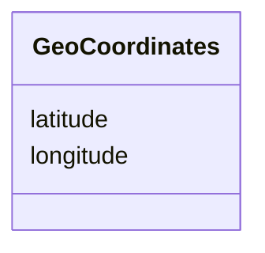

# Class: GeoCoordinates


_A geographic coordinate in decimal degrees._


URI: [schema:GeoCoordinates](http://schema.org/GeoCoordinates)





<!-- no inheritance hierarchy -->


## Slots

| Name | Cardinality and Range | Description | Inheritance |
| ---  | --- | --- | --- |
| [latitude](latitude.md) | 1 <br/> [Float](Float.md) | Latitude in decimal degrees of a location | direct |
| [longitude](longitude.md) | 1 <br/> [Float](Float.md) | Longitude in decimal degrees of a location | direct |


## Usages

| used by | used in | type | used |
| ---  | --- | --- | --- |
| [Place](Place.md) | [geo](geo.md) | any_of[range] | [GeoCoordinates](GeoCoordinates.md) |
| [SpatialCoverage](SpatialCoverage.md) | [geo](geo.md) | any_of[range] | [GeoCoordinates](GeoCoordinates.md) |
| [DosingLocation](DosingLocation.md) | [geo](geo.md) | any_of[range] | [GeoCoordinates](GeoCoordinates.md) |


## Identifier and Mapping Information


### Schema Source


* from schema: https://schema.oaedata.org/OAEDataSchema


## Mappings

| Mapping Type | Mapped Value |
| ---  | ---  |
| self | schema:GeoCoordinates |
| native | oae:GeoCoordinates |


## LinkML Source

<!-- TODO: investigate https://stackoverflow.com/questions/37606292/how-to-create-tabbed-code-blocks-in-mkdocs-or-sphinx -->

### Direct

<details>
```yaml
name: GeoCoordinates
description: A geographic coordinate in decimal degrees.
from_schema: https://schema.oaedata.org/OAEDataSchema
attributes:
  latitude:
    name: latitude
    description: Latitude in decimal degrees of a location. For example 37.42242 (WGS
      84).
    title: Latitude
    from_schema: Core
    rank: 1000
    slot_uri: schema:latitude
    domain_of:
    - GeoCoordinates
    range: float
    required: true
  longitude:
    name: longitude
    description: Longitude in decimal degrees of a location. For example -122.08585
      (WGS 84).
    title: Longitude
    from_schema: Core
    rank: 1000
    slot_uri: schema:longitude
    domain_of:
    - GeoCoordinates
    range: float
    required: true
class_uri: schema:GeoCoordinates

```
</details>

### Induced

<details>
```yaml
name: GeoCoordinates
description: A geographic coordinate in decimal degrees.
from_schema: https://schema.oaedata.org/OAEDataSchema
attributes:
  latitude:
    name: latitude
    description: Latitude in decimal degrees of a location. For example 37.42242 (WGS
      84).
    title: Latitude
    from_schema: Core
    rank: 1000
    slot_uri: schema:latitude
    alias: latitude
    owner: GeoCoordinates
    domain_of:
    - GeoCoordinates
    range: float
    required: true
  longitude:
    name: longitude
    description: Longitude in decimal degrees of a location. For example -122.08585
      (WGS 84).
    title: Longitude
    from_schema: Core
    rank: 1000
    slot_uri: schema:longitude
    alias: longitude
    owner: GeoCoordinates
    domain_of:
    - GeoCoordinates
    range: float
    required: true
class_uri: schema:GeoCoordinates

```
</details>