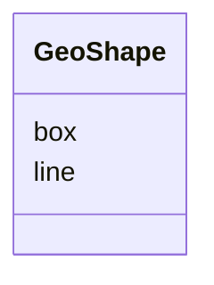

# Class: GeoShape


_The geographic shape of a place. A GeoShape can be described using several properties whose values are based on latitude/longitude pairs. Either whitespace or commas can be used to separate latitude and longitude; whitespace should be used when writing a list of several such points. (imported from schema.org)_


URI: [schema:GeoShape](http://schema.org/GeoShape)





<!-- no inheritance hierarchy -->


## Slots

| Name | Cardinality and Range | Description | Inheritance |
| ---  | --- | --- | --- |
| [box](box.md) | 0..1 <br/> [String](String.md) | A bounding box defined by two corner points — the southwest (lower-left) corn... | direct |
| [line](line.md) | 0..1 <br/> [String](String.md) | A line is a point-to-point path consisting of two or more points | direct |


## Usages

| used by | used in | type | used |
| ---  | --- | --- | --- |
| [Place](Place.md) | [geo](geo.md) | any_of[range] | [GeoShape](GeoShape.md) |
| [SpatialCoverage](SpatialCoverage.md) | [geo](geo.md) | range | [GeoShape](GeoShape.md) |
| [SpatialCoverage](SpatialCoverage.md) | [geo](geo.md) | any_of[range] | [GeoShape](GeoShape.md) |
| [DosingLocation](DosingLocation.md) | [geo](geo.md) | any_of[range] | [GeoShape](GeoShape.md) |


## Identifier and Mapping Information


### Schema Source


* from schema: https://schema.oaedata.org/OAEDataSchema


## Mappings

| Mapping Type | Mapped Value |
| ---  | ---  |
| self | schema:GeoShape |
| native | oae:GeoShape |


## LinkML Source

<!-- TODO: investigate https://stackoverflow.com/questions/37606292/how-to-create-tabbed-code-blocks-in-mkdocs-or-sphinx -->

### Direct

<details>
```yaml
name: GeoShape
description: The geographic shape of a place. A GeoShape can be described using several
  properties whose values are based on latitude/longitude pairs. Either whitespace
  or commas can be used to separate latitude and longitude; whitespace should be used
  when writing a list of several such points. (imported from schema.org)
from_schema: https://schema.oaedata.org/OAEDataSchema
attributes:
  box:
    name: box
    description: 'A bounding box defined by two corner points — the southwest (lower-left)
      corner followed by the northeast (upper-right) corner. Per science-on-schema.org,
      each point is written as `<latitude> <longitude>` in decimal degrees (WGS 84),
      with all four values space-separated: `"<minLat> <minLon> <maxLat> <maxLon>"`.
      Example: `"39.3280 120.1633 40.445 123.7878"`. See https://github.com/ESIPFed/science-on-schema.org/blob/main/guides/Dataset.md#spatial-coverage'
    from_schema: Core
    rank: 1000
    slot_uri: schema:box
    domain_of:
    - GeoShape
    range: string
  line:
    name: line
    description: A line is a point-to-point path consisting of two or more points.
      A line is expressed as a series of two or more point objects separated by space.
    from_schema: Core
    rank: 1000
    slot_uri: schema:line
    domain_of:
    - GeoShape
    range: string
class_uri: schema:GeoShape

```
</details>

### Induced

<details>
```yaml
name: GeoShape
description: The geographic shape of a place. A GeoShape can be described using several
  properties whose values are based on latitude/longitude pairs. Either whitespace
  or commas can be used to separate latitude and longitude; whitespace should be used
  when writing a list of several such points. (imported from schema.org)
from_schema: https://schema.oaedata.org/OAEDataSchema
attributes:
  box:
    name: box
    description: 'A bounding box defined by two corner points — the southwest (lower-left)
      corner followed by the northeast (upper-right) corner. Per science-on-schema.org,
      each point is written as `<latitude> <longitude>` in decimal degrees (WGS 84),
      with all four values space-separated: `"<minLat> <minLon> <maxLat> <maxLon>"`.
      Example: `"39.3280 120.1633 40.445 123.7878"`. See https://github.com/ESIPFed/science-on-schema.org/blob/main/guides/Dataset.md#spatial-coverage'
    from_schema: Core
    rank: 1000
    slot_uri: schema:box
    alias: box
    owner: GeoShape
    domain_of:
    - GeoShape
    range: string
  line:
    name: line
    description: A line is a point-to-point path consisting of two or more points.
      A line is expressed as a series of two or more point objects separated by space.
    from_schema: Core
    rank: 1000
    slot_uri: schema:line
    alias: line
    owner: GeoShape
    domain_of:
    - GeoShape
    range: string
class_uri: schema:GeoShape

```
</details>