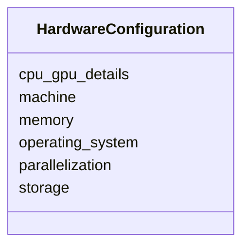

# Class: HardwareConfiguration


_Details about the computational hardware used to run a model simulation._


URI: [oae:HardwareConfiguration](https://schema.oaedata.org/HardwareConfiguration)





<!-- no inheritance hierarchy -->


## Slots

| Name | Cardinality and Range | Description | Inheritance |
| ---  | --- | --- | --- |
| [machine](machine.md) | 0..1 <br/> [String](String.md) | Name of the machine or cluster (e | direct |
| [operating_system](operating_system.md) | 0..1 <br/> [String](String.md) | Operating system used (e | direct |
| [cpu_gpu_details](cpu_gpu_details.md) | 0..1 <br/> [String](String.md) | Details about CPU/GPU hardware or link to specifications | direct |
| [memory](memory.md) | 0..1 <br/> [String](String.md) | Memory available (e | direct |
| [storage](storage.md) | 0..1 <br/> [String](String.md) | Storage available (e | direct |
| [parallelization](parallelization.md) | 0..1 <br/> [String](String.md) | Parallelization details (e | direct |


## Usages

| used by | used in | type | used |
| ---  | --- | --- | --- |
| [ModelOutputDataset](ModelOutputDataset.md) | [hardware_configuration](hardware_configuration.md) | range | [HardwareConfiguration](HardwareConfiguration.md) |


## Identifier and Mapping Information


### Schema Source


* from schema: https://schema.oaedata.org/OAEDataSchema


## Mappings

| Mapping Type | Mapped Value |
| ---  | ---  |
| self | oae:HardwareConfiguration |
| native | oae:HardwareConfiguration |


## LinkML Source

<!-- TODO: investigate https://stackoverflow.com/questions/37606292/how-to-create-tabbed-code-blocks-in-mkdocs-or-sphinx -->

### Direct

<details>
```yaml
name: HardwareConfiguration
description: Details about the computational hardware used to run a model simulation.
from_schema: https://schema.oaedata.org/OAEDataSchema
attributes:
  machine:
    name: machine
    description: Name of the machine or cluster (e.g., 'Perlmutter').
    title: Machine
    from_schema: Dataset
    rank: 1000
    domain_of:
    - HardwareConfiguration
    range: string
  operating_system:
    name: operating_system
    description: Operating system used (e.g., 'Linux').
    title: Operating System
    from_schema: Dataset
    rank: 1000
    domain_of:
    - HardwareConfiguration
    range: string
  cpu_gpu_details:
    name: cpu_gpu_details
    description: Details about CPU/GPU hardware or link to specifications.
    title: CPU/GPU Details
    from_schema: Dataset
    rank: 1000
    domain_of:
    - HardwareConfiguration
    range: string
  memory:
    name: memory
    description: Memory available (e.g., '512 GB DDR4').
    title: Memory
    from_schema: Dataset
    rank: 1000
    domain_of:
    - HardwareConfiguration
    range: string
  storage:
    name: storage
    description: Storage available (e.g., '44 PB').
    title: Storage
    from_schema: Dataset
    rank: 1000
    domain_of:
    - HardwareConfiguration
    range: string
  parallelization:
    name: parallelization
    description: Parallelization details (e.g., '3 nodes, 108 ntasks per node').
    title: Parallelization
    from_schema: Dataset
    rank: 1000
    domain_of:
    - HardwareConfiguration
    range: string

```
</details>

### Induced

<details>
```yaml
name: HardwareConfiguration
description: Details about the computational hardware used to run a model simulation.
from_schema: https://schema.oaedata.org/OAEDataSchema
attributes:
  machine:
    name: machine
    description: Name of the machine or cluster (e.g., 'Perlmutter').
    title: Machine
    from_schema: Dataset
    rank: 1000
    alias: machine
    owner: HardwareConfiguration
    domain_of:
    - HardwareConfiguration
    range: string
  operating_system:
    name: operating_system
    description: Operating system used (e.g., 'Linux').
    title: Operating System
    from_schema: Dataset
    rank: 1000
    alias: operating_system
    owner: HardwareConfiguration
    domain_of:
    - HardwareConfiguration
    range: string
  cpu_gpu_details:
    name: cpu_gpu_details
    description: Details about CPU/GPU hardware or link to specifications.
    title: CPU/GPU Details
    from_schema: Dataset
    rank: 1000
    alias: cpu_gpu_details
    owner: HardwareConfiguration
    domain_of:
    - HardwareConfiguration
    range: string
  memory:
    name: memory
    description: Memory available (e.g., '512 GB DDR4').
    title: Memory
    from_schema: Dataset
    rank: 1000
    alias: memory
    owner: HardwareConfiguration
    domain_of:
    - HardwareConfiguration
    range: string
  storage:
    name: storage
    description: Storage available (e.g., '44 PB').
    title: Storage
    from_schema: Dataset
    rank: 1000
    alias: storage
    owner: HardwareConfiguration
    domain_of:
    - HardwareConfiguration
    range: string
  parallelization:
    name: parallelization
    description: Parallelization details (e.g., '3 nodes, 108 ntasks per node').
    title: Parallelization
    from_schema: Dataset
    rank: 1000
    alias: parallelization
    owner: HardwareConfiguration
    domain_of:
    - HardwareConfiguration
    range: string

```
</details>