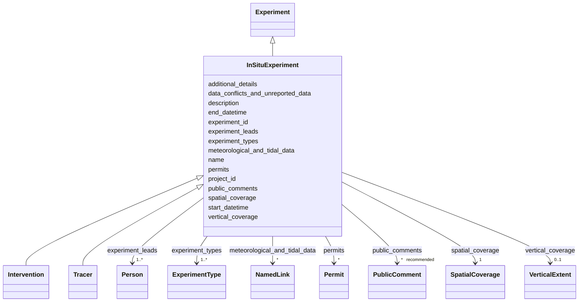

# Class: InSituExperiment


_Experiment metadata for in-situ studies (interventions, tracer studies, etc.). Contains fields specific to field-based experiments that don't apply to model experiments._


URI: [oae:InSituExperiment](https://schema.oaedata.org/InSituExperiment)





## Inheritance
* [Experiment](Experiment.md)
    * **InSituExperiment**
        * [Intervention](Intervention.md) [ [InterventionDetails](InterventionDetails.md) [DosingDetails](DosingDetails.md)]
        * [Tracer](Tracer.md) [ [TracerDetails](TracerDetails.md) [DosingDetails](DosingDetails.md)]


## Slots

| Name | Cardinality and Range | Description | Inheritance |
| ---  | --- | --- | --- |
| [vertical_coverage](vertical_coverage.md) | 0..1 <br/> [VerticalExtent](VerticalExtent.md) | Minimum and maximum depths of observations in meters | direct |
| [permits](permits.md) | * <br/> [Permit](Permit.md) | Associated permit number(s) | direct |
| [data_conflicts_and_unreported_data](data_conflicts_and_unreported_data.md) | 0..1 <br/> [String](String.md) | If data exist that are or have been used by the project but are not provided ... | direct |
| [meteorological_and_tidal_data](meteorological_and_tidal_data.md) | * <br/> [NamedLink](NamedLink.md) | Include links to relevant open datasets if referenced in the experiment but n... | direct |
| [additional_details](additional_details.md) | 0..1 <br/> [String](String.md) | Open text area to include additional information | direct |
| [name](name.md) | 1 <br/> [String](String.md) | Common name for experiment | [Experiment](Experiment.md) |
| [description](description.md) | 1 <br/> [String](String.md) | A narrative description of the experiment | [Experiment](Experiment.md) |
| [spatial_coverage](spatial_coverage.md) | 1 <br/> [SpatialCoverage](SpatialCoverage.md) | Latitude/longitude bounds of observed data in experiment, expressed as a sche... | [Experiment](Experiment.md) |
| [project_id](project_id.md) | 1 <br/> [String](String.md) | The project to which the submitted data belong | [Experiment](Experiment.md) |
| [experiment_id](experiment_id.md) | 1 <br/> [String](String.md) | The experiment to which the data belong | [Experiment](Experiment.md) |
| [experiment_types](experiment_types.md) | 1..* <br/> [ExperimentType](ExperimentType.md) | The type(s) of mCDR experiment conducted | [Experiment](Experiment.md) |
| [public_comments](public_comments.md) | * _recommended_ <br/> [PublicComment](PublicComment.md) | Public comment documents, each with a link or DOI and an optional description | [Experiment](Experiment.md) |
| [experiment_leads](experiment_leads.md) | 1..* <br/> [Person](Person.md) | Provide details for each experiment lead / principal investigator (PI) includ... | [Experiment](Experiment.md) |
| [start_datetime](start_datetime.md) | 1 <br/> [Datetime](Datetime.md) | Start date and time of experiment in UTC ISO-8601 | [Experiment](Experiment.md) |
| [end_datetime](end_datetime.md) | 0..1 <br/> [Datetime](Datetime.md) | End date and time of experiment in UTC ISO-8601 | [Experiment](Experiment.md) |


## Usages

| used by | used in | type | used |
| ---  | --- | --- | --- |
| [Container](Container.md) | [experiments](experiments.md) | any_of[range] | [InSituExperiment](InSituExperiment.md) |


## Identifier and Mapping Information


### Schema Source


* from schema: https://schema.oaedata.org/OAEDataSchema


## Mappings

| Mapping Type | Mapped Value |
| ---  | ---  |
| self | oae:InSituExperiment |
| native | oae:InSituExperiment |


## LinkML Source

<!-- TODO: investigate https://stackoverflow.com/questions/37606292/how-to-create-tabbed-code-blocks-in-mkdocs-or-sphinx -->

### Direct

<details>
```yaml
name: InSituExperiment
description: Experiment metadata for in-situ studies (interventions, tracer studies,
  etc.). Contains fields specific to field-based experiments that don't apply to model
  experiments.
from_schema: https://schema.oaedata.org/OAEDataSchema
is_a: Experiment
slots:
- vertical_coverage
- permits
slot_usage:
  vertical_coverage:
    name: vertical_coverage
    description: Minimum and maximum depths of observations in meters.
attributes:
  data_conflicts_and_unreported_data:
    name: data_conflicts_and_unreported_data
    description: If data exist that are or have been used by the project but are not
      provided due to conflicts (e.g., geopolitical or other), data availability (e.g.,
      a dataset is no longer available), it may be noted here.
    title: Data Conflicts and Unreported Data
    from_schema: Experiment
    rank: 1000
    domain_of:
    - InSituExperiment
    range: string
  meteorological_and_tidal_data:
    name: meteorological_and_tidal_data
    description: Include links to relevant open datasets if referenced in the experiment
      but not provided in the submission.
    title: Meteorological and Tidal Data
    from_schema: Experiment
    rank: 1000
    domain_of:
    - InSituExperiment
    range: NamedLink
    multivalued: true
    inlined: true
    inlined_as_list: true
  additional_details:
    name: additional_details
    description: Open text area to include additional information. These may include
      information for sediment processes data, biological data, or any other required
      information if not included in the main metadata or data files; see General
      Guidelines for Your Data for relevant sections of your data. Additional informational
      files, such as digitized laboratory notebooks, blogs, etc., may be linked here.
    title: Additional Details
    from_schema: Experiment
    domain_of:
    - Project
    - InSituExperiment
    range: string

```
</details>

### Induced

<details>
```yaml
name: InSituExperiment
description: Experiment metadata for in-situ studies (interventions, tracer studies,
  etc.). Contains fields specific to field-based experiments that don't apply to model
  experiments.
from_schema: https://schema.oaedata.org/OAEDataSchema
is_a: Experiment
slot_usage:
  vertical_coverage:
    name: vertical_coverage
    description: Minimum and maximum depths of observations in meters.
attributes:
  data_conflicts_and_unreported_data:
    name: data_conflicts_and_unreported_data
    description: If data exist that are or have been used by the project but are not
      provided due to conflicts (e.g., geopolitical or other), data availability (e.g.,
      a dataset is no longer available), it may be noted here.
    title: Data Conflicts and Unreported Data
    from_schema: Experiment
    rank: 1000
    alias: data_conflicts_and_unreported_data
    owner: InSituExperiment
    domain_of:
    - InSituExperiment
    range: string
  meteorological_and_tidal_data:
    name: meteorological_and_tidal_data
    description: Include links to relevant open datasets if referenced in the experiment
      but not provided in the submission.
    title: Meteorological and Tidal Data
    from_schema: Experiment
    rank: 1000
    alias: meteorological_and_tidal_data
    owner: InSituExperiment
    domain_of:
    - InSituExperiment
    range: NamedLink
    multivalued: true
    inlined: true
    inlined_as_list: true
  additional_details:
    name: additional_details
    description: Open text area to include additional information. These may include
      information for sediment processes data, biological data, or any other required
      information if not included in the main metadata or data files; see General
      Guidelines for Your Data for relevant sections of your data. Additional informational
      files, such as digitized laboratory notebooks, blogs, etc., may be linked here.
    title: Additional Details
    from_schema: Experiment
    alias: additional_details
    owner: InSituExperiment
    domain_of:
    - Project
    - InSituExperiment
    range: string
  vertical_coverage:
    name: vertical_coverage
    description: Minimum and maximum depths of observations in meters.
    title: Vertical Coverage
    from_schema: https://schema.oaedata.org/OAEDataSchema
    rank: 1000
    alias: vertical_coverage
    owner: InSituExperiment
    domain_of:
    - InSituExperiment
    range: VerticalExtent
  permits:
    name: permits
    description: Associated permit number(s).
    title: Permits
    from_schema: https://schema.oaedata.org/OAEDataSchema
    rank: 1000
    alias: permits
    owner: InSituExperiment
    domain_of:
    - InSituExperiment
    range: Permit
    multivalued: true
    inlined: true
    inlined_as_list: true
  name:
    name: name
    description: Common name for experiment.
    title: Name
    from_schema: https://schema.oaedata.org/OAEDataSchema
    rank: 1000
    slot_uri: schema:name
    alias: name
    owner: InSituExperiment
    domain_of:
    - Organization
    - Project
    - NamedLink
    - ExternalProject
    - MonetaryGrant
    - Experiment
    - Person
    - Dataset
    - Platform
    - ModelComponent
    range: string
    required: true
  description:
    name: description
    description: A narrative description of the experiment. For example, what part
      of the project do these data represent (e.g., baseline, intervention, control)
      and what do they contribute to the overall project? Are all project research
      questions listed in Project description relevant? What were the processes to
      achieve these goals and answer these questions? Data submitters are encouraged
      to note any significant changes to the original experimental plan due to unforeseen
      circumstances here.
    title: Experiment Description
    from_schema: https://schema.oaedata.org/OAEDataSchema
    rank: 1000
    slot_uri: schema:description
    alias: description
    owner: InSituExperiment
    domain_of:
    - Project
    - ExternalProject
    - Experiment
    - PublicComment
    - VocabularyItemReference
    - Dataset
    - ModelComponent
    range: string
    required: true
  spatial_coverage:
    name: spatial_coverage
    description: Latitude/longitude bounds of observed data in experiment, expressed
      as a schema.org GeoShape bounding box.
    title: Spatial Coverage
    from_schema: https://schema.oaedata.org/OAEDataSchema
    rank: 1000
    slot_uri: schema:spatialCoverage
    alias: spatial_coverage
    owner: InSituExperiment
    domain_of:
    - Project
    - ExternalProject
    - Experiment
    - ModelGrid
    range: SpatialCoverage
    required: true
  project_id:
    name: project_id
    description: 'The project to which the submitted data belong. A unique project
      identifier that can be used to link project data across data submissions, and
      link baseline data to intervention data, for example.

      If no Project ID has been assigned, one may be generated by combining: lead
      organizer surname and first initial or company, a unique date, and location.

      Any method that creates a unique ID that will link all project data is acceptable.'
    title: Project ID
    from_schema: https://schema.oaedata.org/OAEDataSchema
    rank: 1000
    alias: project_id
    owner: InSituExperiment
    domain_of:
    - Project
    - Experiment
    - Dataset
    range: string
    required: true
  experiment_id:
    name: experiment_id
    description: 'The experiment to which the data belong. Any naming convention that
      produces a unique ID is usable. The recommended naming convention is:

      Project ID + Experiment type + Optional numerical indicator to differentiate
      between various experiments of the same type for a project. A two digit consecutive
      number beginning with 01'
    title: Experiment ID
    from_schema: https://schema.oaedata.org/OAEDataSchema
    rank: 1000
    alias: experiment_id
    owner: InSituExperiment
    domain_of:
    - Experiment
    - Dataset
    range: string
    required: true
  experiment_types:
    name: experiment_types
    description: The type(s) of mCDR experiment conducted. See Controlled Vocabularies
      section for definitions.
    title: mCDR Experiment Type(s)
    from_schema: Experiment
    rank: 1000
    alias: experiment_types
    owner: InSituExperiment
    domain_of:
    - Experiment
    range: ExperimentType
    required: true
    multivalued: true
  public_comments:
    name: public_comments
    description: 'Public comment documents, each with a link or DOI and an optional
      description.

      Please group/concatenate all public comments associated with a specific consultation
      (e.g., for permitting, non-mandated consultations on a specific topic, or informal
      public input such as unsolicited comments and media attention) into a single
      document if possible, and link to it here.'
    title: Public Comments
    from_schema: Experiment
    rank: 1000
    alias: public_comments
    owner: InSituExperiment
    domain_of:
    - Experiment
    range: PublicComment
    recommended: true
    multivalued: true
    inlined: true
    inlined_as_list: true
  experiment_leads:
    name: experiment_leads
    description: 'Provide details for each experiment lead / principal investigator
      (PI) including: Name, institutional information (name, address), phone, email,
      ID type (e.g., ORCID, etc), researcher ID, and role.'
    title: Experiment Lead(s)
    from_schema: Experiment
    rank: 1000
    alias: experiment_leads
    owner: InSituExperiment
    domain_of:
    - Experiment
    range: Person
    required: true
    multivalued: true
    inlined: true
    inlined_as_list: true
  start_datetime:
    name: start_datetime
    description: Start date and time of experiment in UTC ISO-8601
    title: Start Date and Time (UTC)
    from_schema: Experiment
    rank: 1000
    alias: start_datetime
    owner: InSituExperiment
    domain_of:
    - Experiment
    - ModelOutputDataset
    range: datetime
    required: true
  end_datetime:
    name: end_datetime
    description: End date and time of experiment in UTC ISO-8601
    title: End Date and Time (UTC)
    from_schema: Experiment
    rank: 1000
    alias: end_datetime
    owner: InSituExperiment
    domain_of:
    - Experiment
    - ModelOutputDataset
    range: datetime

```
</details>