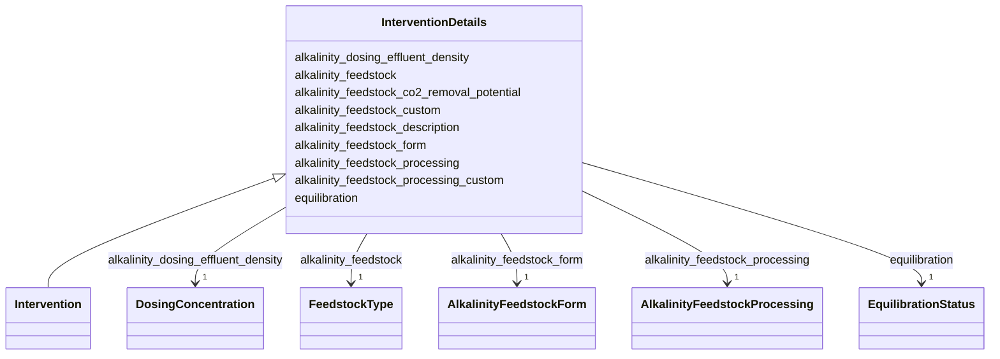

# Class: InterventionDetails


_An abstract class (used as a mixin, not implemented directly) for detailing the required fields that are specific to an Experiment with type "Intervention"_


URI: [oae:InterventionDetails](https://schema.oaedata.org/InterventionDetails)





<!-- no inheritance hierarchy -->


## Slots

| Name | Cardinality and Range | Description | Inheritance |
| ---  | --- | --- | --- |
| [alkalinity_feedstock_processing](alkalinity_feedstock_processing.md) | 1 <br/> [AlkalinityFeedstockProcessing](AlkalinityFeedstockProcessing.md) | Method(s) used to process the alkalinity feedstock | direct |
| [alkalinity_feedstock_processing_custom](alkalinity_feedstock_processing_custom.md) | 0..1 <br/> [String](String.md) | Custom description of alkalinity feedstock processing method when 'other' is ... | direct |
| [alkalinity_feedstock_form](alkalinity_feedstock_form.md) | 1 <br/> [AlkalinityFeedstockForm](AlkalinityFeedstockForm.md) | The phase upon delivery to the ocean | direct |
| [alkalinity_feedstock](alkalinity_feedstock.md) | 1 <br/> [FeedstockType](FeedstockType.md) | Examples may include: olivine, potassium hydroxide, magnesium hydroxide, lime... | direct |
| [alkalinity_feedstock_custom](alkalinity_feedstock_custom.md) | 0..1 <br/> [String](String.md) | Custom description of alkalinity feedstock when using a feedstock type not li... | direct |
| [alkalinity_feedstock_co2_removal_potential](alkalinity_feedstock_co2_removal_potential.md) | 1 <br/> [Float](Float.md) | Maximum CO₂ removal potential of a feedstock material | direct |
| [alkalinity_feedstock_description](alkalinity_feedstock_description.md) | 1 <br/> [String](String.md) | Information such as feedstock source, characteristics, impurities, dilution p... | direct |
| [equilibration](equilibration.md) | 1 <br/> [EquilibrationStatus](EquilibrationStatus.md) | Whether the feedstock was pre-equilibrated or unequilibrated | direct |
| [alkalinity_dosing_effluent_density](alkalinity_dosing_effluent_density.md) | 1 <br/> [DosingConcentration](DosingConcentration.md) | Fixed density or provide link/source to effluent density data if applicable | direct |


## Mixin Usage

| mixed into | description |
| --- | --- |
| [Intervention](Intervention.md) | Additional metadata that applies to experiments where an intervention, such a... |


## Identifier and Mapping Information


### Schema Source


* from schema: https://schema.oaedata.org/OAEDataSchema


## Mappings

| Mapping Type | Mapped Value |
| ---  | ---  |
| self | oae:InterventionDetails |
| native | oae:InterventionDetails |


## LinkML Source

<!-- TODO: investigate https://stackoverflow.com/questions/37606292/how-to-create-tabbed-code-blocks-in-mkdocs-or-sphinx -->

### Direct

<details>
```yaml
name: InterventionDetails
description: An abstract class (used as a mixin, not implemented directly) for detailing
  the required fields that are specific to an Experiment with type "Intervention"
from_schema: https://schema.oaedata.org/OAEDataSchema
mixin: true
attributes:
  alkalinity_feedstock_processing:
    name: alkalinity_feedstock_processing
    description: Method(s) used to process the alkalinity feedstock. See Controlled
      Vocabularies section for definitions.
    title: Alkalinity Feedstock Processing
    from_schema: Experiment
    rank: 1000
    domain_of:
    - InterventionDetails
    range: AlkalinityFeedstockProcessing
    required: true
  alkalinity_feedstock_processing_custom:
    name: alkalinity_feedstock_processing_custom
    description: Custom description of alkalinity feedstock processing method when
      'other' is selected in alkalinity_feedstock_processing.
    title: Alkalinity Feedstock Processing (Custom)
    from_schema: Experiment
    rank: 1000
    domain_of:
    - InterventionDetails
    range: string
  alkalinity_feedstock_form:
    name: alkalinity_feedstock_form
    description: The phase upon delivery to the ocean. See Controlled Vocabularies
      section for definitions.
    title: Alkalinity Feedstock Form
    from_schema: Experiment
    rank: 1000
    domain_of:
    - InterventionDetails
    range: AlkalinityFeedstockForm
    required: true
  alkalinity_feedstock:
    name: alkalinity_feedstock
    description: 'Examples may include: olivine, potassium hydroxide, magnesium hydroxide,
      lime, portlandite, calcium carbonate, anorthite, dolomite, periclase, brucite,
      magnesite, forsterite, sodium hydroxide, natrite, nahcolite, akermanite, akermanite,
      alunoakermanite, etc.

      See Controlled Vocabularies section for selected examples (this list is not
      exhaustive, you may need to include your unique feedstock).'
    title: Alkalinity Feedstock
    from_schema: Experiment
    rank: 1000
    domain_of:
    - InterventionDetails
    range: FeedstockType
    required: true
  alkalinity_feedstock_custom:
    name: alkalinity_feedstock_custom
    description: Custom description of alkalinity feedstock when using a feedstock
      type not listed in the controlled vocabulary.
    title: Alkalinity Feedstock (Custom)
    from_schema: Experiment
    rank: 1000
    domain_of:
    - InterventionDetails
    range: string
  alkalinity_feedstock_co2_removal_potential:
    name: alkalinity_feedstock_co2_removal_potential
    description: Maximum CO₂ removal potential of a feedstock material. We recommend
      using an adjusted version of the Steinour equation (Gunning et al., 2010), which
      uses bulk elemental oxide composition to estimate the maximum CO₂ removal potential
      of a feedstock material. The calculation output is in the form of kg of CO₂
      per tonne of feedstock and represents the quantitative hypothetical potential
      of the material to capture CO₂ as bicarbonate or carbonate. See Isometric's
      CO2 removal potential module for details.
    title: Alkalinity Feedstock CO₂ Removal Potential
    from_schema: Experiment
    rank: 1000
    domain_of:
    - InterventionDetails
    range: float
    required: true
  alkalinity_feedstock_description:
    name: alkalinity_feedstock_description
    description: 'Information such as feedstock source, characteristics, impurities,
      dilution prior to dosing, and concentration. For feedstock other than NaOH:
      trace metal composition and particulate grain size. Any variable information
      must be provided in the dosing data file, in this case include the data file
      and column header names here provided as variables. See [Intervention Data](https://www.carbontosea.org/oae-data-protocol/1-0-0/#intervention-data)
      for details.'
    title: Alkalinity Feedstock Description
    from_schema: Experiment
    rank: 1000
    domain_of:
    - InterventionDetails
    range: string
    required: true
  equilibration:
    name: equilibration
    description: Whether the feedstock was pre-equilibrated or unequilibrated
    title: Equilibration
    from_schema: Experiment
    rank: 1000
    domain_of:
    - InterventionDetails
    range: EquilibrationStatus
    required: true
  alkalinity_dosing_effluent_density:
    name: alkalinity_dosing_effluent_density
    description: Fixed density or provide link/source to effluent density data if
      applicable. Please include whether density is directly measured or a derived
      value. If this is a variable included with your data, please note so here as
      'alkalinity dosing effluent density is provided as a variable' and use 'dosing_effluent_density'
      for your column header name.
    title: Alkalinity Dosing Effluent Density
    from_schema: Experiment
    rank: 1000
    domain_of:
    - InterventionDetails
    range: DosingConcentration
    required: true

```
</details>

### Induced

<details>
```yaml
name: InterventionDetails
description: An abstract class (used as a mixin, not implemented directly) for detailing
  the required fields that are specific to an Experiment with type "Intervention"
from_schema: https://schema.oaedata.org/OAEDataSchema
mixin: true
attributes:
  alkalinity_feedstock_processing:
    name: alkalinity_feedstock_processing
    description: Method(s) used to process the alkalinity feedstock. See Controlled
      Vocabularies section for definitions.
    title: Alkalinity Feedstock Processing
    from_schema: Experiment
    rank: 1000
    alias: alkalinity_feedstock_processing
    owner: InterventionDetails
    domain_of:
    - InterventionDetails
    range: AlkalinityFeedstockProcessing
    required: true
  alkalinity_feedstock_processing_custom:
    name: alkalinity_feedstock_processing_custom
    description: Custom description of alkalinity feedstock processing method when
      'other' is selected in alkalinity_feedstock_processing.
    title: Alkalinity Feedstock Processing (Custom)
    from_schema: Experiment
    rank: 1000
    alias: alkalinity_feedstock_processing_custom
    owner: InterventionDetails
    domain_of:
    - InterventionDetails
    range: string
  alkalinity_feedstock_form:
    name: alkalinity_feedstock_form
    description: The phase upon delivery to the ocean. See Controlled Vocabularies
      section for definitions.
    title: Alkalinity Feedstock Form
    from_schema: Experiment
    rank: 1000
    alias: alkalinity_feedstock_form
    owner: InterventionDetails
    domain_of:
    - InterventionDetails
    range: AlkalinityFeedstockForm
    required: true
  alkalinity_feedstock:
    name: alkalinity_feedstock
    description: 'Examples may include: olivine, potassium hydroxide, magnesium hydroxide,
      lime, portlandite, calcium carbonate, anorthite, dolomite, periclase, brucite,
      magnesite, forsterite, sodium hydroxide, natrite, nahcolite, akermanite, akermanite,
      alunoakermanite, etc.

      See Controlled Vocabularies section for selected examples (this list is not
      exhaustive, you may need to include your unique feedstock).'
    title: Alkalinity Feedstock
    from_schema: Experiment
    rank: 1000
    alias: alkalinity_feedstock
    owner: InterventionDetails
    domain_of:
    - InterventionDetails
    range: FeedstockType
    required: true
  alkalinity_feedstock_custom:
    name: alkalinity_feedstock_custom
    description: Custom description of alkalinity feedstock when using a feedstock
      type not listed in the controlled vocabulary.
    title: Alkalinity Feedstock (Custom)
    from_schema: Experiment
    rank: 1000
    alias: alkalinity_feedstock_custom
    owner: InterventionDetails
    domain_of:
    - InterventionDetails
    range: string
  alkalinity_feedstock_co2_removal_potential:
    name: alkalinity_feedstock_co2_removal_potential
    description: Maximum CO₂ removal potential of a feedstock material. We recommend
      using an adjusted version of the Steinour equation (Gunning et al., 2010), which
      uses bulk elemental oxide composition to estimate the maximum CO₂ removal potential
      of a feedstock material. The calculation output is in the form of kg of CO₂
      per tonne of feedstock and represents the quantitative hypothetical potential
      of the material to capture CO₂ as bicarbonate or carbonate. See Isometric's
      CO2 removal potential module for details.
    title: Alkalinity Feedstock CO₂ Removal Potential
    from_schema: Experiment
    rank: 1000
    alias: alkalinity_feedstock_co2_removal_potential
    owner: InterventionDetails
    domain_of:
    - InterventionDetails
    range: float
    required: true
  alkalinity_feedstock_description:
    name: alkalinity_feedstock_description
    description: 'Information such as feedstock source, characteristics, impurities,
      dilution prior to dosing, and concentration. For feedstock other than NaOH:
      trace metal composition and particulate grain size. Any variable information
      must be provided in the dosing data file, in this case include the data file
      and column header names here provided as variables. See [Intervention Data](https://www.carbontosea.org/oae-data-protocol/1-0-0/#intervention-data)
      for details.'
    title: Alkalinity Feedstock Description
    from_schema: Experiment
    rank: 1000
    alias: alkalinity_feedstock_description
    owner: InterventionDetails
    domain_of:
    - InterventionDetails
    range: string
    required: true
  equilibration:
    name: equilibration
    description: Whether the feedstock was pre-equilibrated or unequilibrated
    title: Equilibration
    from_schema: Experiment
    rank: 1000
    alias: equilibration
    owner: InterventionDetails
    domain_of:
    - InterventionDetails
    range: EquilibrationStatus
    required: true
  alkalinity_dosing_effluent_density:
    name: alkalinity_dosing_effluent_density
    description: Fixed density or provide link/source to effluent density data if
      applicable. Please include whether density is directly measured or a derived
      value. If this is a variable included with your data, please note so here as
      'alkalinity dosing effluent density is provided as a variable' and use 'dosing_effluent_density'
      for your column header name.
    title: Alkalinity Dosing Effluent Density
    from_schema: Experiment
    rank: 1000
    alias: alkalinity_dosing_effluent_density
    owner: InterventionDetails
    domain_of:
    - InterventionDetails
    range: DosingConcentration
    required: true

```
</details>