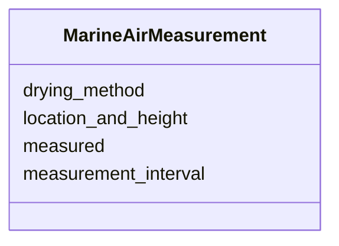

# Class: MarineAirMeasurement


_Information about CO2 measurements in marine air._


URI: [oae:MarineAirMeasurement](https://schema.oaedata.org/MarineAirMeasurement)





<!-- no inheritance hierarchy -->


## Slots

| Name | Cardinality and Range | Description | Inheritance |
| ---  | --- | --- | --- |
| [measured](measured.md) | 1 <br/> [Boolean](Boolean.md) | Whether CO2 in marine air was measured | direct |
| [measurement_interval](measurement_interval.md) | 0..1 <br/> [String](String.md) | How often marine air CO2 is measured, e | direct |
| [location_and_height](location_and_height.md) | 0..1 <br/> [String](String.md) | Location and height of the marine air intake | direct |
| [drying_method](drying_method.md) | 0..1 <br/> [String](String.md) | Method used to dry the gas stream for marine air measurements | direct |


## Usages

| used by | used in | type | used |
| ---  | --- | --- | --- |
| [ContinuousCO2Variable](ContinuousCO2Variable.md) | [marine_air_measurement](marine_air_measurement.md) | range | [MarineAirMeasurement](MarineAirMeasurement.md) |


## Identifier and Mapping Information


### Schema Source


* from schema: https://schema.oaedata.org/OAEDataSchema


## Mappings

| Mapping Type | Mapped Value |
| ---  | ---  |
| self | oae:MarineAirMeasurement |
| native | oae:MarineAirMeasurement |


## LinkML Source

<!-- TODO: investigate https://stackoverflow.com/questions/37606292/how-to-create-tabbed-code-blocks-in-mkdocs-or-sphinx -->

### Direct

<details>
```yaml
name: MarineAirMeasurement
description: Information about CO2 measurements in marine air.
from_schema: https://schema.oaedata.org/OAEDataSchema
attributes:
  measured:
    name: measured
    description: Whether CO2 in marine air was measured.
    title: CO2 in marine air measured
    from_schema: Instrument
    rank: 1000
    domain_of:
    - MarineAirMeasurement
    range: boolean
    required: true
  measurement_interval:
    name: measurement_interval
    description: How often marine air CO2 is measured, e.g., 5 readings in a group
      every 5 hours.
    title: Measurement interval
    from_schema: Instrument
    rank: 1000
    domain_of:
    - MarineAirMeasurement
    range: string
  location_and_height:
    name: location_and_height
    description: Location and height of the marine air intake.
    title: Location and height
    from_schema: Instrument
    rank: 1000
    domain_of:
    - MarineAirMeasurement
    range: string
  drying_method:
    name: drying_method
    description: Method used to dry the gas stream for marine air measurements.
    title: Drying method
    from_schema: Instrument
    rank: 1000
    domain_of:
    - MarineAirMeasurement
    - ContinuousCO2Variable
    range: string

```
</details>

### Induced

<details>
```yaml
name: MarineAirMeasurement
description: Information about CO2 measurements in marine air.
from_schema: https://schema.oaedata.org/OAEDataSchema
attributes:
  measured:
    name: measured
    description: Whether CO2 in marine air was measured.
    title: CO2 in marine air measured
    from_schema: Instrument
    rank: 1000
    alias: measured
    owner: MarineAirMeasurement
    domain_of:
    - MarineAirMeasurement
    range: boolean
    required: true
  measurement_interval:
    name: measurement_interval
    description: How often marine air CO2 is measured, e.g., 5 readings in a group
      every 5 hours.
    title: Measurement interval
    from_schema: Instrument
    rank: 1000
    alias: measurement_interval
    owner: MarineAirMeasurement
    domain_of:
    - MarineAirMeasurement
    range: string
  location_and_height:
    name: location_and_height
    description: Location and height of the marine air intake.
    title: Location and height
    from_schema: Instrument
    rank: 1000
    alias: location_and_height
    owner: MarineAirMeasurement
    domain_of:
    - MarineAirMeasurement
    range: string
  drying_method:
    name: drying_method
    description: Method used to dry the gas stream for marine air measurements.
    title: Drying method
    from_schema: Instrument
    rank: 1000
    alias: drying_method
    owner: MarineAirMeasurement
    domain_of:
    - MarineAirMeasurement
    - ContinuousCO2Variable
    range: string

```
</details>