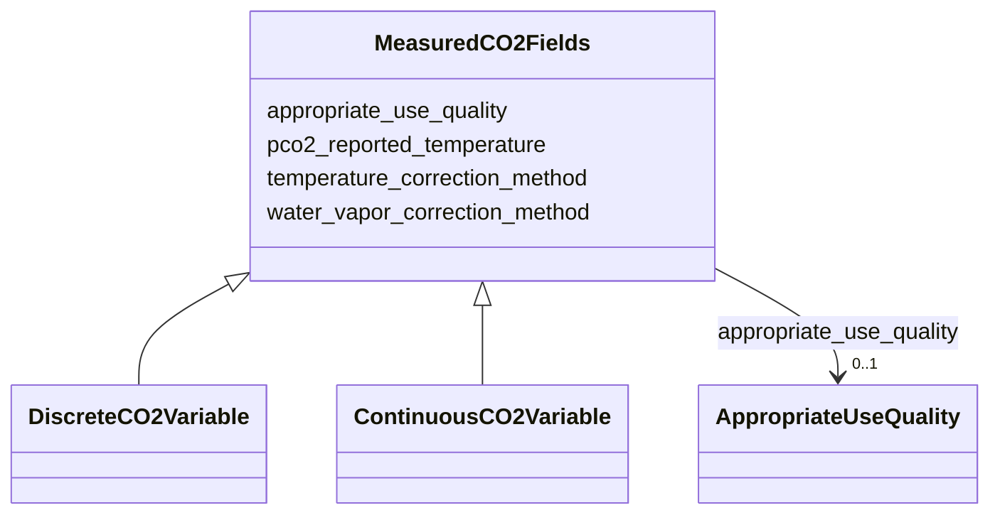

# Class: MeasuredCO2Fields


_Fields applied to all measured CO2 variable types (discrete and continuous)_


URI: [oae:MeasuredCO2Fields](https://schema.oaedata.org/MeasuredCO2Fields)





<!-- no inheritance hierarchy -->


## Slots

| Name | Cardinality and Range | Description | Inheritance |
| ---  | --- | --- | --- |
| [appropriate_use_quality](appropriate_use_quality.md) | 0..1 <br/> [AppropriateUseQuality](AppropriateUseQuality.md) | Climate quality is defined as measurements of quality sufficient to assess lo... | direct |
| [pco2_reported_temperature](pco2_reported_temperature.md) | 1 <br/> [String](String.md) | In Celsius | direct |
| [water_vapor_correction_method](water_vapor_correction_method.md) | 0..1 <br/> [String](String.md) | How the water vapor pressure inside the equilibrator was determined | direct |
| [temperature_correction_method](temperature_correction_method.md) | 0..1 <br/> [String](String.md) | How the temperature effect was corrected | direct |


## Mixin Usage

| mixed into | description |
| --- | --- |
| [DiscreteCO2Variable](DiscreteCO2Variable.md) | CO2 discrete (bottle) measured variable (pCO2/fCO2) |
| [ContinuousCO2Variable](ContinuousCO2Variable.md) | CO2 continuous (sensor) measured variable (xCO2/pCO2/fCO2) |


## Identifier and Mapping Information


### Schema Source


* from schema: https://schema.oaedata.org/OAEDataSchema


## Mappings

| Mapping Type | Mapped Value |
| ---  | ---  |
| self | oae:MeasuredCO2Fields |
| native | oae:MeasuredCO2Fields |


## LinkML Source

<!-- TODO: investigate https://stackoverflow.com/questions/37606292/how-to-create-tabbed-code-blocks-in-mkdocs-or-sphinx -->

### Direct

<details>
```yaml
name: MeasuredCO2Fields
description: Fields applied to all measured CO2 variable types (discrete and continuous)
from_schema: https://schema.oaedata.org/OAEDataSchema
mixin: true
slots:
- appropriate_use_quality
attributes:
  pco2_reported_temperature:
    name: pco2_reported_temperature
    description: In Celsius. The input could be a constant temperature value, or something
      like, in-situ temperature, temperature of analysis, etc.
    title: Temperature at which pCO2 was reported
    from_schema: Variable
    rank: 1000
    domain_of:
    - MeasuredCO2Fields
    range: string
    required: true
  water_vapor_correction_method:
    name: water_vapor_correction_method
    description: How the water vapor pressure inside the equilibrator was determined.
    title: Water vapor correction method
    from_schema: Variable
    rank: 1000
    domain_of:
    - MeasuredCO2Fields
    range: string
  temperature_correction_method:
    name: temperature_correction_method
    description: How the temperature effect was corrected.
    title: Temperature correction method
    from_schema: Variable
    domain_of:
    - DiscretePHVariable
    - MeasuredCO2Fields
    range: string

```
</details>

### Induced

<details>
```yaml
name: MeasuredCO2Fields
description: Fields applied to all measured CO2 variable types (discrete and continuous)
from_schema: https://schema.oaedata.org/OAEDataSchema
mixin: true
attributes:
  pco2_reported_temperature:
    name: pco2_reported_temperature
    description: In Celsius. The input could be a constant temperature value, or something
      like, in-situ temperature, temperature of analysis, etc.
    title: Temperature at which pCO2 was reported
    from_schema: Variable
    rank: 1000
    alias: pco2_reported_temperature
    owner: MeasuredCO2Fields
    domain_of:
    - MeasuredCO2Fields
    range: string
    required: true
  water_vapor_correction_method:
    name: water_vapor_correction_method
    description: How the water vapor pressure inside the equilibrator was determined.
    title: Water vapor correction method
    from_schema: Variable
    rank: 1000
    alias: water_vapor_correction_method
    owner: MeasuredCO2Fields
    domain_of:
    - MeasuredCO2Fields
    range: string
  temperature_correction_method:
    name: temperature_correction_method
    description: How the temperature effect was corrected.
    title: Temperature correction method
    from_schema: Variable
    alias: temperature_correction_method
    owner: MeasuredCO2Fields
    domain_of:
    - DiscretePHVariable
    - MeasuredCO2Fields
    range: string
  appropriate_use_quality:
    name: appropriate_use_quality
    description: 'Climate quality is defined as measurements of quality sufficient
      to assess long term trends with a defined level of confidence. Weather quality
      is defined as measurements of quality sufficient to identify relative spatial
      patterns and short term variation.

      For more details, refer to Newton J.A., Feely R. A., Jewett E. B., Williamson
      P. & Mathis J., 2015. Global Ocean Acidification Observing Network: Requirements
      and Governance Plan. Second Edition, GOA-ON, http://www.goa-on.org/docs/GOA-ON_plan_print.pdf.'
    title: Weather or climate quality
    from_schema: https://schema.oaedata.org/OAEDataSchema
    rank: 1000
    alias: appropriate_use_quality
    owner: MeasuredCO2Fields
    domain_of:
    - MeasuredTAFields
    - MeasuredDICFields
    - MeasuredPHFields
    - MeasuredCO2Fields
    range: AppropriateUseQuality

```
</details>