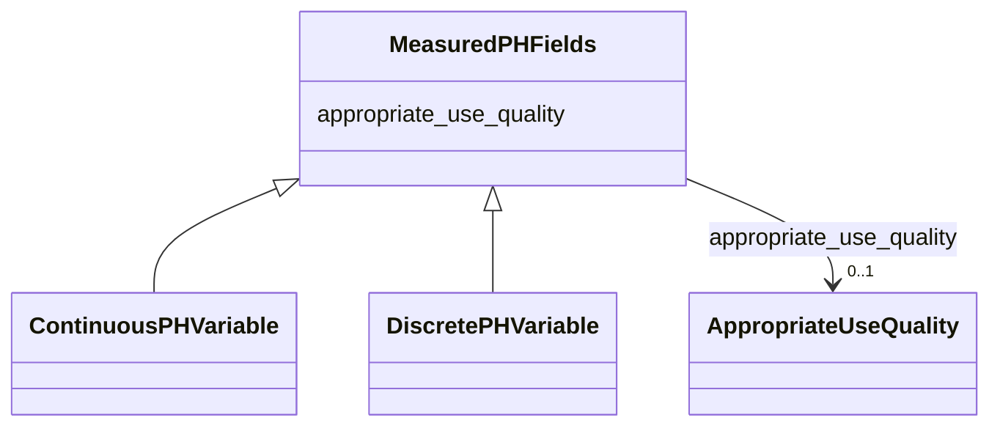

# Class: MeasuredPHFields


_Fields applied to all measured pH variable types (discrete and continuous)_


URI: [oae:MeasuredPHFields](https://schema.oaedata.org/MeasuredPHFields)





<!-- no inheritance hierarchy -->


## Slots

| Name | Cardinality and Range | Description | Inheritance |
| ---  | --- | --- | --- |
| [appropriate_use_quality](appropriate_use_quality.md) | 0..1 <br/> [AppropriateUseQuality](AppropriateUseQuality.md) | Climate quality is defined as measurements of quality sufficient to assess lo... | direct |


## Mixin Usage

| mixed into | description |
| --- | --- |
| [ContinuousPHVariable](ContinuousPHVariable.md) | pH measured variable from continuous autonomous sensor |
| [DiscretePHVariable](DiscretePHVariable.md) | pH measured variable with dye-based spectrophotometric measurement |


## Identifier and Mapping Information


### Schema Source


* from schema: https://schema.oaedata.org/OAEDataSchema


## Mappings

| Mapping Type | Mapped Value |
| ---  | ---  |
| self | oae:MeasuredPHFields |
| native | oae:MeasuredPHFields |


## LinkML Source

<!-- TODO: investigate https://stackoverflow.com/questions/37606292/how-to-create-tabbed-code-blocks-in-mkdocs-or-sphinx -->

### Direct

<details>
```yaml
name: MeasuredPHFields
description: Fields applied to all measured pH variable types (discrete and continuous)
from_schema: https://schema.oaedata.org/OAEDataSchema
mixin: true
slots:
- appropriate_use_quality

```
</details>

### Induced

<details>
```yaml
name: MeasuredPHFields
description: Fields applied to all measured pH variable types (discrete and continuous)
from_schema: https://schema.oaedata.org/OAEDataSchema
mixin: true
attributes:
  appropriate_use_quality:
    name: appropriate_use_quality
    description: 'Climate quality is defined as measurements of quality sufficient
      to assess long term trends with a defined level of confidence. Weather quality
      is defined as measurements of quality sufficient to identify relative spatial
      patterns and short term variation.

      For more details, refer to Newton J.A., Feely R. A., Jewett E. B., Williamson
      P. & Mathis J., 2015. Global Ocean Acidification Observing Network: Requirements
      and Governance Plan. Second Edition, GOA-ON, http://www.goa-on.org/docs/GOA-ON_plan_print.pdf.'
    title: Weather or climate quality
    from_schema: https://schema.oaedata.org/OAEDataSchema
    rank: 1000
    alias: appropriate_use_quality
    owner: MeasuredPHFields
    domain_of:
    - MeasuredTAFields
    - MeasuredDICFields
    - MeasuredPHFields
    - MeasuredCO2Fields
    range: AppropriateUseQuality

```
</details>