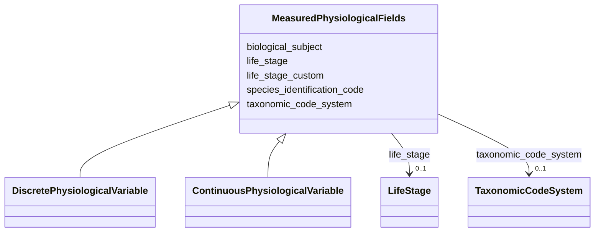

# Class: MeasuredPhysiologicalFields


_Fields applied to all measured physiological variable types (discrete and continuous). Captures biological subject identification and experimental design information for organism response field studies._


URI: [oae:MeasuredPhysiologicalFields](https://schema.oaedata.org/MeasuredPhysiologicalFields)





<!-- no inheritance hierarchy -->


## Slots

| Name | Cardinality and Range | Description | Inheritance |
| ---  | --- | --- | --- |
| [biological_subject](biological_subject.md) | 1 <br/> [String](String.md) | Taxonomy (species, genus, or community) being studied (e | direct |
| [species_identification_code](species_identification_code.md) | 0..1 <br/> [String](String.md) | Species reference code from a taxonomic database (e | direct |
| [taxonomic_code_system](taxonomic_code_system.md) | 0..1 <br/> [TaxonomicCodeSystem](TaxonomicCodeSystem.md) | Which taxonomic code system the identification code refers to | direct |
| [life_stage](life_stage.md) | 0..1 <br/> [LifeStage](LifeStage.md) | Life stage of the organism at time of measurement | direct |
| [life_stage_custom](life_stage_custom.md) | 0..1 <br/> [String](String.md) | Custom life stage description when "other" is selected | direct |


## Mixin Usage

| mixed into | description |
| --- | --- |
| [DiscretePhysiologicalVariable](DiscretePhysiologicalVariable.md) | Physiological response variable from discrete field samples (e |
| [ContinuousPhysiologicalVariable](ContinuousPhysiologicalVariable.md) | Physiological response variable from continuous autonomous field sensors (e |


## Identifier and Mapping Information


### Schema Source


* from schema: https://schema.oaedata.org/OAEDataSchema


## Mappings

| Mapping Type | Mapped Value |
| ---  | ---  |
| self | oae:MeasuredPhysiologicalFields |
| native | oae:MeasuredPhysiologicalFields |


## LinkML Source

<!-- TODO: investigate https://stackoverflow.com/questions/37606292/how-to-create-tabbed-code-blocks-in-mkdocs-or-sphinx -->

### Direct

<details>
```yaml
name: MeasuredPhysiologicalFields
description: Fields applied to all measured physiological variable types (discrete
  and continuous). Captures biological subject identification and experimental design
  information for organism response field studies.
from_schema: https://schema.oaedata.org/OAEDataSchema
mixin: true
attributes:
  biological_subject:
    name: biological_subject
    description: Taxonomy (species, genus, or community) being studied (e.g., Crassostrea
      gigas, coral reef community).
    title: Biological Subject
    from_schema: Variable
    rank: 1000
    domain_of:
    - MeasuredPhysiologicalFields
    range: string
    required: true
  species_identification_code:
    name: species_identification_code
    description: Species reference code from a taxonomic database (e.g., WoRMS AphiaID
      140656, ITIS TSN 79861).
    title: Species Identification Code
    from_schema: Variable
    rank: 1000
    domain_of:
    - MeasuredPhysiologicalFields
    range: string
  taxonomic_code_system:
    name: taxonomic_code_system
    description: Which taxonomic code system the identification code refers to.
    title: Taxonomic Code System
    from_schema: Variable
    rank: 1000
    domain_of:
    - MeasuredPhysiologicalFields
    range: TaxonomicCodeSystem
  life_stage:
    name: life_stage
    description: Life stage of the organism at time of measurement.
    title: Life Stage
    from_schema: Variable
    rank: 1000
    domain_of:
    - MeasuredPhysiologicalFields
    range: LifeStage
  life_stage_custom:
    name: life_stage_custom
    description: Custom life stage description when "other" is selected.
    title: Life Stage (custom)
    from_schema: Variable
    rank: 1000
    domain_of:
    - MeasuredPhysiologicalFields
    range: string

```
</details>

### Induced

<details>
```yaml
name: MeasuredPhysiologicalFields
description: Fields applied to all measured physiological variable types (discrete
  and continuous). Captures biological subject identification and experimental design
  information for organism response field studies.
from_schema: https://schema.oaedata.org/OAEDataSchema
mixin: true
attributes:
  biological_subject:
    name: biological_subject
    description: Taxonomy (species, genus, or community) being studied (e.g., Crassostrea
      gigas, coral reef community).
    title: Biological Subject
    from_schema: Variable
    rank: 1000
    alias: biological_subject
    owner: MeasuredPhysiologicalFields
    domain_of:
    - MeasuredPhysiologicalFields
    range: string
    required: true
  species_identification_code:
    name: species_identification_code
    description: Species reference code from a taxonomic database (e.g., WoRMS AphiaID
      140656, ITIS TSN 79861).
    title: Species Identification Code
    from_schema: Variable
    rank: 1000
    alias: species_identification_code
    owner: MeasuredPhysiologicalFields
    domain_of:
    - MeasuredPhysiologicalFields
    range: string
  taxonomic_code_system:
    name: taxonomic_code_system
    description: Which taxonomic code system the identification code refers to.
    title: Taxonomic Code System
    from_schema: Variable
    rank: 1000
    alias: taxonomic_code_system
    owner: MeasuredPhysiologicalFields
    domain_of:
    - MeasuredPhysiologicalFields
    range: TaxonomicCodeSystem
  life_stage:
    name: life_stage
    description: Life stage of the organism at time of measurement.
    title: Life Stage
    from_schema: Variable
    rank: 1000
    alias: life_stage
    owner: MeasuredPhysiologicalFields
    domain_of:
    - MeasuredPhysiologicalFields
    range: LifeStage
  life_stage_custom:
    name: life_stage_custom
    description: Custom life stage description when "other" is selected.
    title: Life Stage (custom)
    from_schema: Variable
    rank: 1000
    alias: life_stage_custom
    owner: MeasuredPhysiologicalFields
    domain_of:
    - MeasuredPhysiologicalFields
    range: string

```
</details>