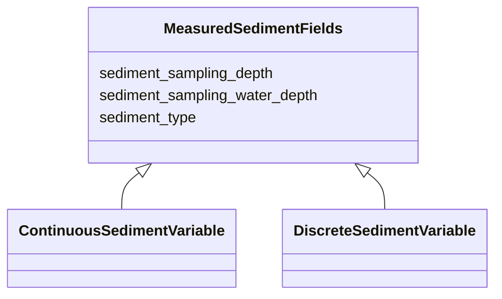

# Class: MeasuredSedimentFields


_Fields applied to all measured sediment variable types (discrete and continuous)_


URI: [oae:MeasuredSedimentFields](https://schema.oaedata.org/MeasuredSedimentFields)





<!-- no inheritance hierarchy -->


## Slots

| Name | Cardinality and Range | Description | Inheritance |
| ---  | --- | --- | --- |
| [sediment_type](sediment_type.md) | 1 <br/> [String](String.md) | e | direct |
| [sediment_sampling_depth](sediment_sampling_depth.md) | 1 <br/> [String](String.md) | Depth that sediment was collected below sediment surface | direct |
| [sediment_sampling_water_depth](sediment_sampling_water_depth.md) | 1 <br/> [String](String.md) | Water depth where sediment was collected | direct |


## Mixin Usage

| mixed into | description |
| --- | --- |
| [ContinuousSedimentVariable](ContinuousSedimentVariable.md) | Measured sediment variable collected from continuous autonomous sensor |
| [DiscreteSedimentVariable](DiscreteSedimentVariable.md) | Measured sediment variable collected from discrete bottle samples |


## Identifier and Mapping Information


### Schema Source


* from schema: https://schema.oaedata.org/OAEDataSchema


## Mappings

| Mapping Type | Mapped Value |
| ---  | ---  |
| self | oae:MeasuredSedimentFields |
| native | oae:MeasuredSedimentFields |


## LinkML Source

<!-- TODO: investigate https://stackoverflow.com/questions/37606292/how-to-create-tabbed-code-blocks-in-mkdocs-or-sphinx -->

### Direct

<details>
```yaml
name: MeasuredSedimentFields
description: Fields applied to all measured sediment variable types (discrete and
  continuous)
from_schema: https://schema.oaedata.org/OAEDataSchema
mixin: true
attributes:
  sediment_type:
    name: sediment_type
    description: e.g., mud, sand, etc.
    title: Sediment Type
    from_schema: Variable
    rank: 1000
    domain_of:
    - MeasuredSedimentFields
    range: string
    required: true
  sediment_sampling_depth:
    name: sediment_sampling_depth
    description: Depth that sediment was collected below sediment surface. If provided
      as a variable (recommended), please list the column header name here.
    title: Sediment Sampling Depth
    from_schema: Variable
    rank: 1000
    domain_of:
    - MeasuredSedimentFields
    range: string
    required: true
  sediment_sampling_water_depth:
    name: sediment_sampling_water_depth
    description: Water depth where sediment was collected. If provided as a variable
      (recommended), please list the column header name here.
    title: Sediment Sampling Water Depth
    from_schema: Variable
    rank: 1000
    domain_of:
    - MeasuredSedimentFields
    range: string
    required: true

```
</details>

### Induced

<details>
```yaml
name: MeasuredSedimentFields
description: Fields applied to all measured sediment variable types (discrete and
  continuous)
from_schema: https://schema.oaedata.org/OAEDataSchema
mixin: true
attributes:
  sediment_type:
    name: sediment_type
    description: e.g., mud, sand, etc.
    title: Sediment Type
    from_schema: Variable
    rank: 1000
    alias: sediment_type
    owner: MeasuredSedimentFields
    domain_of:
    - MeasuredSedimentFields
    range: string
    required: true
  sediment_sampling_depth:
    name: sediment_sampling_depth
    description: Depth that sediment was collected below sediment surface. If provided
      as a variable (recommended), please list the column header name here.
    title: Sediment Sampling Depth
    from_schema: Variable
    rank: 1000
    alias: sediment_sampling_depth
    owner: MeasuredSedimentFields
    domain_of:
    - MeasuredSedimentFields
    range: string
    required: true
  sediment_sampling_water_depth:
    name: sediment_sampling_water_depth
    description: Water depth where sediment was collected. If provided as a variable
      (recommended), please list the column header name here.
    title: Sediment Sampling Water Depth
    from_schema: Variable
    rank: 1000
    alias: sediment_sampling_water_depth
    owner: MeasuredSedimentFields
    domain_of:
    - MeasuredSedimentFields
    range: string
    required: true

```
</details>