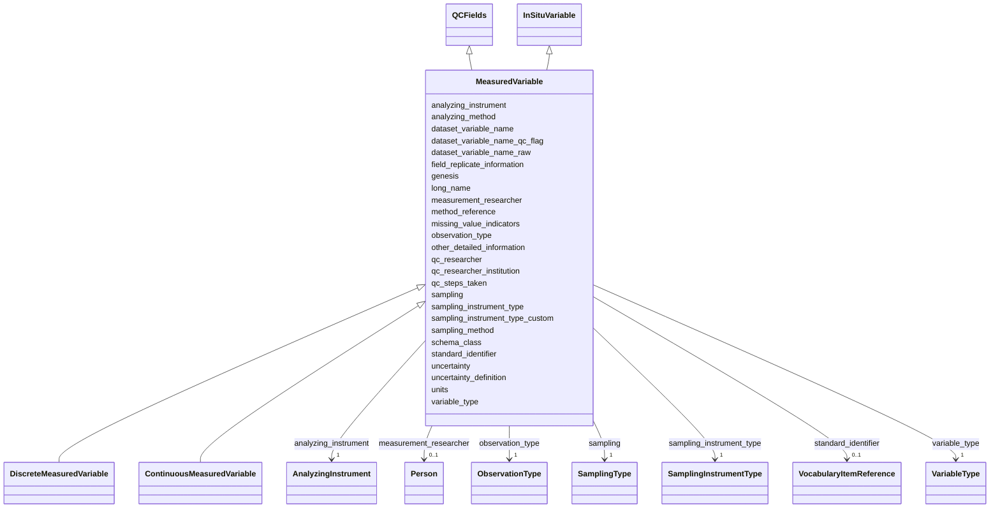

# Class: MeasuredVariable


_Variable that is directly measured in-situ using instruments. Reference: OAPMetadata XSD variables.xsd - basic_measured_observation_base_


* __NOTE__: this is an abstract class and should not be instantiated directly


URI: [oae:MeasuredVariable](https://schema.oaedata.org/MeasuredVariable)





## Inheritance
* [Variable](Variable.md)
    * [FieldVariable](FieldVariable.md)
        * [InSituVariable](InSituVariable.md)
            * **MeasuredVariable** [ [QCFields](QCFields.md)]
                * [DiscreteMeasuredVariable](DiscreteMeasuredVariable.md)
                * [ContinuousMeasuredVariable](ContinuousMeasuredVariable.md)


## Slots

| Name | Cardinality and Range | Description | Inheritance |
| ---  | --- | --- | --- |
| [analyzing_instrument](analyzing_instrument.md) | 1 <br/> [AnalyzingInstrument](AnalyzingInstrument.md) | Instrument used to analyze the water samples or measure the water body contin... | direct |
| [sampling_method](sampling_method.md) | 1 <br/> [String](String.md) | Method used to collect samples | direct |
| [field_replicate_information](field_replicate_information.md) | 0..1 <br/> [String](String.md) | Repetition of sample collection and measurement, e | direct |
| [analyzing_method](analyzing_method.md) | 1 <br/> [String](String.md) | Additional information describing how the sample was analyzed | direct |
| [observation_type](observation_type.md) | 1 <br/> [ObservationType](ObservationType.md) |  | direct |
| [sampling](sampling.md) | 1 <br/> [SamplingType](SamplingType.md) |  | direct |
| [sampling_instrument_type](sampling_instrument_type.md) | 1 <br/> [SamplingInstrumentType](SamplingInstrumentType.md) |  | direct |
| [sampling_instrument_type_custom](sampling_instrument_type_custom.md) | 0..1 <br/> [String](String.md) |  | direct |
| [qc_steps_taken](qc_steps_taken.md) | 1 <br/> [String](String.md) | Describe what QC steps have been taken to improve the quality of the data (e | [QCFields](QCFields.md) |
| [uncertainty](uncertainty.md) | 1 <br/> [String](String.md) | It is recommended to provide uncertainty for each data point in the data file | [QCFields](QCFields.md) |
| [uncertainty_definition](uncertainty_definition.md) | 1 <br/> [String](String.md) | A description of the uncertainties involved in this method | [QCFields](QCFields.md) |
| [missing_value_indicators](missing_value_indicators.md) | 1 <br/> [String](String.md) | The indicator used to represent missing values in the data file, e | [QCFields](QCFields.md) |
| [qc_researcher](qc_researcher.md) | 0..1 <br/> [String](String.md) | The name of the PI whose research team QCed this parameter | [QCFields](QCFields.md) |
| [qc_researcher_institution](qc_researcher_institution.md) | 0..1 <br/> [String](String.md) | The institution of the PI whose research team QCed this parameter | [QCFields](QCFields.md) |
| [genesis](genesis.md) | 1 <br/> [String](String.md) |  | [InSituVariable](InSituVariable.md) |
| [dataset_variable_name_qc_flag](dataset_variable_name_qc_flag.md) | 0..1 <br/> [String](String.md) | If applicable, the column header name used for the quality control flag corre... | [InSituVariable](InSituVariable.md) |
| [dataset_variable_name_raw](dataset_variable_name_raw.md) | 0..1 <br/> [String](String.md) | If applicable, the column header name used for the raw data corresponding to ... | [InSituVariable](InSituVariable.md) |
| [other_detailed_information](other_detailed_information.md) | 0..1 <br/> [String](String.md) | Any additional information about this variable | [InSituVariable](InSituVariable.md) |
| [method_reference](method_reference.md) | 0..1 <br/> [String](String.md) | Citation for the method used | [InSituVariable](InSituVariable.md) |
| [measurement_researcher](measurement_researcher.md) | 0..1 <br/> [Person](Person.md) | The name of the PI whose research team measured or derived this parameter | [InSituVariable](InSituVariable.md) |
| [units](units.md) | 1 <br/> [String](String.md) | Unit of measurement for this variable | [Variable](Variable.md) |
| [variable_type](variable_type.md) | 1 <br/> [VariableType](VariableType.md) | High-level classification of the variable | [Variable](Variable.md) |
| [schema_class](schema_class.md) | 1 <br/> [String](String.md) | The schema class name for this variable (e | [Variable](Variable.md) |
| [standard_identifier](standard_identifier.md) | 0..1 <br/> [VocabularyItemReference](VocabularyItemReference.md) | A term from a community vocabulary that identifies this variable | [Variable](Variable.md) |
| [dataset_variable_name](dataset_variable_name.md) | 1 <br/> [String](String.md) | The name for the variable as it is identified in the dataset data file | [Variable](Variable.md) |
| [long_name](long_name.md) | 1 <br/> [String](String.md) | Full descriptive name of the variable | [Variable](Variable.md) |


## Identifier and Mapping Information


### Schema Source


* from schema: https://schema.oaedata.org/OAEDataSchema


## Mappings

| Mapping Type | Mapped Value |
| ---  | ---  |
| self | oae:MeasuredVariable |
| native | oae:MeasuredVariable |


## LinkML Source

<!-- TODO: investigate https://stackoverflow.com/questions/37606292/how-to-create-tabbed-code-blocks-in-mkdocs-or-sphinx -->

### Direct

<details>
```yaml
name: MeasuredVariable
description: 'Variable that is directly measured in-situ using instruments. Reference:
  OAPMetadata XSD variables.xsd - basic_measured_observation_base'
from_schema: https://schema.oaedata.org/OAEDataSchema
is_a: InSituVariable
abstract: true
mixins:
- QCFields
slots:
- analyzing_instrument
slot_usage:
  qc_steps_taken:
    name: qc_steps_taken
    required: true
  uncertainty:
    name: uncertainty
    required: true
  uncertainty_definition:
    name: uncertainty_definition
    required: true
  missing_value_indicators:
    name: missing_value_indicators
    required: true
  genesis:
    name: genesis
    range: string
    equals_string: measured
attributes:
  sampling_method:
    name: sampling_method
    description: Method used to collect samples.
    title: Sampling Method
    from_schema: Variable
    rank: 1000
    domain_of:
    - MeasuredVariable
    range: string
    required: true
  field_replicate_information:
    name: field_replicate_information
    description: Repetition of sample collection and measurement, e.g., triplicate
      samples.
    title: Field replicate information
    from_schema: Variable
    rank: 1000
    domain_of:
    - MeasuredVariable
    range: string
  analyzing_method:
    name: analyzing_method
    description: Additional information describing how the sample was analyzed. DOIs
      provided as applicable.
    title: Analyzing Method
    from_schema: Variable
    rank: 1000
    domain_of:
    - MeasuredVariable
    range: string
    required: true
  observation_type:
    name: observation_type
    title: Observation Type
    from_schema: Variable
    rank: 1000
    domain_of:
    - MeasuredVariable
    range: ObservationType
    required: true
  sampling:
    name: sampling
    from_schema: Variable
    rank: 1000
    domain_of:
    - MeasuredVariable
    range: SamplingType
    required: true
  sampling_instrument_type:
    name: sampling_instrument_type
    title: Sampling instrument type
    from_schema: Variable
    rank: 1000
    domain_of:
    - MeasuredVariable
    range: SamplingInstrumentType
    required: true
  sampling_instrument_type_custom:
    name: sampling_instrument_type_custom
    title: Sampling instrument type (custom)
    from_schema: Variable
    rank: 1000
    domain_of:
    - MeasuredVariable
    range: string

```
</details>

### Induced

<details>
```yaml
name: MeasuredVariable
description: 'Variable that is directly measured in-situ using instruments. Reference:
  OAPMetadata XSD variables.xsd - basic_measured_observation_base'
from_schema: https://schema.oaedata.org/OAEDataSchema
is_a: InSituVariable
abstract: true
mixins:
- QCFields
slot_usage:
  qc_steps_taken:
    name: qc_steps_taken
    required: true
  uncertainty:
    name: uncertainty
    required: true
  uncertainty_definition:
    name: uncertainty_definition
    required: true
  missing_value_indicators:
    name: missing_value_indicators
    required: true
  genesis:
    name: genesis
    range: string
    equals_string: measured
attributes:
  sampling_method:
    name: sampling_method
    description: Method used to collect samples.
    title: Sampling Method
    from_schema: Variable
    rank: 1000
    alias: sampling_method
    owner: MeasuredVariable
    domain_of:
    - MeasuredVariable
    range: string
    required: true
  field_replicate_information:
    name: field_replicate_information
    description: Repetition of sample collection and measurement, e.g., triplicate
      samples.
    title: Field replicate information
    from_schema: Variable
    rank: 1000
    alias: field_replicate_information
    owner: MeasuredVariable
    domain_of:
    - MeasuredVariable
    range: string
  analyzing_method:
    name: analyzing_method
    description: Additional information describing how the sample was analyzed. DOIs
      provided as applicable.
    title: Analyzing Method
    from_schema: Variable
    rank: 1000
    alias: analyzing_method
    owner: MeasuredVariable
    domain_of:
    - MeasuredVariable
    range: string
    required: true
  observation_type:
    name: observation_type
    title: Observation Type
    from_schema: Variable
    rank: 1000
    alias: observation_type
    owner: MeasuredVariable
    domain_of:
    - MeasuredVariable
    range: ObservationType
    required: true
  sampling:
    name: sampling
    from_schema: Variable
    rank: 1000
    alias: sampling
    owner: MeasuredVariable
    domain_of:
    - MeasuredVariable
    range: SamplingType
    required: true
  sampling_instrument_type:
    name: sampling_instrument_type
    title: Sampling instrument type
    from_schema: Variable
    rank: 1000
    alias: sampling_instrument_type
    owner: MeasuredVariable
    domain_of:
    - MeasuredVariable
    range: SamplingInstrumentType
    required: true
  sampling_instrument_type_custom:
    name: sampling_instrument_type_custom
    title: Sampling instrument type (custom)
    from_schema: Variable
    rank: 1000
    alias: sampling_instrument_type_custom
    owner: MeasuredVariable
    domain_of:
    - MeasuredVariable
    range: string
  analyzing_instrument:
    name: analyzing_instrument
    description: Instrument used to analyze the water samples or measure the water
      body continuously. Instrument includes calibration information.
    title: Analyzing instrument
    from_schema: https://schema.oaedata.org/OAEDataSchema
    rank: 1000
    alias: analyzing_instrument
    owner: MeasuredVariable
    domain_of:
    - MeasuredVariable
    range: AnalyzingInstrument
    required: true
  qc_steps_taken:
    name: qc_steps_taken
    description: 'Describe what QC steps have been taken to improve the quality of
      the data (e.g., DOI, software and settings used, outlier removal, etc.).

      If quality control procedures are described in a separate document uploaded
      with the data, provide the name of the document here.'
    title: QC steps taken
    from_schema: https://schema.oaedata.org/OAEDataSchema
    rank: 1000
    alias: qc_steps_taken
    owner: MeasuredVariable
    domain_of:
    - QCFields
    range: string
    required: true
  uncertainty:
    name: uncertainty
    description: 'It is recommended to provide uncertainty for each data point in
      the data file. Else provide a single value representative of the dataset.

      If uncertainty is provided as a variable, please list the column header name
      here.'
    title: Uncertainty
    from_schema: https://schema.oaedata.org/OAEDataSchema
    rank: 1000
    alias: uncertainty
    owner: MeasuredVariable
    domain_of:
    - StandardGas
    - CO2GasDetector
    - QCFields
    range: string
    required: true
  uncertainty_definition:
    name: uncertainty_definition
    description: A description of the uncertainties involved in this method.
    title: How was the uncertainty defined
    from_schema: https://schema.oaedata.org/OAEDataSchema
    rank: 1000
    alias: uncertainty_definition
    owner: MeasuredVariable
    domain_of:
    - QCFields
    range: string
    required: true
  missing_value_indicators:
    name: missing_value_indicators
    description: The indicator used to represent missing values in the data file,
      e.g., -999, NaN, etc.
    title: Missing value indicators
    from_schema: https://schema.oaedata.org/OAEDataSchema
    rank: 1000
    alias: missing_value_indicators
    owner: MeasuredVariable
    domain_of:
    - QCFields
    range: string
    required: true
  qc_researcher:
    name: qc_researcher
    description: The name of the PI whose research team QCed this parameter.
    title: Researcher who QCed this variable
    from_schema: Variable
    rank: 1000
    alias: qc_researcher
    owner: MeasuredVariable
    domain_of:
    - QCFields
    range: string
  qc_researcher_institution:
    name: qc_researcher_institution
    description: The institution of the PI whose research team QCed this parameter.
    title: QC Researcher Institution
    from_schema: Variable
    rank: 1000
    alias: qc_researcher_institution
    owner: MeasuredVariable
    domain_of:
    - QCFields
    range: string
  genesis:
    name: genesis
    from_schema: Variable
    rank: 1000
    alias: genesis
    owner: MeasuredVariable
    domain_of:
    - InSituVariable
    range: string
    required: true
    equals_string: measured
  dataset_variable_name_qc_flag:
    name: dataset_variable_name_qc_flag
    description: If applicable, the column header name used for the quality control
      flag corresponding to this variable.
    title: Dataset variable name (Quality Flag)
    from_schema: Variable
    rank: 1000
    alias: dataset_variable_name_qc_flag
    owner: MeasuredVariable
    domain_of:
    - InSituVariable
    range: string
  dataset_variable_name_raw:
    name: dataset_variable_name_raw
    description: If applicable, the column header name used for the raw data corresponding
      to this variable.
    title: Dataset variable name (raw)
    from_schema: Variable
    rank: 1000
    alias: dataset_variable_name_raw
    owner: MeasuredVariable
    domain_of:
    - InSituVariable
    range: string
  other_detailed_information:
    name: other_detailed_information
    description: Any additional information about this variable.
    title: Other Detailed Information
    from_schema: Variable
    rank: 1000
    alias: other_detailed_information
    owner: MeasuredVariable
    domain_of:
    - InSituVariable
    range: string
  method_reference:
    name: method_reference
    description: Citation for the method used.
    title: Method Reference
    from_schema: Variable
    alias: method_reference
    owner: MeasuredVariable
    domain_of:
    - Calibration
    - InSituVariable
    range: string
  measurement_researcher:
    name: measurement_researcher
    description: The name of the PI whose research team measured or derived this parameter.
    title: Researcher who measured the variable
    from_schema: Variable
    rank: 1000
    alias: measurement_researcher
    owner: MeasuredVariable
    domain_of:
    - InSituVariable
    range: Person
  units:
    name: units
    description: Unit of measurement for this variable.
    title: Unit
    from_schema: https://schema.oaedata.org/OAEDataSchema
    rank: 1000
    alias: units
    owner: MeasuredVariable
    domain_of:
    - Variable
    range: string
    required: true
  variable_type:
    name: variable_type
    description: High-level classification of the variable. Determines which standard
      identifiers are available and, combined with genesis and sampling, which schema
      class to use.
    title: Variable Type
    from_schema: https://schema.oaedata.org/OAEDataSchema
    rank: 1000
    alias: variable_type
    owner: MeasuredVariable
    domain_of:
    - Variable
    range: VariableType
    required: true
  schema_class:
    name: schema_class
    description: The schema class name for this variable (e.g., "DiscretePHVariable").
      Auto-populated by the metadata builder.
    from_schema: Variable
    rank: 1000
    designates_type: true
    alias: schema_class
    owner: MeasuredVariable
    domain_of:
    - Variable
    range: string
    required: true
  standard_identifier:
    name: standard_identifier
    description: A term from a community vocabulary that identifies this variable.
      CF standard names (NERC P07) are recommended.
    from_schema: Variable
    rank: 1000
    alias: standard_identifier
    owner: MeasuredVariable
    domain_of:
    - Variable
    range: VocabularyItemReference
  dataset_variable_name:
    name: dataset_variable_name
    description: The name for the variable as it is identified in the dataset data
      file. This could be the column header in a CSV or the variable name in a NetCDF
      file. Standard common recommended column header names can be found in protocol
      documentation [here](https://www.carbontosea.org/oae-data-protocol/1-0-0/#column-header-name).
    title: Dataset variable name
    from_schema: Variable
    rank: 1000
    alias: dataset_variable_name
    owner: MeasuredVariable
    domain_of:
    - Variable
    range: string
    required: true
  long_name:
    name: long_name
    description: Full descriptive name of the variable.
    title: Variable full name
    from_schema: Variable
    rank: 1000
    alias: long_name
    owner: MeasuredVariable
    domain_of:
    - Variable
    range: string
    required: true

```
</details>