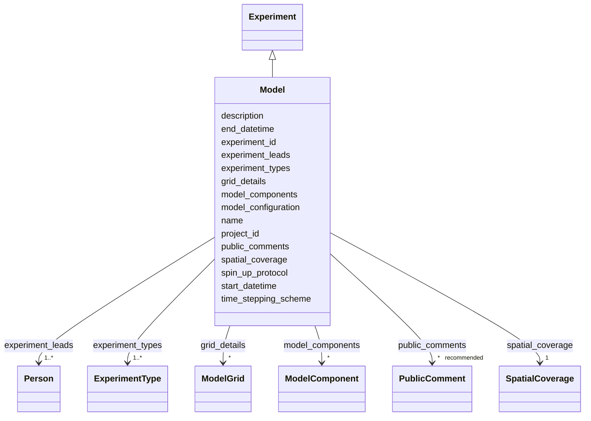

# Class: Model


_A computational model experiment related to OAE._


URI: [oae:Model](https://schema.oaedata.org/Model)





## Inheritance
* [Experiment](Experiment.md)
    * **Model**


## Slots

| Name | Cardinality and Range | Description | Inheritance |
| ---  | --- | --- | --- |
| [model_configuration](model_configuration.md) | * <br/> [uri](uri.md) | Links to model configuration files or documentation | direct |
| [model_components](model_components.md) | * <br/> [ModelComponent](ModelComponent.md) | Components of the model (e | direct |
| [grid_details](grid_details.md) | * <br/> [ModelGrid](ModelGrid.md) | Details about the model grid(s) | direct |
| [spin_up_protocol](spin_up_protocol.md) | 0..1 <br/> [String](String.md) | Description of the model spin-up process | direct |
| [time_stepping_scheme](time_stepping_scheme.md) | 0..1 <br/> [String](String.md) | Time-stepping method and time step used in the simulation | direct |
| [name](name.md) | 1 <br/> [String](String.md) | Common name for experiment | [Experiment](Experiment.md) |
| [description](description.md) | 1 <br/> [String](String.md) | A narrative description of the experiment | [Experiment](Experiment.md) |
| [spatial_coverage](spatial_coverage.md) | 1 <br/> [SpatialCoverage](SpatialCoverage.md) | Latitude/longitude bounds of observed data in experiment, expressed as a sche... | [Experiment](Experiment.md) |
| [project_id](project_id.md) | 1 <br/> [String](String.md) | The project to which the submitted data belong | [Experiment](Experiment.md) |
| [experiment_id](experiment_id.md) | 1 <br/> [String](String.md) | The experiment to which the data belong | [Experiment](Experiment.md) |
| [experiment_types](experiment_types.md) | 1..* <br/> [ExperimentType](ExperimentType.md) | The type(s) of mCDR experiment conducted | [Experiment](Experiment.md) |
| [public_comments](public_comments.md) | * _recommended_ <br/> [PublicComment](PublicComment.md) | Public comment documents, each with a link or DOI and an optional description | [Experiment](Experiment.md) |
| [experiment_leads](experiment_leads.md) | 1..* <br/> [Person](Person.md) | Provide details for each experiment lead / principal investigator (PI) includ... | [Experiment](Experiment.md) |
| [start_datetime](start_datetime.md) | 1 <br/> [Datetime](Datetime.md) | Start date and time of experiment in UTC ISO-8601 | [Experiment](Experiment.md) |
| [end_datetime](end_datetime.md) | 0..1 <br/> [Datetime](Datetime.md) | End date and time of experiment in UTC ISO-8601 | [Experiment](Experiment.md) |


## Usages

| used by | used in | type | used |
| ---  | --- | --- | --- |
| [Container](Container.md) | [experiments](experiments.md) | any_of[range] | [Model](Model.md) |


## Identifier and Mapping Information


### Schema Source


* from schema: https://schema.oaedata.org/OAEDataSchema


## Mappings

| Mapping Type | Mapped Value |
| ---  | ---  |
| self | oae:Model |
| native | oae:Model |


## LinkML Source

<!-- TODO: investigate https://stackoverflow.com/questions/37606292/how-to-create-tabbed-code-blocks-in-mkdocs-or-sphinx -->

### Direct

<details>
```yaml
name: Model
description: A computational model experiment related to OAE.
from_schema: https://schema.oaedata.org/OAEDataSchema
is_a: Experiment
attributes:
  model_configuration:
    name: model_configuration
    description: Links to model configuration files or documentation.
    title: Model Configuration
    from_schema: Model
    rank: 1000
    domain_of:
    - Model
    range: uri
    multivalued: true
  model_components:
    name: model_components
    description: Components of the model (e.g., physics, biogeochemistry).
    title: Model Components
    from_schema: Model
    rank: 1000
    domain_of:
    - Model
    range: ModelComponent
    multivalued: true
    inlined: true
    inlined_as_list: true
  grid_details:
    name: grid_details
    description: Details about the model grid(s). Use multiple entries for nested
      grid configurations.
    title: Grid Details
    from_schema: Model
    rank: 1000
    domain_of:
    - Model
    range: ModelGrid
    multivalued: true
    inlined: true
    inlined_as_list: true
  spin_up_protocol:
    name: spin_up_protocol
    description: Description of the model spin-up process.
    title: Spin-up Protocol
    from_schema: Model
    rank: 1000
    domain_of:
    - Model
    range: string
  time_stepping_scheme:
    name: time_stepping_scheme
    description: Time-stepping method and time step used in the simulation.
    title: Time-stepping Scheme
    from_schema: Model
    rank: 1000
    domain_of:
    - Model
    range: string

```
</details>

### Induced

<details>
```yaml
name: Model
description: A computational model experiment related to OAE.
from_schema: https://schema.oaedata.org/OAEDataSchema
is_a: Experiment
attributes:
  model_configuration:
    name: model_configuration
    description: Links to model configuration files or documentation.
    title: Model Configuration
    from_schema: Model
    rank: 1000
    alias: model_configuration
    owner: Model
    domain_of:
    - Model
    range: uri
    multivalued: true
  model_components:
    name: model_components
    description: Components of the model (e.g., physics, biogeochemistry).
    title: Model Components
    from_schema: Model
    rank: 1000
    alias: model_components
    owner: Model
    domain_of:
    - Model
    range: ModelComponent
    multivalued: true
    inlined: true
    inlined_as_list: true
  grid_details:
    name: grid_details
    description: Details about the model grid(s). Use multiple entries for nested
      grid configurations.
    title: Grid Details
    from_schema: Model
    rank: 1000
    alias: grid_details
    owner: Model
    domain_of:
    - Model
    range: ModelGrid
    multivalued: true
    inlined: true
    inlined_as_list: true
  spin_up_protocol:
    name: spin_up_protocol
    description: Description of the model spin-up process.
    title: Spin-up Protocol
    from_schema: Model
    rank: 1000
    alias: spin_up_protocol
    owner: Model
    domain_of:
    - Model
    range: string
  time_stepping_scheme:
    name: time_stepping_scheme
    description: Time-stepping method and time step used in the simulation.
    title: Time-stepping Scheme
    from_schema: Model
    rank: 1000
    alias: time_stepping_scheme
    owner: Model
    domain_of:
    - Model
    range: string
  name:
    name: name
    description: Common name for experiment.
    title: Name
    from_schema: https://schema.oaedata.org/OAEDataSchema
    rank: 1000
    slot_uri: schema:name
    alias: name
    owner: Model
    domain_of:
    - Organization
    - Project
    - NamedLink
    - ExternalProject
    - MonetaryGrant
    - Experiment
    - Person
    - Dataset
    - Platform
    - ModelComponent
    range: string
    required: true
  description:
    name: description
    description: A narrative description of the experiment. For example, what part
      of the project do these data represent (e.g., baseline, intervention, control)
      and what do they contribute to the overall project? Are all project research
      questions listed in Project description relevant? What were the processes to
      achieve these goals and answer these questions? Data submitters are encouraged
      to note any significant changes to the original experimental plan due to unforeseen
      circumstances here.
    title: Experiment Description
    from_schema: https://schema.oaedata.org/OAEDataSchema
    rank: 1000
    slot_uri: schema:description
    alias: description
    owner: Model
    domain_of:
    - Project
    - ExternalProject
    - Experiment
    - PublicComment
    - VocabularyItemReference
    - Dataset
    - ModelComponent
    range: string
    required: true
  spatial_coverage:
    name: spatial_coverage
    description: Latitude/longitude bounds of observed data in experiment, expressed
      as a schema.org GeoShape bounding box.
    title: Spatial Coverage
    from_schema: https://schema.oaedata.org/OAEDataSchema
    rank: 1000
    slot_uri: schema:spatialCoverage
    alias: spatial_coverage
    owner: Model
    domain_of:
    - Project
    - ExternalProject
    - Experiment
    - ModelGrid
    range: SpatialCoverage
    required: true
  project_id:
    name: project_id
    description: 'The project to which the submitted data belong. A unique project
      identifier that can be used to link project data across data submissions, and
      link baseline data to intervention data, for example.

      If no Project ID has been assigned, one may be generated by combining: lead
      organizer surname and first initial or company, a unique date, and location.

      Any method that creates a unique ID that will link all project data is acceptable.'
    title: Project ID
    from_schema: https://schema.oaedata.org/OAEDataSchema
    rank: 1000
    alias: project_id
    owner: Model
    domain_of:
    - Project
    - Experiment
    - Dataset
    range: string
    required: true
  experiment_id:
    name: experiment_id
    description: 'The experiment to which the data belong. Any naming convention that
      produces a unique ID is usable. The recommended naming convention is:

      Project ID + Experiment type + Optional numerical indicator to differentiate
      between various experiments of the same type for a project. A two digit consecutive
      number beginning with 01'
    title: Experiment ID
    from_schema: https://schema.oaedata.org/OAEDataSchema
    rank: 1000
    alias: experiment_id
    owner: Model
    domain_of:
    - Experiment
    - Dataset
    range: string
    required: true
  experiment_types:
    name: experiment_types
    description: The type(s) of mCDR experiment conducted. See Controlled Vocabularies
      section for definitions.
    title: mCDR Experiment Type(s)
    from_schema: Experiment
    rank: 1000
    alias: experiment_types
    owner: Model
    domain_of:
    - Experiment
    range: ExperimentType
    required: true
    multivalued: true
  public_comments:
    name: public_comments
    description: 'Public comment documents, each with a link or DOI and an optional
      description.

      Please group/concatenate all public comments associated with a specific consultation
      (e.g., for permitting, non-mandated consultations on a specific topic, or informal
      public input such as unsolicited comments and media attention) into a single
      document if possible, and link to it here.'
    title: Public Comments
    from_schema: Experiment
    rank: 1000
    alias: public_comments
    owner: Model
    domain_of:
    - Experiment
    range: PublicComment
    recommended: true
    multivalued: true
    inlined: true
    inlined_as_list: true
  experiment_leads:
    name: experiment_leads
    description: 'Provide details for each experiment lead / principal investigator
      (PI) including: Name, institutional information (name, address), phone, email,
      ID type (e.g., ORCID, etc), researcher ID, and role.'
    title: Experiment Lead(s)
    from_schema: Experiment
    rank: 1000
    alias: experiment_leads
    owner: Model
    domain_of:
    - Experiment
    range: Person
    required: true
    multivalued: true
    inlined: true
    inlined_as_list: true
  start_datetime:
    name: start_datetime
    description: Start date and time of experiment in UTC ISO-8601
    title: Start Date and Time (UTC)
    from_schema: Experiment
    rank: 1000
    alias: start_datetime
    owner: Model
    domain_of:
    - Experiment
    - ModelOutputDataset
    range: datetime
    required: true
  end_datetime:
    name: end_datetime
    description: End date and time of experiment in UTC ISO-8601
    title: End Date and Time (UTC)
    from_schema: Experiment
    rank: 1000
    alias: end_datetime
    owner: Model
    domain_of:
    - Experiment
    - ModelOutputDataset
    range: datetime

```
</details>