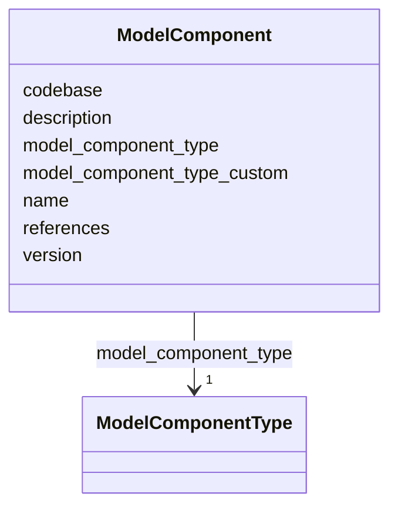

# Class: ModelComponent


_A component of a model (e.g., physics, biogeochemistry/ecosystem)._


URI: [oae:ModelComponent](https://schema.oaedata.org/ModelComponent)





<!-- no inheritance hierarchy -->


## Slots

| Name | Cardinality and Range | Description | Inheritance |
| ---  | --- | --- | --- |
| [description](description.md) | 0..1 <br/> [String](String.md) | A description of the model component characteristics | direct |
| [model_component_type](model_component_type.md) | 1 <br/> [ModelComponentType](ModelComponentType.md) | The type of model component (physics, BGC/ecosystem, or other) | direct |
| [model_component_type_custom](model_component_type_custom.md) | 0..1 <br/> [String](String.md) |  | direct |
| [name](name.md) | 1 <br/> [String](String.md) | Name of the model component (e | direct |
| [version](version.md) | 0..1 <br/> [String](String.md) | Release version of the model component | direct |
| [codebase](codebase.md) | 0..1 <br/> [uri](uri.md) | Link to model code repository | direct |
| [references](references.md) | * <br/> [uri](uri.md) | Links or DOIs to any reference(s) relevant to the model components/developmen... | direct |


## Usages

| used by | used in | type | used |
| ---  | --- | --- | --- |
| [Model](Model.md) | [model_components](model_components.md) | range | [ModelComponent](ModelComponent.md) |


## Identifier and Mapping Information


### Schema Source


* from schema: https://schema.oaedata.org/OAEDataSchema


## Mappings

| Mapping Type | Mapped Value |
| ---  | ---  |
| self | oae:ModelComponent |
| native | oae:ModelComponent |


## LinkML Source

<!-- TODO: investigate https://stackoverflow.com/questions/37606292/how-to-create-tabbed-code-blocks-in-mkdocs-or-sphinx -->

### Direct

<details>
```yaml
name: ModelComponent
description: A component of a model (e.g., physics, biogeochemistry/ecosystem).
from_schema: https://schema.oaedata.org/OAEDataSchema
slots:
- description
slot_usage:
  description:
    name: description
    description: 'A description of the model component characteristics.

      For physics components, this should include the version of equations being solved
      (hydrostatic vs non-hydrostatic), tracer advection scheme, how bottom drag is
      represented, mixed layer parameterizations, sub-grid mixing parameterizations
      if applicable, etc.

      For BGC components, this should include details of which parameters are modeled
      explicitly, derived carbonate system parameters, advection scheme for biological
      tracers, CO₂ solver protocol (e.g., CO₂SYS), links to data/code with biological
      model parameters (e.g., growth and mortality rates), etc. Equations for each
      explicitly modeled parameter should be provided (can be links to publications),
      and it should be noted if any equations or parameter values (e.g. growth rates)
      were modified. Description and/or references of air-sea CO₂ flux parameterization
      used, gas transfer velocity formulation and atmospheric CO₂ details (e.g., fixed
      or time varying, and if time varying which data were used). Also include details
      on whether dissolution and precipitation of calcium carbonate are considered,
      how exchanges between sediment and overlying water are represented (if applicable),
      and whether active feedbacks between biological processes and the carbonate
      system are represented.

      Associated links to data, DOIs, or publications can be noted here, but should
      be supplemental.'
    title: Model Component Description
attributes:
  model_component_type:
    name: model_component_type
    description: The type of model component (physics, BGC/ecosystem, or other).
    title: Model Component Type
    from_schema: Model
    rank: 1000
    domain_of:
    - ModelComponent
    range: ModelComponentType
    required: true
  model_component_type_custom:
    name: model_component_type_custom
    title: Model Component Type (custom)
    from_schema: Model
    rank: 1000
    domain_of:
    - ModelComponent
    range: string
  name:
    name: name
    description: Name of the model component (e.g., ROMS, MARBL, Oceananigans).
    title: Component Name
    from_schema: Model
    domain_of:
    - Organization
    - Project
    - NamedLink
    - ExternalProject
    - MonetaryGrant
    - Experiment
    - Person
    - Dataset
    - Platform
    - ModelComponent
    range: string
    required: true
  version:
    name: version
    description: Release version of the model component.
    title: Version
    from_schema: Model
    domain_of:
    - Container
    - ModelComponent
    range: string
  codebase:
    name: codebase
    description: Link to model code repository.
    title: Codebase
    from_schema: Model
    rank: 1000
    domain_of:
    - ModelComponent
    range: uri
  references:
    name: references
    description: Links or DOIs to any reference(s) relevant to the model components/development,
      specific model configuration, model validation etc.
    title: References
    from_schema: Model
    rank: 1000
    domain_of:
    - ModelComponent
    range: uri
    multivalued: true
rules:
- preconditions:
    slot_conditions:
      model_component_type:
        name: model_component_type
        equals_string: other
  postconditions:
    slot_conditions:
      model_component_type_custom:
        name: model_component_type_custom
        required: true

```
</details>

### Induced

<details>
```yaml
name: ModelComponent
description: A component of a model (e.g., physics, biogeochemistry/ecosystem).
from_schema: https://schema.oaedata.org/OAEDataSchema
slot_usage:
  description:
    name: description
    description: 'A description of the model component characteristics.

      For physics components, this should include the version of equations being solved
      (hydrostatic vs non-hydrostatic), tracer advection scheme, how bottom drag is
      represented, mixed layer parameterizations, sub-grid mixing parameterizations
      if applicable, etc.

      For BGC components, this should include details of which parameters are modeled
      explicitly, derived carbonate system parameters, advection scheme for biological
      tracers, CO₂ solver protocol (e.g., CO₂SYS), links to data/code with biological
      model parameters (e.g., growth and mortality rates), etc. Equations for each
      explicitly modeled parameter should be provided (can be links to publications),
      and it should be noted if any equations or parameter values (e.g. growth rates)
      were modified. Description and/or references of air-sea CO₂ flux parameterization
      used, gas transfer velocity formulation and atmospheric CO₂ details (e.g., fixed
      or time varying, and if time varying which data were used). Also include details
      on whether dissolution and precipitation of calcium carbonate are considered,
      how exchanges between sediment and overlying water are represented (if applicable),
      and whether active feedbacks between biological processes and the carbonate
      system are represented.

      Associated links to data, DOIs, or publications can be noted here, but should
      be supplemental.'
    title: Model Component Description
attributes:
  model_component_type:
    name: model_component_type
    description: The type of model component (physics, BGC/ecosystem, or other).
    title: Model Component Type
    from_schema: Model
    rank: 1000
    alias: model_component_type
    owner: ModelComponent
    domain_of:
    - ModelComponent
    range: ModelComponentType
    required: true
  model_component_type_custom:
    name: model_component_type_custom
    title: Model Component Type (custom)
    from_schema: Model
    rank: 1000
    alias: model_component_type_custom
    owner: ModelComponent
    domain_of:
    - ModelComponent
    range: string
  name:
    name: name
    description: Name of the model component (e.g., ROMS, MARBL, Oceananigans).
    title: Component Name
    from_schema: Model
    alias: name
    owner: ModelComponent
    domain_of:
    - Organization
    - Project
    - NamedLink
    - ExternalProject
    - MonetaryGrant
    - Experiment
    - Person
    - Dataset
    - Platform
    - ModelComponent
    range: string
    required: true
  version:
    name: version
    description: Release version of the model component.
    title: Version
    from_schema: Model
    alias: version
    owner: ModelComponent
    domain_of:
    - Container
    - ModelComponent
    range: string
  codebase:
    name: codebase
    description: Link to model code repository.
    title: Codebase
    from_schema: Model
    rank: 1000
    alias: codebase
    owner: ModelComponent
    domain_of:
    - ModelComponent
    range: uri
  references:
    name: references
    description: Links or DOIs to any reference(s) relevant to the model components/development,
      specific model configuration, model validation etc.
    title: References
    from_schema: Model
    rank: 1000
    alias: references
    owner: ModelComponent
    domain_of:
    - ModelComponent
    range: uri
    multivalued: true
  description:
    name: description
    description: 'A description of the model component characteristics.

      For physics components, this should include the version of equations being solved
      (hydrostatic vs non-hydrostatic), tracer advection scheme, how bottom drag is
      represented, mixed layer parameterizations, sub-grid mixing parameterizations
      if applicable, etc.

      For BGC components, this should include details of which parameters are modeled
      explicitly, derived carbonate system parameters, advection scheme for biological
      tracers, CO₂ solver protocol (e.g., CO₂SYS), links to data/code with biological
      model parameters (e.g., growth and mortality rates), etc. Equations for each
      explicitly modeled parameter should be provided (can be links to publications),
      and it should be noted if any equations or parameter values (e.g. growth rates)
      were modified. Description and/or references of air-sea CO₂ flux parameterization
      used, gas transfer velocity formulation and atmospheric CO₂ details (e.g., fixed
      or time varying, and if time varying which data were used). Also include details
      on whether dissolution and precipitation of calcium carbonate are considered,
      how exchanges between sediment and overlying water are represented (if applicable),
      and whether active feedbacks between biological processes and the carbonate
      system are represented.

      Associated links to data, DOIs, or publications can be noted here, but should
      be supplemental.'
    title: Model Component Description
    from_schema: https://schema.oaedata.org/OAEDataSchema
    rank: 1000
    slot_uri: schema:description
    alias: description
    owner: ModelComponent
    domain_of:
    - Project
    - ExternalProject
    - Experiment
    - PublicComment
    - VocabularyItemReference
    - Dataset
    - ModelComponent
    range: string
rules:
- preconditions:
    slot_conditions:
      model_component_type:
        name: model_component_type
        equals_string: other
  postconditions:
    slot_conditions:
      model_component_type_custom:
        name: model_component_type_custom
        required: true

```
</details>