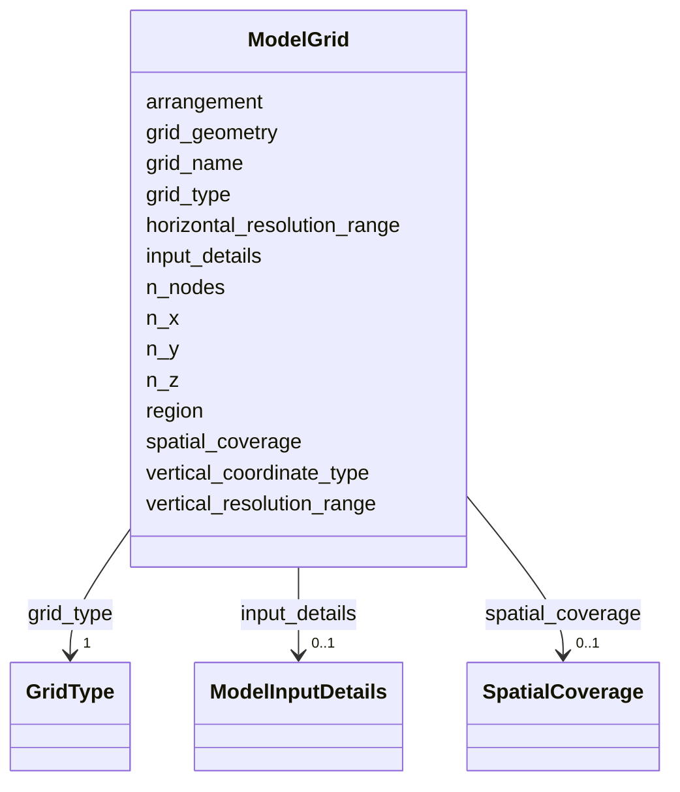

# Class: ModelGrid


_Details about a model grid. Use multiple ModelGrid entries to describe nested or multi-grid configurations._


URI: [oae:ModelGrid](https://schema.oaedata.org/ModelGrid)





<!-- no inheritance hierarchy -->


## Slots

| Name | Cardinality and Range | Description | Inheritance |
| ---  | --- | --- | --- |
| [grid_name](grid_name.md) | 0..1 <br/> [String](String.md) | Name of the grid (e | direct |
| [grid_geometry](grid_geometry.md) | 0..1 <br/> [String](String.md) | Descriptive structure of the grid (e | direct |
| [grid_type](grid_type.md) | 1 <br/> [GridType](GridType.md) | Role of this grid in a nested or multi-grid configuration | direct |
| [region](region.md) | 0..1 <br/> [String](String.md) | Region covered by the grid | direct |
| [spatial_coverage](spatial_coverage.md) | 0..1 <br/> [SpatialCoverage](SpatialCoverage.md) | Bounding box for this grid, expressed as a schema | direct |
| [arrangement](arrangement.md) | 0..1 <br/> [String](String.md) | The grid arrangement of orthogonal physical quantities (e | direct |
| [vertical_coordinate_type](vertical_coordinate_type.md) | 0..1 <br/> [String](String.md) | The vertical grid coordinate type (e | direct |
| [n_x](n_x.md) | 0..1 <br/> [Integer](Integer.md) | Number of grid points in the x-direction | direct |
| [n_y](n_y.md) | 0..1 <br/> [Integer](Integer.md) | Number of grid points in the y-direction | direct |
| [n_z](n_z.md) | 0..1 <br/> [Integer](Integer.md) | Number of vertical coordinate levels | direct |
| [n_nodes](n_nodes.md) | 0..1 <br/> [Integer](Integer.md) | Number of nodes in the grid (for unstructured grids) | direct |
| [horizontal_resolution_range](horizontal_resolution_range.md) | 0..1 <br/> [String](String.md) | Description of horizontal resolution (e | direct |
| [vertical_resolution_range](vertical_resolution_range.md) | 0..1 <br/> [String](String.md) | Description of vertical resolution (e | direct |
| [input_details](input_details.md) | 0..1 <br/> [ModelInputDetails](ModelInputDetails.md) | Details about input data sources used to drive the model on this grid | direct |


## Usages

| used by | used in | type | used |
| ---  | --- | --- | --- |
| [Model](Model.md) | [grid_details](grid_details.md) | range | [ModelGrid](ModelGrid.md) |


## Identifier and Mapping Information


### Schema Source


* from schema: https://schema.oaedata.org/OAEDataSchema


## Mappings

| Mapping Type | Mapped Value |
| ---  | ---  |
| self | oae:ModelGrid |
| native | oae:ModelGrid |


## LinkML Source

<!-- TODO: investigate https://stackoverflow.com/questions/37606292/how-to-create-tabbed-code-blocks-in-mkdocs-or-sphinx -->

### Direct

<details>
```yaml
name: ModelGrid
description: Details about a model grid. Use multiple ModelGrid entries to describe
  nested or multi-grid configurations.
from_schema: https://schema.oaedata.org/OAEDataSchema
attributes:
  grid_name:
    name: grid_name
    description: Name of the grid (e.g., 'inner grid', 'L1', 'global').
    title: Grid Name
    from_schema: Model
    rank: 1000
    domain_of:
    - ModelGrid
    range: string
  grid_geometry:
    name: grid_geometry
    description: Descriptive structure of the grid (e.g., latitude-longitude, unstructured
      triangular, tripolar).
    title: Grid Geometry
    from_schema: Model
    rank: 1000
    domain_of:
    - ModelGrid
    range: string
  grid_type:
    name: grid_type
    description: Role of this grid in a nested or multi-grid configuration.
    title: Grid Type
    from_schema: Model
    rank: 1000
    domain_of:
    - ModelGrid
    range: GridType
    required: true
  region:
    name: region
    description: Region covered by the grid.
    title: Region
    from_schema: Model
    rank: 1000
    domain_of:
    - ModelGrid
    range: string
  spatial_coverage:
    name: spatial_coverage
    description: Bounding box for this grid, expressed as a schema.org GeoShape bounding
      box.
    title: Spatial Coverage
    from_schema: Model
    domain_of:
    - Project
    - ExternalProject
    - Experiment
    - ModelGrid
    range: SpatialCoverage
  arrangement:
    name: arrangement
    description: The grid arrangement of orthogonal physical quantities (e.g., Arakawa
      A, Arakawa B, Arakawa C).
    title: Arrangement
    from_schema: Model
    rank: 1000
    domain_of:
    - ModelGrid
    range: string
  vertical_coordinate_type:
    name: vertical_coordinate_type
    description: The vertical grid coordinate type (e.g. z-coordinate, z*-coordinate,
      terrain-following coordinate, isopycnal coordinate)
    title: Vertical coordinate type
    from_schema: Model
    rank: 1000
    domain_of:
    - ModelGrid
    range: string
  n_x:
    name: n_x
    description: Number of grid points in the x-direction.
    title: Nx
    from_schema: Model
    rank: 1000
    domain_of:
    - ModelGrid
    range: integer
  n_y:
    name: n_y
    description: Number of grid points in the y-direction.
    title: Ny
    from_schema: Model
    rank: 1000
    domain_of:
    - ModelGrid
    range: integer
  n_z:
    name: n_z
    description: Number of vertical coordinate levels.
    title: Nz
    from_schema: Model
    rank: 1000
    domain_of:
    - ModelGrid
    range: integer
  n_nodes:
    name: n_nodes
    description: Number of nodes in the grid (for unstructured grids).
    title: N nodes
    from_schema: Model
    rank: 1000
    domain_of:
    - ModelGrid
    range: integer
  horizontal_resolution_range:
    name: horizontal_resolution_range
    description: Description of horizontal resolution (e.g., '3.3 km', '1/12 degree').
    title: Horizontal Resolution Range
    from_schema: Model
    rank: 1000
    domain_of:
    - ModelGrid
    range: string
  vertical_resolution_range:
    name: vertical_resolution_range
    description: Description of vertical resolution (e.g., 'Max. 4 m near surface,
      stretching to 500 m at depth').
    title: Vertical Resolution Range
    from_schema: Model
    rank: 1000
    domain_of:
    - ModelGrid
    range: string
  input_details:
    name: input_details
    description: Details about input data sources used to drive the model on this
      grid.
    title: Input Details
    from_schema: Model
    rank: 1000
    domain_of:
    - ModelGrid
    range: ModelInputDetails
    inlined: true

```
</details>

### Induced

<details>
```yaml
name: ModelGrid
description: Details about a model grid. Use multiple ModelGrid entries to describe
  nested or multi-grid configurations.
from_schema: https://schema.oaedata.org/OAEDataSchema
attributes:
  grid_name:
    name: grid_name
    description: Name of the grid (e.g., 'inner grid', 'L1', 'global').
    title: Grid Name
    from_schema: Model
    rank: 1000
    alias: grid_name
    owner: ModelGrid
    domain_of:
    - ModelGrid
    range: string
  grid_geometry:
    name: grid_geometry
    description: Descriptive structure of the grid (e.g., latitude-longitude, unstructured
      triangular, tripolar).
    title: Grid Geometry
    from_schema: Model
    rank: 1000
    alias: grid_geometry
    owner: ModelGrid
    domain_of:
    - ModelGrid
    range: string
  grid_type:
    name: grid_type
    description: Role of this grid in a nested or multi-grid configuration.
    title: Grid Type
    from_schema: Model
    rank: 1000
    alias: grid_type
    owner: ModelGrid
    domain_of:
    - ModelGrid
    range: GridType
    required: true
  region:
    name: region
    description: Region covered by the grid.
    title: Region
    from_schema: Model
    rank: 1000
    alias: region
    owner: ModelGrid
    domain_of:
    - ModelGrid
    range: string
  spatial_coverage:
    name: spatial_coverage
    description: Bounding box for this grid, expressed as a schema.org GeoShape bounding
      box.
    title: Spatial Coverage
    from_schema: Model
    alias: spatial_coverage
    owner: ModelGrid
    domain_of:
    - Project
    - ExternalProject
    - Experiment
    - ModelGrid
    range: SpatialCoverage
  arrangement:
    name: arrangement
    description: The grid arrangement of orthogonal physical quantities (e.g., Arakawa
      A, Arakawa B, Arakawa C).
    title: Arrangement
    from_schema: Model
    rank: 1000
    alias: arrangement
    owner: ModelGrid
    domain_of:
    - ModelGrid
    range: string
  vertical_coordinate_type:
    name: vertical_coordinate_type
    description: The vertical grid coordinate type (e.g. z-coordinate, z*-coordinate,
      terrain-following coordinate, isopycnal coordinate)
    title: Vertical coordinate type
    from_schema: Model
    rank: 1000
    alias: vertical_coordinate_type
    owner: ModelGrid
    domain_of:
    - ModelGrid
    range: string
  n_x:
    name: n_x
    description: Number of grid points in the x-direction.
    title: Nx
    from_schema: Model
    rank: 1000
    alias: n_x
    owner: ModelGrid
    domain_of:
    - ModelGrid
    range: integer
  n_y:
    name: n_y
    description: Number of grid points in the y-direction.
    title: Ny
    from_schema: Model
    rank: 1000
    alias: n_y
    owner: ModelGrid
    domain_of:
    - ModelGrid
    range: integer
  n_z:
    name: n_z
    description: Number of vertical coordinate levels.
    title: Nz
    from_schema: Model
    rank: 1000
    alias: n_z
    owner: ModelGrid
    domain_of:
    - ModelGrid
    range: integer
  n_nodes:
    name: n_nodes
    description: Number of nodes in the grid (for unstructured grids).
    title: N nodes
    from_schema: Model
    rank: 1000
    alias: n_nodes
    owner: ModelGrid
    domain_of:
    - ModelGrid
    range: integer
  horizontal_resolution_range:
    name: horizontal_resolution_range
    description: Description of horizontal resolution (e.g., '3.3 km', '1/12 degree').
    title: Horizontal Resolution Range
    from_schema: Model
    rank: 1000
    alias: horizontal_resolution_range
    owner: ModelGrid
    domain_of:
    - ModelGrid
    range: string
  vertical_resolution_range:
    name: vertical_resolution_range
    description: Description of vertical resolution (e.g., 'Max. 4 m near surface,
      stretching to 500 m at depth').
    title: Vertical Resolution Range
    from_schema: Model
    rank: 1000
    alias: vertical_resolution_range
    owner: ModelGrid
    domain_of:
    - ModelGrid
    range: string
  input_details:
    name: input_details
    description: Details about input data sources used to drive the model on this
      grid.
    title: Input Details
    from_schema: Model
    rank: 1000
    alias: input_details
    owner: ModelGrid
    domain_of:
    - ModelGrid
    range: ModelInputDetails
    inlined: true

```
</details>