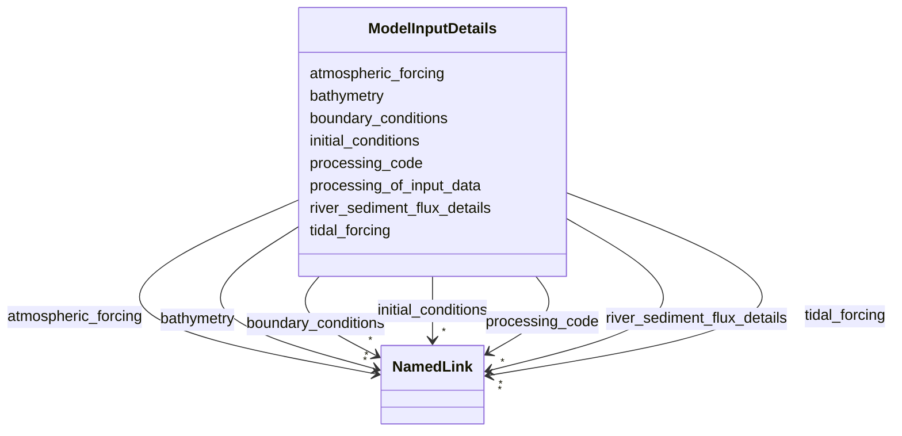

# Class: ModelInputDetails


_Details about input data sources used to drive the model._


URI: [oae:ModelInputDetails](https://schema.oaedata.org/ModelInputDetails)





<!-- no inheritance hierarchy -->


## Slots

| Name | Cardinality and Range | Description | Inheritance |
| ---  | --- | --- | --- |
| [bathymetry](bathymetry.md) | * <br/> [NamedLink](NamedLink.md) | Bathymetry data source(s) | direct |
| [initial_conditions](initial_conditions.md) | * <br/> [NamedLink](NamedLink.md) | Initial condition data source(s) | direct |
| [boundary_conditions](boundary_conditions.md) | * <br/> [NamedLink](NamedLink.md) | Boundary condition data source(s) | direct |
| [atmospheric_forcing](atmospheric_forcing.md) | * <br/> [NamedLink](NamedLink.md) | Atmospheric forcing data source(s) | direct |
| [tidal_forcing](tidal_forcing.md) | * <br/> [NamedLink](NamedLink.md) | Tidal forcing data source(s) | direct |
| [river_sediment_flux_details](river_sediment_flux_details.md) | * <br/> [NamedLink](NamedLink.md) | River and/or sediment flux data source(s) | direct |
| [processing_of_input_data](processing_of_input_data.md) | 0..1 <br/> [String](String.md) | Narrative description of any processing applied to input data before use in t... | direct |
| [processing_code](processing_code.md) | * <br/> [NamedLink](NamedLink.md) | If applicable, link to any code for processing of raw forcing and input data ... | direct |


## Usages

| used by | used in | type | used |
| ---  | --- | --- | --- |
| [ModelGrid](ModelGrid.md) | [input_details](input_details.md) | range | [ModelInputDetails](ModelInputDetails.md) |


## Identifier and Mapping Information


### Schema Source


* from schema: https://schema.oaedata.org/OAEDataSchema


## Mappings

| Mapping Type | Mapped Value |
| ---  | ---  |
| self | oae:ModelInputDetails |
| native | oae:ModelInputDetails |


## LinkML Source

<!-- TODO: investigate https://stackoverflow.com/questions/37606292/how-to-create-tabbed-code-blocks-in-mkdocs-or-sphinx -->

### Direct

<details>
```yaml
name: ModelInputDetails
description: Details about input data sources used to drive the model.
from_schema: https://schema.oaedata.org/OAEDataSchema
attributes:
  bathymetry:
    name: bathymetry
    description: Bathymetry data source(s).
    title: Bathymetry
    from_schema: Model
    rank: 1000
    domain_of:
    - ModelInputDetails
    range: NamedLink
    multivalued: true
    inlined: true
    inlined_as_list: true
  initial_conditions:
    name: initial_conditions
    description: Initial condition data source(s).
    title: Initial Conditions
    from_schema: Model
    rank: 1000
    domain_of:
    - ModelInputDetails
    range: NamedLink
    multivalued: true
    inlined: true
    inlined_as_list: true
  boundary_conditions:
    name: boundary_conditions
    description: Boundary condition data source(s).
    title: Boundary Conditions
    from_schema: Model
    rank: 1000
    domain_of:
    - ModelInputDetails
    range: NamedLink
    multivalued: true
    inlined: true
    inlined_as_list: true
  atmospheric_forcing:
    name: atmospheric_forcing
    description: Atmospheric forcing data source(s).
    title: Atmospheric Forcing
    from_schema: Model
    rank: 1000
    domain_of:
    - ModelInputDetails
    range: NamedLink
    multivalued: true
    inlined: true
    inlined_as_list: true
  tidal_forcing:
    name: tidal_forcing
    description: Tidal forcing data source(s).
    title: Tidal Forcing
    from_schema: Model
    rank: 1000
    domain_of:
    - ModelInputDetails
    range: NamedLink
    multivalued: true
    inlined: true
    inlined_as_list: true
  river_sediment_flux_details:
    name: river_sediment_flux_details
    description: River and/or sediment flux data source(s).
    title: River/Sediment Flux Details
    from_schema: Model
    rank: 1000
    domain_of:
    - ModelInputDetails
    range: NamedLink
    multivalued: true
    inlined: true
    inlined_as_list: true
  processing_of_input_data:
    name: processing_of_input_data
    description: Narrative description of any processing applied to input data before
      use in the model.
    title: Processing of Input Data
    from_schema: Model
    rank: 1000
    domain_of:
    - ModelInputDetails
    range: string
  processing_code:
    name: processing_code
    description: If applicable, link to any code for processing of raw forcing and
      input data listed in the fields above.
    title: Processing code
    from_schema: Model
    rank: 1000
    domain_of:
    - ModelInputDetails
    range: NamedLink
    multivalued: true
    inlined: true
    inlined_as_list: true

```
</details>

### Induced

<details>
```yaml
name: ModelInputDetails
description: Details about input data sources used to drive the model.
from_schema: https://schema.oaedata.org/OAEDataSchema
attributes:
  bathymetry:
    name: bathymetry
    description: Bathymetry data source(s).
    title: Bathymetry
    from_schema: Model
    rank: 1000
    alias: bathymetry
    owner: ModelInputDetails
    domain_of:
    - ModelInputDetails
    range: NamedLink
    multivalued: true
    inlined: true
    inlined_as_list: true
  initial_conditions:
    name: initial_conditions
    description: Initial condition data source(s).
    title: Initial Conditions
    from_schema: Model
    rank: 1000
    alias: initial_conditions
    owner: ModelInputDetails
    domain_of:
    - ModelInputDetails
    range: NamedLink
    multivalued: true
    inlined: true
    inlined_as_list: true
  boundary_conditions:
    name: boundary_conditions
    description: Boundary condition data source(s).
    title: Boundary Conditions
    from_schema: Model
    rank: 1000
    alias: boundary_conditions
    owner: ModelInputDetails
    domain_of:
    - ModelInputDetails
    range: NamedLink
    multivalued: true
    inlined: true
    inlined_as_list: true
  atmospheric_forcing:
    name: atmospheric_forcing
    description: Atmospheric forcing data source(s).
    title: Atmospheric Forcing
    from_schema: Model
    rank: 1000
    alias: atmospheric_forcing
    owner: ModelInputDetails
    domain_of:
    - ModelInputDetails
    range: NamedLink
    multivalued: true
    inlined: true
    inlined_as_list: true
  tidal_forcing:
    name: tidal_forcing
    description: Tidal forcing data source(s).
    title: Tidal Forcing
    from_schema: Model
    rank: 1000
    alias: tidal_forcing
    owner: ModelInputDetails
    domain_of:
    - ModelInputDetails
    range: NamedLink
    multivalued: true
    inlined: true
    inlined_as_list: true
  river_sediment_flux_details:
    name: river_sediment_flux_details
    description: River and/or sediment flux data source(s).
    title: River/Sediment Flux Details
    from_schema: Model
    rank: 1000
    alias: river_sediment_flux_details
    owner: ModelInputDetails
    domain_of:
    - ModelInputDetails
    range: NamedLink
    multivalued: true
    inlined: true
    inlined_as_list: true
  processing_of_input_data:
    name: processing_of_input_data
    description: Narrative description of any processing applied to input data before
      use in the model.
    title: Processing of Input Data
    from_schema: Model
    rank: 1000
    alias: processing_of_input_data
    owner: ModelInputDetails
    domain_of:
    - ModelInputDetails
    range: string
  processing_code:
    name: processing_code
    description: If applicable, link to any code for processing of raw forcing and
      input data listed in the fields above.
    title: Processing code
    from_schema: Model
    rank: 1000
    alias: processing_code
    owner: ModelInputDetails
    domain_of:
    - ModelInputDetails
    range: NamedLink
    multivalued: true
    inlined: true
    inlined_as_list: true

```
</details>