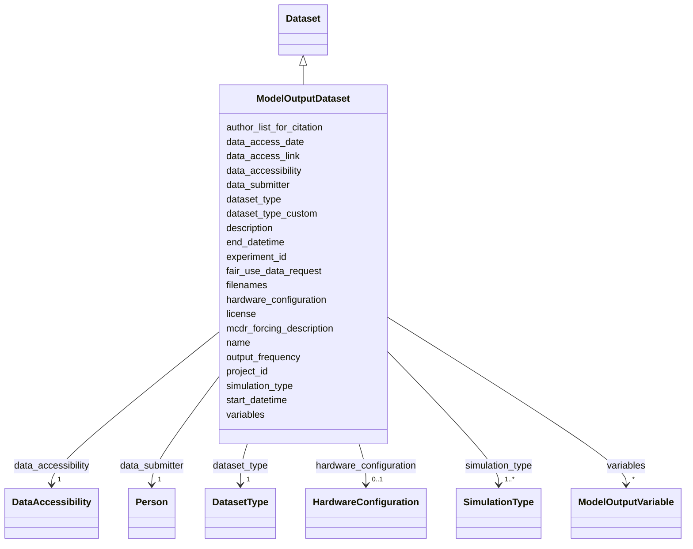

# Class: ModelOutputDataset


_A model simulation output dataset. Contains fields specific to computational model output including simulation configuration, output variables, and hardware information._


URI: [oae:ModelOutputDataset](https://schema.oaedata.org/ModelOutputDataset)





## Inheritance
* [Dataset](Dataset.md)
    * **ModelOutputDataset**


## Slots

| Name | Cardinality and Range | Description | Inheritance |
| ---  | --- | --- | --- |
| [variables](variables.md) | * <br/> [ModelOutputVariable](ModelOutputVariable.md) | The variables in this dataset, each with its own metadata | direct |
| [simulation_type](simulation_type.md) | 1..* <br/> [SimulationType](SimulationType.md) | The type(s) of model simulation (e | direct |
| [start_datetime](start_datetime.md) | 1 <br/> [Datetime](Datetime.md) | Start date and time of the simulation in UTC ISO-8601 | direct |
| [end_datetime](end_datetime.md) | 1 <br/> [Datetime](Datetime.md) | End date and time of the simulation in UTC ISO-8601 | direct |
| [output_frequency](output_frequency.md) | 0..1 <br/> [String](String.md) | Frequency of model output (e | direct |
| [mcdr_forcing_description](mcdr_forcing_description.md) | 0..1 <br/> [String](String.md) | Description of the mCDR forcing applied in the simulation (e | direct |
| [hardware_configuration](hardware_configuration.md) | 0..1 <br/> [HardwareConfiguration](HardwareConfiguration.md) | Details about the computational hardware used for the simulation | direct |
| [name](name.md) | 1 <br/> [String](String.md) | A brief descriptive sentence that summarizes the content of a dataset | [Dataset](Dataset.md) |
| [description](description.md) | 1 <br/> [String](String.md) | The abstract of a dataset is a brief summary that provides an overview of the... | [Dataset](Dataset.md) |
| [project_id](project_id.md) | 1 <br/> [String](String.md) | The project to which the submitted data belong | [Dataset](Dataset.md) |
| [experiment_id](experiment_id.md) | 1 <br/> [String](String.md) | The experiment to which the data belong | [Dataset](Dataset.md) |
| [filenames](filenames.md) | 1..* <br/> [String](String.md) |  | [Dataset](Dataset.md) |
| [dataset_type](dataset_type.md) | 1 <br/> [DatasetType](DatasetType.md) | Selected controlled vocabularies for data types relevant to mCDR have been re... | [Dataset](Dataset.md) |
| [dataset_type_custom](dataset_type_custom.md) | 0..1 <br/> [String](String.md) | Custom "data type" when an appropriate value is not found in the controlled v... | [Dataset](Dataset.md) |
| [data_submitter](data_submitter.md) | 1 <br/> [Person](Person.md) | Information about the individual submitting the dataset(s), including contact... | [Dataset](Dataset.md) |
| [author_list_for_citation](author_list_for_citation.md) | 0..1 <br/> [String](String.md) | Author list in the format of Lastname1, Firstname1 Middlename1; Lastname2, Fi... | [Dataset](Dataset.md) |
| [license](license.md) | 0..1 <br/> [uri](uri.md) | Link a Dataset to its license to document legal constraints by adding a schem... | [Dataset](Dataset.md) |
| [fair_use_data_request](fair_use_data_request.md) | 0..1 <br/> [String](String.md) | A statement from the data producer regarding how this dataset should be used | [Dataset](Dataset.md) |
| [data_accessibility](data_accessibility.md) | 1 <br/> [DataAccessibility](DataAccessibility.md) | Level of access to this dataset | [Dataset](Dataset.md) |
| [data_access_link](data_access_link.md) | 0..1 <br/> [uri](uri.md) | URL to access this dataset, if it is already archived or published elsewhere | [Dataset](Dataset.md) |
| [data_access_date](data_access_date.md) | 0..1 <br/> [Date](Date.md) | The date by when this dataset will be openly available on a public repository | [Dataset](Dataset.md) |


## Usages

| used by | used in | type | used |
| ---  | --- | --- | --- |
| [Container](Container.md) | [datasets](datasets.md) | any_of[range] | [ModelOutputDataset](ModelOutputDataset.md) |


## Identifier and Mapping Information


### Schema Source


* from schema: https://schema.oaedata.org/OAEDataSchema


## Mappings

| Mapping Type | Mapped Value |
| ---  | ---  |
| self | oae:ModelOutputDataset |
| native | oae:ModelOutputDataset |


## LinkML Source

<!-- TODO: investigate https://stackoverflow.com/questions/37606292/how-to-create-tabbed-code-blocks-in-mkdocs-or-sphinx -->

### Direct

<details>
```yaml
name: ModelOutputDataset
description: A model simulation output dataset. Contains fields specific to computational
  model output including simulation configuration, output variables, and hardware
  information.
from_schema: https://schema.oaedata.org/OAEDataSchema
is_a: Dataset
slots:
- variables
slot_usage:
  filenames:
    name: filenames
    title: Model Output Filenames
  variables:
    name: variables
    range: ModelOutputVariable
attributes:
  simulation_type:
    name: simulation_type
    description: The type(s) of model simulation (e.g., counterfactual, perturbation,
      or both).
    title: Simulation Type
    from_schema: Dataset
    rank: 1000
    domain_of:
    - ModelOutputDataset
    range: SimulationType
    required: true
    multivalued: true
    minimum_cardinality: 1
  start_datetime:
    name: start_datetime
    description: Start date and time of the simulation in UTC ISO-8601.
    title: Start Date and Time
    from_schema: Dataset
    domain_of:
    - Experiment
    - ModelOutputDataset
    range: datetime
    required: true
  end_datetime:
    name: end_datetime
    description: End date and time of the simulation in UTC ISO-8601.
    title: End Date and Time
    from_schema: Dataset
    domain_of:
    - Experiment
    - ModelOutputDataset
    range: datetime
    required: true
  output_frequency:
    name: output_frequency
    description: Frequency of model output (e.g., 'hourly mean', 'daily mean').
    title: Output Frequency
    from_schema: Dataset
    rank: 1000
    domain_of:
    - ModelOutputDataset
    range: string
  mcdr_forcing_description:
    name: mcdr_forcing_description
    description: Description of the mCDR forcing applied in the simulation (e.g.,
      the alkalinity perturbation). Required when simulation_type is "perturbation".
    title: Description of mCDR Forcing
    from_schema: Dataset
    rank: 1000
    domain_of:
    - ModelOutputDataset
    range: string
  hardware_configuration:
    name: hardware_configuration
    description: Details about the computational hardware used for the simulation.
    title: Hardware Configuration
    from_schema: Dataset
    rank: 1000
    domain_of:
    - ModelOutputDataset
    range: HardwareConfiguration
    inlined: true
rules:
- preconditions:
    slot_conditions:
      simulation_type:
        name: simulation_type
        has_member:
          equals_string: perturbation
  postconditions:
    slot_conditions:
      mcdr_forcing_description:
        name: mcdr_forcing_description
        required: true

```
</details>

### Induced

<details>
```yaml
name: ModelOutputDataset
description: A model simulation output dataset. Contains fields specific to computational
  model output including simulation configuration, output variables, and hardware
  information.
from_schema: https://schema.oaedata.org/OAEDataSchema
is_a: Dataset
slot_usage:
  filenames:
    name: filenames
    title: Model Output Filenames
  variables:
    name: variables
    range: ModelOutputVariable
attributes:
  simulation_type:
    name: simulation_type
    description: The type(s) of model simulation (e.g., counterfactual, perturbation,
      or both).
    title: Simulation Type
    from_schema: Dataset
    rank: 1000
    alias: simulation_type
    owner: ModelOutputDataset
    domain_of:
    - ModelOutputDataset
    range: SimulationType
    required: true
    multivalued: true
    minimum_cardinality: 1
  start_datetime:
    name: start_datetime
    description: Start date and time of the simulation in UTC ISO-8601.
    title: Start Date and Time
    from_schema: Dataset
    alias: start_datetime
    owner: ModelOutputDataset
    domain_of:
    - Experiment
    - ModelOutputDataset
    range: datetime
    required: true
  end_datetime:
    name: end_datetime
    description: End date and time of the simulation in UTC ISO-8601.
    title: End Date and Time
    from_schema: Dataset
    alias: end_datetime
    owner: ModelOutputDataset
    domain_of:
    - Experiment
    - ModelOutputDataset
    range: datetime
    required: true
  output_frequency:
    name: output_frequency
    description: Frequency of model output (e.g., 'hourly mean', 'daily mean').
    title: Output Frequency
    from_schema: Dataset
    rank: 1000
    alias: output_frequency
    owner: ModelOutputDataset
    domain_of:
    - ModelOutputDataset
    range: string
  mcdr_forcing_description:
    name: mcdr_forcing_description
    description: Description of the mCDR forcing applied in the simulation (e.g.,
      the alkalinity perturbation). Required when simulation_type is "perturbation".
    title: Description of mCDR Forcing
    from_schema: Dataset
    rank: 1000
    alias: mcdr_forcing_description
    owner: ModelOutputDataset
    domain_of:
    - ModelOutputDataset
    range: string
  hardware_configuration:
    name: hardware_configuration
    description: Details about the computational hardware used for the simulation.
    title: Hardware Configuration
    from_schema: Dataset
    rank: 1000
    alias: hardware_configuration
    owner: ModelOutputDataset
    domain_of:
    - ModelOutputDataset
    range: HardwareConfiguration
    inlined: true
  variables:
    name: variables
    description: The variables in this dataset, each with its own metadata.
    title: Variables
    from_schema: https://schema.oaedata.org/OAEDataSchema
    rank: 1000
    slot_uri: schema:variableMeasured
    alias: variables
    owner: ModelOutputDataset
    domain_of:
    - FieldDataset
    - ModelOutputDataset
    range: ModelOutputVariable
    multivalued: true
  name:
    name: name
    description: 'A brief descriptive sentence that summarizes the content of a dataset.
      Here is one example:

      "Dissolved inorganic carbon, total alkalinity, pH, temperature, salinity and
      other variables collected from profile and discrete sample observations using
      CTD, Niskin bottle, and other instruments from R/V Wecoma in the U.S. West Coast
      California Current System during the 2011 West Coast Ocean Acidification Cruise
      (WCOA2011) from 2011-08-12 to 2011-08-30"'
    title: Dataset Title
    from_schema: https://schema.oaedata.org/OAEDataSchema
    rank: 1000
    slot_uri: schema:name
    alias: name
    owner: ModelOutputDataset
    domain_of:
    - Organization
    - Project
    - NamedLink
    - ExternalProject
    - MonetaryGrant
    - Experiment
    - Person
    - Dataset
    - Platform
    - ModelComponent
    range: string
    required: true
  description:
    name: description
    description: The abstract of a dataset is a brief summary that provides an overview
      of the dataset's content, purpose, and scope. It is used to provide context
      and background information to users who are interested in using the dataset.
      An abstract may include information such as the dataset's source, how the data
      was collected or generated, the variables or attributes included in the dataset,
      and any limitations or restrictions on the use of the data. It may also include
      information on how the data can be accessed or used.
    title: Description
    from_schema: https://schema.oaedata.org/OAEDataSchema
    rank: 1000
    slot_uri: schema:description
    alias: description
    owner: ModelOutputDataset
    domain_of:
    - Project
    - ExternalProject
    - Experiment
    - PublicComment
    - VocabularyItemReference
    - Dataset
    - ModelComponent
    range: string
    required: true
  project_id:
    name: project_id
    description: 'The project to which the submitted data belong. A unique project
      identifier that can be used to link project data across data submissions, and
      link baseline data to intervention data, for example.

      If no Project ID has been assigned, one may be generated by combining: lead
      organizer surname and first initial or company, a unique date, and location.

      Any method that creates a unique ID that will link all project data is acceptable.'
    title: Project ID
    from_schema: https://schema.oaedata.org/OAEDataSchema
    rank: 1000
    alias: project_id
    owner: ModelOutputDataset
    domain_of:
    - Project
    - Experiment
    - Dataset
    range: string
    required: true
  experiment_id:
    name: experiment_id
    description: 'The experiment to which the data belong. Any naming convention that
      produces a unique ID is usable. The recommended naming convention is:

      Project ID + Experiment type + Optional numerical indicator to differentiate
      between various experiments of the same type for a project. A two digit consecutive
      number beginning with 01'
    title: Experiment ID
    from_schema: https://schema.oaedata.org/OAEDataSchema
    rank: 1000
    alias: experiment_id
    owner: ModelOutputDataset
    domain_of:
    - Experiment
    - Dataset
    range: string
    required: true
  filenames:
    name: filenames
    title: Model Output Filenames
    from_schema: https://schema.oaedata.org/OAEDataSchema
    rank: 1000
    alias: filenames
    owner: ModelOutputDataset
    domain_of:
    - Dataset
    range: string
    required: true
    multivalued: true
    minimum_cardinality: 1
  dataset_type:
    name: dataset_type
    description: Selected controlled vocabularies for data types relevant to mCDR
      have been referenced from NASA's SeaBASS metadata system and are provided below,
      for additional data types of optical characteristics see the [SeaBASS controlled
      definitions list](https://seabass.gsfc.nasa.gov/wiki/metadataheaders#data_type).
      Additional data types have been included to meet the needs of mCDR field projects.
    title: Dataset Type
    from_schema: Dataset
    rank: 1000
    alias: dataset_type
    owner: ModelOutputDataset
    domain_of:
    - Dataset
    range: DatasetType
    required: true
  dataset_type_custom:
    name: dataset_type_custom
    description: Custom "data type" when an appropriate value is not found in the
      controlled vocabulary list for mCDR Data Type and the corresponding `data_type`
      field is set to "other".
    title: Dataset Type (Custom)
    from_schema: Dataset
    rank: 1000
    alias: dataset_type_custom
    owner: ModelOutputDataset
    domain_of:
    - Dataset
    range: string
  data_submitter:
    name: data_submitter
    description: Information about the individual submitting the dataset(s), including
      contact information
    title: Data Submitter
    from_schema: Dataset
    rank: 1000
    alias: data_submitter
    owner: ModelOutputDataset
    domain_of:
    - Dataset
    range: Person
    required: true
  author_list_for_citation:
    name: author_list_for_citation
    description: Author list in the format of Lastname1, Firstname1 Middlename1; Lastname2,
      Firstname2 Middlename2; ...
    title: Author List (for citation)
    from_schema: Dataset
    rank: 1000
    alias: author_list_for_citation
    owner: ModelOutputDataset
    domain_of:
    - Dataset
    range: string
  license:
    name: license
    description: Link a Dataset to its license to document legal constraints by adding
      a schema:license property. The guide recommends providing a URL that unambiguously
      identifies a specific version of the license used, but for many licenses it
      is hard to determine what that URL should be. Thus, we recommend that the license
      URL be drawn from the [SPDX license list](https://spdx.org/licenses/), which
      provides a curated list of licenses and their properties that is well maintained.
      For each SPDX entry, SPDX provides a canonical URL for the license (e.g., http://spdx.org/licenses/CC0-1.0),
      a unique licenseId (e.g., CC0-1.0), and other metadata about the license.
    title: License
    from_schema: Dataset
    rank: 1000
    slot_uri: schema:license
    alias: license
    owner: ModelOutputDataset
    domain_of:
    - Dataset
    range: uri
  fair_use_data_request:
    name: fair_use_data_request
    description: A statement from the data producer regarding how this dataset should
      be used.
    title: Fair Use Data Request
    from_schema: Dataset
    rank: 1000
    alias: fair_use_data_request
    owner: ModelOutputDataset
    domain_of:
    - Dataset
    range: string
  data_accessibility:
    name: data_accessibility
    description: Level of access to this dataset. Open Access data are freely available
      now, without restriction. Conditional Access data are available upon request,
      subject to review. Scheduled Access data will become openly available after
      a specified date; choose it for any data that are not openly available yet.
    title: Data Accessibility
    from_schema: Dataset
    rank: 1000
    alias: data_accessibility
    owner: ModelOutputDataset
    domain_of:
    - Dataset
    range: DataAccessibility
    required: true
  data_access_link:
    name: data_access_link
    description: URL to access this dataset, if it is already archived or published
      elsewhere. DOIs are preferred if available (e.g., https://doi.org/10.25921/xxxx-xxx).
      Required for open access, optional otherwise.
    title: Data Access Link
    from_schema: Dataset
    rank: 1000
    alias: data_access_link
    owner: ModelOutputDataset
    domain_of:
    - Dataset
    range: uri
    pattern: ^https?://.+
  data_access_date:
    name: data_access_date
    description: The date by when this dataset will be openly available on a public
      repository. Only used when data_accessibility is scheduled_access; leave empty
      otherwise.
    title: Data Access Date
    from_schema: Dataset
    rank: 1000
    alias: data_access_date
    owner: ModelOutputDataset
    domain_of:
    - Dataset
    range: date
rules:
- preconditions:
    slot_conditions:
      simulation_type:
        name: simulation_type
        has_member:
          equals_string: perturbation
  postconditions:
    slot_conditions:
      mcdr_forcing_description:
        name: mcdr_forcing_description
        required: true

```
</details>