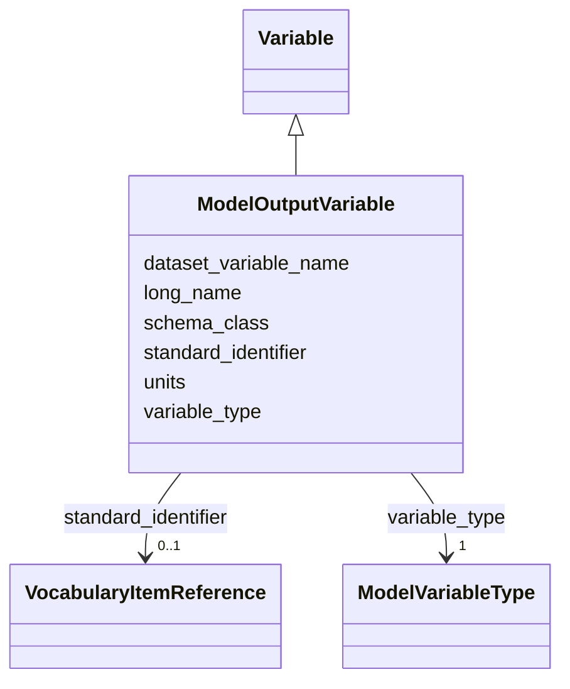

# Class: ModelOutputVariable


_A variable output by a model simulation (e.g., air-sea CO2 flux, dissolved inorganic carbon, total alkalinity, pH, temperature, salinity from an OAE model run). Model outputs are produced by the simulation itself, so they carry none of the sampling, instrument, calibration or in-situ QC metadata that field-collected variables do — how the output was produced is described by the simulation configuration on the parent ModelOutputDataset._


URI: [oae:ModelOutputVariable](https://schema.oaedata.org/ModelOutputVariable)





## Inheritance
* [Variable](Variable.md)
    * **ModelOutputVariable**


## Slots

| Name | Cardinality and Range | Description | Inheritance |
| ---  | --- | --- | --- |
| [units](units.md) | 1 <br/> [String](String.md) | Unit of measurement for this variable | [Variable](Variable.md) |
| [variable_type](variable_type.md) | 1 <br/> [ModelVariableType](ModelVariableType.md) | Which model output quantity this variable holds | [Variable](Variable.md) |
| [schema_class](schema_class.md) | 1 <br/> [String](String.md) | The schema class name for this variable (e | [Variable](Variable.md) |
| [standard_identifier](standard_identifier.md) | 0..1 <br/> [VocabularyItemReference](VocabularyItemReference.md) | A term from a community vocabulary that identifies this variable | [Variable](Variable.md) |
| [dataset_variable_name](dataset_variable_name.md) | 1 <br/> [String](String.md) | The name for the variable as it is identified in the dataset data file | [Variable](Variable.md) |
| [long_name](long_name.md) | 1 <br/> [String](String.md) | Full descriptive name of the variable | [Variable](Variable.md) |


## Usages

| used by | used in | type | used |
| ---  | --- | --- | --- |
| [ModelOutputDataset](ModelOutputDataset.md) | [variables](variables.md) | range | [ModelOutputVariable](ModelOutputVariable.md) |


## Identifier and Mapping Information


### Schema Source


* from schema: https://schema.oaedata.org/OAEDataSchema


## Mappings

| Mapping Type | Mapped Value |
| ---  | ---  |
| self | oae:ModelOutputVariable |
| native | oae:ModelOutputVariable |


## LinkML Source

<!-- TODO: investigate https://stackoverflow.com/questions/37606292/how-to-create-tabbed-code-blocks-in-mkdocs-or-sphinx -->

### Direct

<details>
```yaml
name: ModelOutputVariable
description: A variable output by a model simulation (e.g., air-sea CO2 flux, dissolved
  inorganic carbon, total alkalinity, pH, temperature, salinity from an OAE model
  run). Model outputs are produced by the simulation itself, so they carry none of
  the sampling, instrument, calibration or in-situ QC metadata that field-collected
  variables do — how the output was produced is described by the simulation configuration
  on the parent ModelOutputDataset.
from_schema: https://schema.oaedata.org/OAEDataSchema
is_a: Variable
slot_usage:
  units:
    name: units
    required: true
  variable_type:
    name: variable_type
    description: Which model output quantity this variable holds. There is only one
      model variable class, so this classifies the variable rather than selecting
      a schema class.
    title: Model Output Variable
    range: ModelVariableType
    required: true

```
</details>

### Induced

<details>
```yaml
name: ModelOutputVariable
description: A variable output by a model simulation (e.g., air-sea CO2 flux, dissolved
  inorganic carbon, total alkalinity, pH, temperature, salinity from an OAE model
  run). Model outputs are produced by the simulation itself, so they carry none of
  the sampling, instrument, calibration or in-situ QC metadata that field-collected
  variables do — how the output was produced is described by the simulation configuration
  on the parent ModelOutputDataset.
from_schema: https://schema.oaedata.org/OAEDataSchema
is_a: Variable
slot_usage:
  units:
    name: units
    required: true
  variable_type:
    name: variable_type
    description: Which model output quantity this variable holds. There is only one
      model variable class, so this classifies the variable rather than selecting
      a schema class.
    title: Model Output Variable
    range: ModelVariableType
    required: true
attributes:
  units:
    name: units
    description: Unit of measurement for this variable.
    title: Unit
    from_schema: https://schema.oaedata.org/OAEDataSchema
    rank: 1000
    alias: units
    owner: ModelOutputVariable
    domain_of:
    - Variable
    range: string
    required: true
  variable_type:
    name: variable_type
    description: Which model output quantity this variable holds. There is only one
      model variable class, so this classifies the variable rather than selecting
      a schema class.
    title: Model Output Variable
    from_schema: https://schema.oaedata.org/OAEDataSchema
    rank: 1000
    alias: variable_type
    owner: ModelOutputVariable
    domain_of:
    - Variable
    range: ModelVariableType
    required: true
  schema_class:
    name: schema_class
    description: The schema class name for this variable (e.g., "DiscretePHVariable").
      Auto-populated by the metadata builder.
    from_schema: Variable
    rank: 1000
    designates_type: true
    alias: schema_class
    owner: ModelOutputVariable
    domain_of:
    - Variable
    range: string
    required: true
  standard_identifier:
    name: standard_identifier
    description: A term from a community vocabulary that identifies this variable.
      CF standard names (NERC P07) are recommended.
    from_schema: Variable
    rank: 1000
    alias: standard_identifier
    owner: ModelOutputVariable
    domain_of:
    - Variable
    range: VocabularyItemReference
  dataset_variable_name:
    name: dataset_variable_name
    description: The name for the variable as it is identified in the dataset data
      file. This could be the column header in a CSV or the variable name in a NetCDF
      file. Standard common recommended column header names can be found in protocol
      documentation [here](https://www.carbontosea.org/oae-data-protocol/1-0-0/#column-header-name).
    title: Dataset variable name
    from_schema: Variable
    rank: 1000
    alias: dataset_variable_name
    owner: ModelOutputVariable
    domain_of:
    - Variable
    range: string
    required: true
  long_name:
    name: long_name
    description: Full descriptive name of the variable.
    title: Variable full name
    from_schema: Variable
    rank: 1000
    alias: long_name
    owner: ModelOutputVariable
    domain_of:
    - Variable
    range: string
    required: true

```
</details>