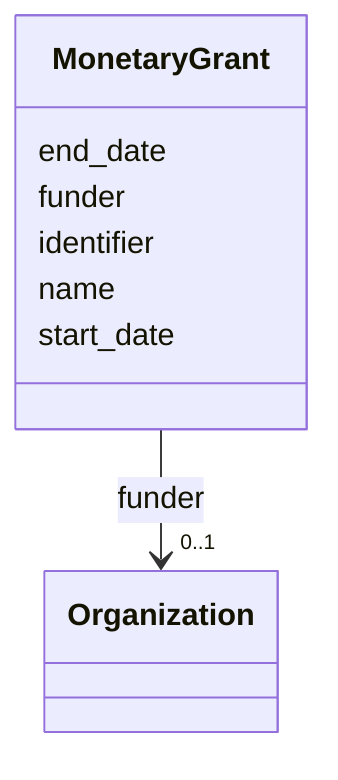

# Class: MonetaryGrant


URI: [schema:MonetaryGrant](http://schema.org/MonetaryGrant)





<!-- no inheritance hierarchy -->


## Slots

| Name | Cardinality and Range | Description | Inheritance |
| ---  | --- | --- | --- |
| [name](name.md) | 0..1 <br/> [String](String.md) | Name of the grant | direct |
| [identifier](identifier.md) | 0..1 <br/> [String](String.md) | Unique identifier of the grant | direct |
| [start_date](start_date.md) | 0..1 <br/> [Date](Date.md) |  | direct |
| [end_date](end_date.md) | 0..1 <br/> [Date](Date.md) |  | direct |
| [funder](funder.md) | 0..1 <br/> [Organization](Organization.md) |  | direct |


## Usages

| used by | used in | type | used |
| ---  | --- | --- | --- |
| [Project](Project.md) | [funding](funding.md) | range | [MonetaryGrant](MonetaryGrant.md) |


## Identifier and Mapping Information


### Schema Source


* from schema: https://schema.oaedata.org/OAEDataSchema


## Mappings

| Mapping Type | Mapped Value |
| ---  | ---  |
| self | schema:MonetaryGrant |
| native | oae:MonetaryGrant |


## LinkML Source

<!-- TODO: investigate https://stackoverflow.com/questions/37606292/how-to-create-tabbed-code-blocks-in-mkdocs-or-sphinx -->

### Direct

<details>
```yaml
name: MonetaryGrant
from_schema: https://schema.oaedata.org/OAEDataSchema
slots:
- name
- identifier
slot_usage:
  name:
    name: name
    description: Name of the grant
  identifier:
    name: identifier
    description: Unique identifier of the grant. Should be be URL or project id used
      by the funder
attributes:
  start_date:
    name: start_date
    title: Start Date
    from_schema: MonetaryGrant
    rank: 1000
    domain_of:
    - MonetaryGrant
    range: date
  end_date:
    name: end_date
    title: End Date
    from_schema: MonetaryGrant
    rank: 1000
    domain_of:
    - MonetaryGrant
    range: date
  funder:
    name: funder
    title: Funder
    from_schema: MonetaryGrant
    rank: 1000
    domain_of:
    - MonetaryGrant
    range: Organization
class_uri: schema:MonetaryGrant

```
</details>

### Induced

<details>
```yaml
name: MonetaryGrant
from_schema: https://schema.oaedata.org/OAEDataSchema
slot_usage:
  name:
    name: name
    description: Name of the grant
  identifier:
    name: identifier
    description: Unique identifier of the grant. Should be be URL or project id used
      by the funder
attributes:
  start_date:
    name: start_date
    title: Start Date
    from_schema: MonetaryGrant
    rank: 1000
    alias: start_date
    owner: MonetaryGrant
    domain_of:
    - MonetaryGrant
    range: date
  end_date:
    name: end_date
    title: End Date
    from_schema: MonetaryGrant
    rank: 1000
    alias: end_date
    owner: MonetaryGrant
    domain_of:
    - MonetaryGrant
    range: date
  funder:
    name: funder
    title: Funder
    from_schema: MonetaryGrant
    rank: 1000
    alias: funder
    owner: MonetaryGrant
    domain_of:
    - MonetaryGrant
    range: Organization
  name:
    name: name
    description: Name of the grant
    title: Name
    from_schema: https://schema.oaedata.org/OAEDataSchema
    rank: 1000
    slot_uri: schema:name
    alias: name
    owner: MonetaryGrant
    domain_of:
    - Organization
    - Project
    - NamedLink
    - ExternalProject
    - MonetaryGrant
    - Experiment
    - Person
    - Dataset
    - Platform
    - ModelComponent
    range: string
  identifier:
    name: identifier
    description: Unique identifier of the grant. Should be be URL or project id used
      by the funder
    from_schema: https://schema.oaedata.org/OAEDataSchema
    rank: 1000
    slot_uri: schema:identifier
    alias: identifier
    owner: MonetaryGrant
    domain_of:
    - Organization
    - MonetaryGrant
    - Person
    range: string
class_uri: schema:MonetaryGrant

```
</details>