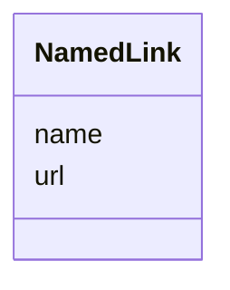

# Class: NamedLink


_A link to a resource with a name and URL._


URI: [oae:NamedLink](https://schema.oaedata.org/NamedLink)





<!-- no inheritance hierarchy -->


## Slots

| Name | Cardinality and Range | Description | Inheritance |
| ---  | --- | --- | --- |
| [name](name.md) | 1 <br/> [String](String.md) | The name of the linked resource | direct |
| [url](url.md) | 1 <br/> [uri](uri.md) | The URL of the linked resource | direct |


## Usages

| used by | used in | type | used |
| ---  | --- | --- | --- |
| [InSituExperiment](InSituExperiment.md) | [meteorological_and_tidal_data](meteorological_and_tidal_data.md) | range | [NamedLink](NamedLink.md) |
| [Intervention](Intervention.md) | [meteorological_and_tidal_data](meteorological_and_tidal_data.md) | range | [NamedLink](NamedLink.md) |
| [Tracer](Tracer.md) | [meteorological_and_tidal_data](meteorological_and_tidal_data.md) | range | [NamedLink](NamedLink.md) |
| [InterventionWithTracer](InterventionWithTracer.md) | [meteorological_and_tidal_data](meteorological_and_tidal_data.md) | range | [NamedLink](NamedLink.md) |
| [ModelInputDetails](ModelInputDetails.md) | [bathymetry](bathymetry.md) | range | [NamedLink](NamedLink.md) |
| [ModelInputDetails](ModelInputDetails.md) | [initial_conditions](initial_conditions.md) | range | [NamedLink](NamedLink.md) |
| [ModelInputDetails](ModelInputDetails.md) | [boundary_conditions](boundary_conditions.md) | range | [NamedLink](NamedLink.md) |
| [ModelInputDetails](ModelInputDetails.md) | [atmospheric_forcing](atmospheric_forcing.md) | range | [NamedLink](NamedLink.md) |
| [ModelInputDetails](ModelInputDetails.md) | [tidal_forcing](tidal_forcing.md) | range | [NamedLink](NamedLink.md) |
| [ModelInputDetails](ModelInputDetails.md) | [river_sediment_flux_details](river_sediment_flux_details.md) | range | [NamedLink](NamedLink.md) |
| [ModelInputDetails](ModelInputDetails.md) | [processing_code](processing_code.md) | range | [NamedLink](NamedLink.md) |


## Identifier and Mapping Information


### Schema Source


* from schema: https://schema.oaedata.org/OAEDataSchema


## Mappings

| Mapping Type | Mapped Value |
| ---  | ---  |
| self | oae:NamedLink |
| native | oae:NamedLink |


## LinkML Source

<!-- TODO: investigate https://stackoverflow.com/questions/37606292/how-to-create-tabbed-code-blocks-in-mkdocs-or-sphinx -->

### Direct

<details>
```yaml
name: NamedLink
description: A link to a resource with a name and URL.
from_schema: https://schema.oaedata.org/OAEDataSchema
attributes:
  name:
    name: name
    description: The name of the linked resource.
    title: Name
    from_schema: Project
    domain_of:
    - Organization
    - Project
    - NamedLink
    - ExternalProject
    - MonetaryGrant
    - Experiment
    - Person
    - Dataset
    - Platform
    - ModelComponent
    range: string
    required: true
  url:
    name: url
    description: The URL of the linked resource.
    title: URL
    from_schema: Project
    rank: 1000
    domain_of:
    - NamedLink
    - PublicComment
    range: uri
    required: true

```
</details>

### Induced

<details>
```yaml
name: NamedLink
description: A link to a resource with a name and URL.
from_schema: https://schema.oaedata.org/OAEDataSchema
attributes:
  name:
    name: name
    description: The name of the linked resource.
    title: Name
    from_schema: Project
    alias: name
    owner: NamedLink
    domain_of:
    - Organization
    - Project
    - NamedLink
    - ExternalProject
    - MonetaryGrant
    - Experiment
    - Person
    - Dataset
    - Platform
    - ModelComponent
    range: string
    required: true
  url:
    name: url
    description: The URL of the linked resource.
    title: URL
    from_schema: Project
    rank: 1000
    alias: url
    owner: NamedLink
    domain_of:
    - NamedLink
    - PublicComment
    range: uri
    required: true

```
</details>