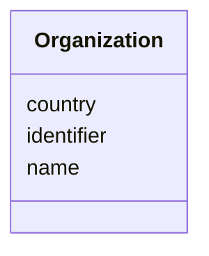

# Class: Organization


URI: [schema:Organization](http://schema.org/Organization)





<!-- no inheritance hierarchy -->


## Slots

| Name | Cardinality and Range | Description | Inheritance |
| ---  | --- | --- | --- |
| [identifier](identifier.md) | 0..1 <br/> [String](String.md) | Organization identifier in the form of an ROR URL (e | direct |
| [name](name.md) | 1 <br/> [String](String.md) | Name of the organization | direct |
| [country](country.md) | 0..1 <br/> [String](String.md) | The country in which the organization belongs | direct |


## Usages

| used by | used in | type | used |
| ---  | --- | --- | --- |
| [MonetaryGrant](MonetaryGrant.md) | [funder](funder.md) | range | [Organization](Organization.md) |
| [Person](Person.md) | [affiliation](affiliation.md) | range | [Organization](Organization.md) |


## Identifier and Mapping Information


### Schema Source


* from schema: https://schema.oaedata.org/OAEDataSchema


## Mappings

| Mapping Type | Mapped Value |
| ---  | ---  |
| self | schema:Organization |
| native | oae:Organization |


## LinkML Source

<!-- TODO: investigate https://stackoverflow.com/questions/37606292/how-to-create-tabbed-code-blocks-in-mkdocs-or-sphinx -->

### Direct

<details>
```yaml
name: Organization
from_schema: https://schema.oaedata.org/OAEDataSchema
slots:
- identifier
- name
slot_usage:
  identifier:
    name: identifier
    description: Organization identifier in the form of an ROR URL (e.g., https://ror.org/02mhbdp94).
      Please visit [https://ror.org](https://ror.org) to search for the organization
      and find the appropriate ROR URL.
  name:
    name: name
    description: Name of the organization
    required: true
attributes:
  country:
    name: country
    description: The country in which the organization belongs.
    title: Country
    from_schema: Core
    rank: 1000
    domain_of:
    - Organization
    - Platform
    range: string
class_uri: schema:Organization

```
</details>

### Induced

<details>
```yaml
name: Organization
from_schema: https://schema.oaedata.org/OAEDataSchema
slot_usage:
  identifier:
    name: identifier
    description: Organization identifier in the form of an ROR URL (e.g., https://ror.org/02mhbdp94).
      Please visit [https://ror.org](https://ror.org) to search for the organization
      and find the appropriate ROR URL.
  name:
    name: name
    description: Name of the organization
    required: true
attributes:
  country:
    name: country
    description: The country in which the organization belongs.
    title: Country
    from_schema: Core
    rank: 1000
    alias: country
    owner: Organization
    domain_of:
    - Organization
    - Platform
    range: string
  identifier:
    name: identifier
    description: Organization identifier in the form of an ROR URL (e.g., https://ror.org/02mhbdp94).
      Please visit [https://ror.org](https://ror.org) to search for the organization
      and find the appropriate ROR URL.
    from_schema: https://schema.oaedata.org/OAEDataSchema
    rank: 1000
    slot_uri: schema:identifier
    alias: identifier
    owner: Organization
    domain_of:
    - Organization
    - MonetaryGrant
    - Person
    range: string
  name:
    name: name
    description: Name of the organization
    title: Name
    from_schema: https://schema.oaedata.org/OAEDataSchema
    rank: 1000
    slot_uri: schema:name
    alias: name
    owner: Organization
    domain_of:
    - Organization
    - Project
    - NamedLink
    - ExternalProject
    - MonetaryGrant
    - Experiment
    - Person
    - Dataset
    - Platform
    - ModelComponent
    range: string
    required: true
class_uri: schema:Organization

```
</details>