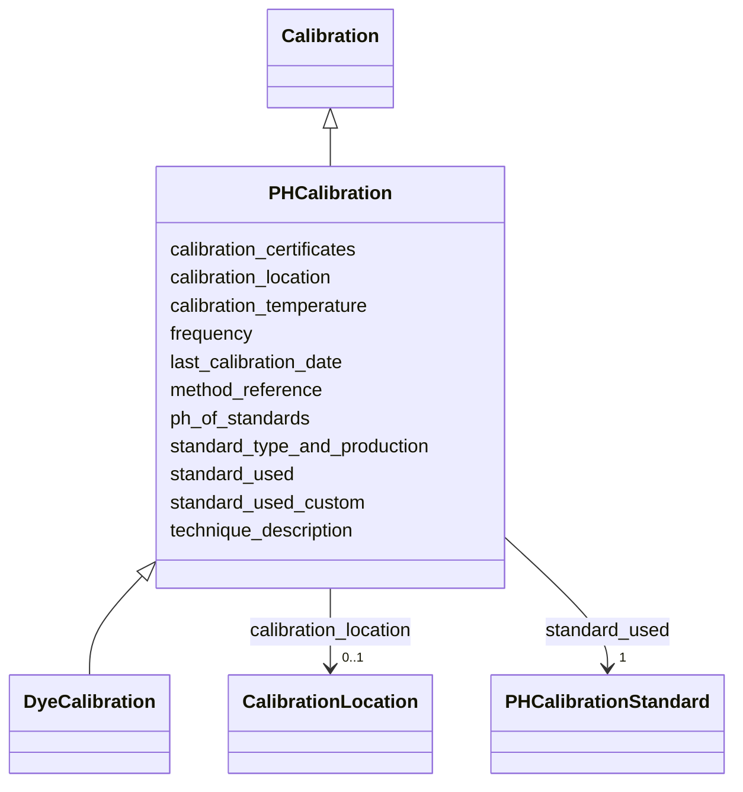

# Class: PHCalibration


_pH instrument calibration. Use this class directly for TRIS or other standards, and DyeCalibration when standard_used is dye._


URI: [oae:PHCalibration](https://schema.oaedata.org/PHCalibration)





## Inheritance
* [Calibration](Calibration.md)
    * **PHCalibration**
        * [DyeCalibration](DyeCalibration.md)


## Slots

| Name | Cardinality and Range | Description | Inheritance |
| ---  | --- | --- | --- |
| [calibration_temperature](calibration_temperature.md) | 0..1 <br/> [String](String.md) | Temperature at which calibration was performed | direct |
| [standard_used](standard_used.md) | 1 <br/> [PHCalibrationStandard](PHCalibrationStandard.md) | Type of standard used to calibrate the pH measurement | direct |
| [standard_used_custom](standard_used_custom.md) | 0..1 <br/> [String](String.md) | Name of the standard used, when it is not in the list | direct |
| [standard_type_and_production](standard_type_and_production.md) | 0..1 <br/> [String](String.md) | Details on the standard (e | direct |
| [ph_of_standards](ph_of_standards.md) | 0..1 <br/> [String](String.md) | pH values of the calibration standards used | direct |
| [calibration_location](calibration_location.md) | 0..1 <br/> [CalibrationLocation](CalibrationLocation.md) | Factory calibration, lab calibration, or field calibration | [Calibration](Calibration.md) |
| [technique_description](technique_description.md) | 1 <br/> [String](String.md) | Details of the calibration technique used | [Calibration](Calibration.md) |
| [method_reference](method_reference.md) | 0..1 <br/> [String](String.md) | Citation or reference for the calibration method | [Calibration](Calibration.md) |
| [frequency](frequency.md) | 0..1 <br/> [String](String.md) | How often the instrument was calibrated | [Calibration](Calibration.md) |
| [last_calibration_date](last_calibration_date.md) | 0..1 <br/> [Datetime](Datetime.md) | Date and time of most recent calibration in UTC | [Calibration](Calibration.md) |
| [calibration_certificates](calibration_certificates.md) | 0..1 <br/> [String](String.md) | Information about calibration certificates | [Calibration](Calibration.md) |


## Usages

| used by | used in | type | used |
| ---  | --- | --- | --- |
| [PHInstrument](PHInstrument.md) | [calibration](calibration.md) | any_of[range] | [PHCalibration](PHCalibration.md) |


## Identifier and Mapping Information


### Schema Source


* from schema: https://schema.oaedata.org/OAEDataSchema


## Mappings

| Mapping Type | Mapped Value |
| ---  | ---  |
| self | oae:PHCalibration |
| native | oae:PHCalibration |


## LinkML Source

<!-- TODO: investigate https://stackoverflow.com/questions/37606292/how-to-create-tabbed-code-blocks-in-mkdocs-or-sphinx -->

### Direct

<details>
```yaml
name: PHCalibration
description: pH instrument calibration. Use this class directly for TRIS or other
  standards, and DyeCalibration when standard_used is dye.
from_schema: https://schema.oaedata.org/OAEDataSchema
is_a: Calibration
slots:
- calibration_temperature
- standard_used
attributes:
  standard_used_custom:
    name: standard_used_custom
    description: Name of the standard used, when it is not in the list.
    title: Standard used (custom)
    from_schema: Calibration
    rank: 1000
    domain_of:
    - PHCalibration
    range: string
  standard_type_and_production:
    name: standard_type_and_production
    description: Details on the standard (e.g., type of dye used) and how or where
      it was produced.
    title: Standard type and production
    from_schema: Calibration
    rank: 1000
    domain_of:
    - PHCalibration
    range: string
  ph_of_standards:
    name: ph_of_standards
    description: pH values of the calibration standards used.
    title: pH of standards
    from_schema: Calibration
    rank: 1000
    domain_of:
    - PHCalibration
    range: string
rules:
- preconditions:
    slot_conditions:
      standard_used:
        name: standard_used
        equals_string: other
  postconditions:
    slot_conditions:
      standard_used_custom:
        name: standard_used_custom
        required: true

```
</details>

### Induced

<details>
```yaml
name: PHCalibration
description: pH instrument calibration. Use this class directly for TRIS or other
  standards, and DyeCalibration when standard_used is dye.
from_schema: https://schema.oaedata.org/OAEDataSchema
is_a: Calibration
attributes:
  standard_used_custom:
    name: standard_used_custom
    description: Name of the standard used, when it is not in the list.
    title: Standard used (custom)
    from_schema: Calibration
    rank: 1000
    alias: standard_used_custom
    owner: PHCalibration
    domain_of:
    - PHCalibration
    range: string
  standard_type_and_production:
    name: standard_type_and_production
    description: Details on the standard (e.g., type of dye used) and how or where
      it was produced.
    title: Standard type and production
    from_schema: Calibration
    rank: 1000
    alias: standard_type_and_production
    owner: PHCalibration
    domain_of:
    - PHCalibration
    range: string
  ph_of_standards:
    name: ph_of_standards
    description: pH values of the calibration standards used.
    title: pH of standards
    from_schema: Calibration
    rank: 1000
    alias: ph_of_standards
    owner: PHCalibration
    domain_of:
    - PHCalibration
    range: string
  calibration_temperature:
    name: calibration_temperature
    description: Temperature at which calibration was performed.
    title: Calibration temperature
    from_schema: https://schema.oaedata.org/OAEDataSchema
    rank: 1000
    alias: calibration_temperature
    owner: PHCalibration
    domain_of:
    - PHCalibration
    - DiscreteCO2Calibration
    range: string
  standard_used:
    name: standard_used
    description: Type of standard used to calibrate the pH measurement.
    title: Standard used
    from_schema: https://schema.oaedata.org/OAEDataSchema
    rank: 1000
    alias: standard_used
    owner: PHCalibration
    domain_of:
    - PHCalibration
    range: PHCalibrationStandard
    required: true
  calibration_location:
    name: calibration_location
    description: Factory calibration, lab calibration, or field calibration.
    title: Calibration location
    from_schema: https://schema.oaedata.org/OAEDataSchema
    rank: 1000
    alias: calibration_location
    owner: PHCalibration
    domain_of:
    - Calibration
    range: CalibrationLocation
  technique_description:
    name: technique_description
    description: Details of the calibration technique used.
    title: Calibration technique description
    from_schema: Calibration
    rank: 1000
    alias: technique_description
    owner: PHCalibration
    domain_of:
    - Calibration
    range: string
    required: true
  method_reference:
    name: method_reference
    description: Citation or reference for the calibration method.
    title: Calibration method reference
    from_schema: Calibration
    rank: 1000
    alias: method_reference
    owner: PHCalibration
    domain_of:
    - Calibration
    - InSituVariable
    range: string
  frequency:
    name: frequency
    description: How often the instrument was calibrated.
    title: Frequency of calibration
    from_schema: Calibration
    rank: 1000
    alias: frequency
    owner: PHCalibration
    domain_of:
    - Calibration
    range: string
  last_calibration_date:
    name: last_calibration_date
    description: Date and time of most recent calibration in UTC.
    title: Last calibration date (UTC)
    from_schema: Calibration
    rank: 1000
    alias: last_calibration_date
    owner: PHCalibration
    domain_of:
    - Calibration
    range: datetime
  calibration_certificates:
    name: calibration_certificates
    description: Information about calibration certificates. Ideally, the certificate
      should be made available in a PDF file with filename listed here.
    title: Calibration certificate information
    from_schema: Calibration
    rank: 1000
    alias: calibration_certificates
    owner: PHCalibration
    domain_of:
    - Calibration
    range: string
rules:
- preconditions:
    slot_conditions:
      standard_used:
        name: standard_used
        equals_string: other
  postconditions:
    slot_conditions:
      standard_used_custom:
        name: standard_used_custom
        required: true

```
</details>