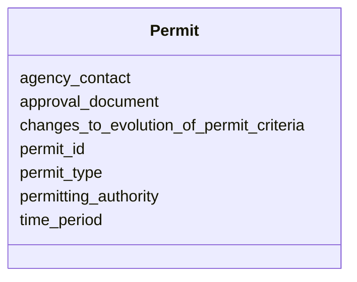

# Class: Permit


_A permit associated with the project._


URI: [oae:Permit](https://schema.oaedata.org/Permit)





<!-- no inheritance hierarchy -->


## Slots

| Name | Cardinality and Range | Description | Inheritance |
| ---  | --- | --- | --- |
| [permit_id](permit_id.md) | 1 <br/> [String](String.md) | The unique identifier or number associated with this permit | direct |
| [permitting_authority](permitting_authority.md) | 1 <br/> [String](String.md) | The group that issued the permit | direct |
| [agency_contact](agency_contact.md) | 0..1 <br/> [String](String.md) | The point of contact at the permitting agency | direct |
| [changes_to_evolution_of_permit_criteria](changes_to_evolution_of_permit_criteria.md) | 0..1 <br/> [String](String.md) | e | direct |
| [permit_type](permit_type.md) | 0..1 <br/> [String](String.md) | The category of permit (E | direct |
| [time_period](time_period.md) | 0..1 <br/> [String](String.md) | The time period during which the permit will be applicable, or expected durat... | direct |
| [approval_document](approval_document.md) | 1 <br/> [String](String.md) | Filename(s), links and/or DOIs to access files of permitting documents, separ... | direct |


## Usages

| used by | used in | type | used |
| ---  | --- | --- | --- |
| [InSituExperiment](InSituExperiment.md) | [permits](permits.md) | range | [Permit](Permit.md) |
| [Intervention](Intervention.md) | [permits](permits.md) | range | [Permit](Permit.md) |
| [Tracer](Tracer.md) | [permits](permits.md) | range | [Permit](Permit.md) |
| [InterventionWithTracer](InterventionWithTracer.md) | [permits](permits.md) | range | [Permit](Permit.md) |


## Identifier and Mapping Information


### Schema Source


* from schema: https://schema.oaedata.org/OAEDataSchema


## Mappings

| Mapping Type | Mapped Value |
| ---  | ---  |
| self | oae:Permit |
| native | oae:Permit |


## LinkML Source

<!-- TODO: investigate https://stackoverflow.com/questions/37606292/how-to-create-tabbed-code-blocks-in-mkdocs-or-sphinx -->

### Direct

<details>
```yaml
name: Permit
description: A permit associated with the project.
from_schema: https://schema.oaedata.org/OAEDataSchema
attributes:
  permit_id:
    name: permit_id
    description: The unique identifier or number associated with this permit.
    title: Permit ID or Number
    from_schema: Permit
    rank: 1000
    domain_of:
    - Permit
    range: string
    required: true
  permitting_authority:
    name: permitting_authority
    description: The group that issued the permit.
    title: Permitting Authority
    from_schema: Permit
    rank: 1000
    domain_of:
    - Permit
    range: string
    required: true
  agency_contact:
    name: agency_contact
    description: The point of contact at the permitting agency.
    title: Agency Contact
    from_schema: Permit
    rank: 1000
    domain_of:
    - Permit
    range: string
  changes_to_evolution_of_permit_criteria:
    name: changes_to_evolution_of_permit_criteria
    description: e.g., changes of discharge pH and basis for changes
    title: Changes to evolution of permit criteria
    from_schema: Permit
    rank: 1000
    domain_of:
    - Permit
    range: string
  permit_type:
    name: permit_type
    description: The category of permit (E.g., experimental permit, commercial permit)
    title: Permit Type
    from_schema: Permit
    rank: 1000
    domain_of:
    - Permit
    range: string
  time_period:
    name: time_period
    description: The time period during which the permit will be applicable, or expected
      duration of the permit.
    title: Permit Time Period
    from_schema: Permit
    rank: 1000
    domain_of:
    - Permit
    range: string
  approval_document:
    name: approval_document
    description: Filename(s), links and/or DOIs to access files of permitting documents,
      separated by commas
    title: Permit Document
    from_schema: Permit
    rank: 1000
    domain_of:
    - Permit
    range: string
    required: true

```
</details>

### Induced

<details>
```yaml
name: Permit
description: A permit associated with the project.
from_schema: https://schema.oaedata.org/OAEDataSchema
attributes:
  permit_id:
    name: permit_id
    description: The unique identifier or number associated with this permit.
    title: Permit ID or Number
    from_schema: Permit
    rank: 1000
    alias: permit_id
    owner: Permit
    domain_of:
    - Permit
    range: string
    required: true
  permitting_authority:
    name: permitting_authority
    description: The group that issued the permit.
    title: Permitting Authority
    from_schema: Permit
    rank: 1000
    alias: permitting_authority
    owner: Permit
    domain_of:
    - Permit
    range: string
    required: true
  agency_contact:
    name: agency_contact
    description: The point of contact at the permitting agency.
    title: Agency Contact
    from_schema: Permit
    rank: 1000
    alias: agency_contact
    owner: Permit
    domain_of:
    - Permit
    range: string
  changes_to_evolution_of_permit_criteria:
    name: changes_to_evolution_of_permit_criteria
    description: e.g., changes of discharge pH and basis for changes
    title: Changes to evolution of permit criteria
    from_schema: Permit
    rank: 1000
    alias: changes_to_evolution_of_permit_criteria
    owner: Permit
    domain_of:
    - Permit
    range: string
  permit_type:
    name: permit_type
    description: The category of permit (E.g., experimental permit, commercial permit)
    title: Permit Type
    from_schema: Permit
    rank: 1000
    alias: permit_type
    owner: Permit
    domain_of:
    - Permit
    range: string
  time_period:
    name: time_period
    description: The time period during which the permit will be applicable, or expected
      duration of the permit.
    title: Permit Time Period
    from_schema: Permit
    rank: 1000
    alias: time_period
    owner: Permit
    domain_of:
    - Permit
    range: string
  approval_document:
    name: approval_document
    description: Filename(s), links and/or DOIs to access files of permitting documents,
      separated by commas
    title: Permit Document
    from_schema: Permit
    rank: 1000
    alias: approval_document
    owner: Permit
    domain_of:
    - Permit
    range: string
    required: true

```
</details>