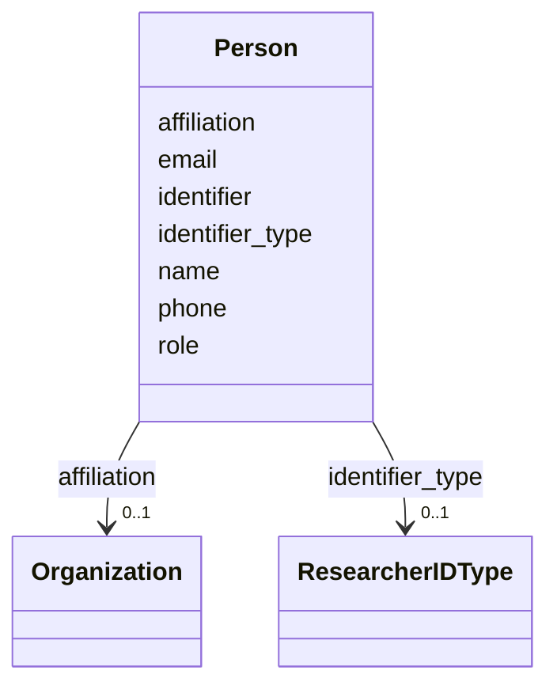

# Class: Person


_Information about a researcher or investigator involved in the experiment._


URI: [schema:Person](http://schema.org/Person)





<!-- no inheritance hierarchy -->


## Slots

| Name | Cardinality and Range | Description | Inheritance |
| ---  | --- | --- | --- |
| [name](name.md) | 1 <br/> [String](String.md) | Full name of the person | direct |
| [affiliation](affiliation.md) | 0..1 <br/> [Organization](Organization.md) | Institutional affiliation of the investigator | direct |
| [phone](phone.md) | 0..1 <br/> [String](String.md) | Contact phone number | direct |
| [email](email.md) | 1 <br/> [String](String.md) | Contact email address | direct |
| [identifier_type](identifier_type.md) | 0..1 <br/> [ResearcherIDType](ResearcherIDType.md) | Type of Researcher ID (e | direct |
| [identifier](identifier.md) | 0..1 <br/> [String](String.md) | Unique researcher identifier value | direct |
| [role](role.md) | 0..1 <br/> [String](String.md) | Role of the investigator in the experiment (e | direct |


## Usages

| used by | used in | type | used |
| ---  | --- | --- | --- |
| [Project](Project.md) | [project_leads](project_leads.md) | range | [Person](Person.md) |
| [Experiment](Experiment.md) | [experiment_leads](experiment_leads.md) | range | [Person](Person.md) |
| [InSituExperiment](InSituExperiment.md) | [experiment_leads](experiment_leads.md) | range | [Person](Person.md) |
| [Intervention](Intervention.md) | [experiment_leads](experiment_leads.md) | range | [Person](Person.md) |
| [Tracer](Tracer.md) | [experiment_leads](experiment_leads.md) | range | [Person](Person.md) |
| [InterventionWithTracer](InterventionWithTracer.md) | [experiment_leads](experiment_leads.md) | range | [Person](Person.md) |
| [InSituVariable](InSituVariable.md) | [measurement_researcher](measurement_researcher.md) | range | [Person](Person.md) |
| [MeasuredVariable](MeasuredVariable.md) | [measurement_researcher](measurement_researcher.md) | range | [Person](Person.md) |
| [DiscreteMeasuredVariable](DiscreteMeasuredVariable.md) | [measurement_researcher](measurement_researcher.md) | range | [Person](Person.md) |
| [ContinuousMeasuredVariable](ContinuousMeasuredVariable.md) | [measurement_researcher](measurement_researcher.md) | range | [Person](Person.md) |
| [CalculatedVariable](CalculatedVariable.md) | [measurement_researcher](measurement_researcher.md) | range | [Person](Person.md) |
| [ContinuousPHVariable](ContinuousPHVariable.md) | [measurement_researcher](measurement_researcher.md) | range | [Person](Person.md) |
| [DiscretePHVariable](DiscretePHVariable.md) | [measurement_researcher](measurement_researcher.md) | range | [Person](Person.md) |
| [ContinuousTAVariable](ContinuousTAVariable.md) | [measurement_researcher](measurement_researcher.md) | range | [Person](Person.md) |
| [DiscreteTAVariable](DiscreteTAVariable.md) | [measurement_researcher](measurement_researcher.md) | range | [Person](Person.md) |
| [ContinuousDICVariable](ContinuousDICVariable.md) | [measurement_researcher](measurement_researcher.md) | range | [Person](Person.md) |
| [DiscreteDICVariable](DiscreteDICVariable.md) | [measurement_researcher](measurement_researcher.md) | range | [Person](Person.md) |
| [ContinuousSedimentVariable](ContinuousSedimentVariable.md) | [measurement_researcher](measurement_researcher.md) | range | [Person](Person.md) |
| [DiscreteSedimentVariable](DiscreteSedimentVariable.md) | [measurement_researcher](measurement_researcher.md) | range | [Person](Person.md) |
| [DiscreteCO2Variable](DiscreteCO2Variable.md) | [measurement_researcher](measurement_researcher.md) | range | [Person](Person.md) |
| [ContinuousCO2Variable](ContinuousCO2Variable.md) | [measurement_researcher](measurement_researcher.md) | range | [Person](Person.md) |
| [HPLCVariable](HPLCVariable.md) | [measurement_researcher](measurement_researcher.md) | range | [Person](Person.md) |
| [DiscretePhysiologicalVariable](DiscretePhysiologicalVariable.md) | [measurement_researcher](measurement_researcher.md) | range | [Person](Person.md) |
| [ContinuousPhysiologicalVariable](ContinuousPhysiologicalVariable.md) | [measurement_researcher](measurement_researcher.md) | range | [Person](Person.md) |
| [SocioeconomicVariable](SocioeconomicVariable.md) | [measurement_researcher](measurement_researcher.md) | range | [Person](Person.md) |
| [Dataset](Dataset.md) | [data_submitter](data_submitter.md) | range | [Person](Person.md) |
| [FieldDataset](FieldDataset.md) | [data_submitter](data_submitter.md) | range | [Person](Person.md) |
| [ModelOutputDataset](ModelOutputDataset.md) | [data_submitter](data_submitter.md) | range | [Person](Person.md) |
| [Model](Model.md) | [experiment_leads](experiment_leads.md) | range | [Person](Person.md) |


## Identifier and Mapping Information


### Schema Source


* from schema: https://schema.oaedata.org/OAEDataSchema


## Mappings

| Mapping Type | Mapped Value |
| ---  | ---  |
| self | schema:Person |
| native | oae:Person |


## LinkML Source

<!-- TODO: investigate https://stackoverflow.com/questions/37606292/how-to-create-tabbed-code-blocks-in-mkdocs-or-sphinx -->

### Direct

<details>
```yaml
name: Person
description: Information about a researcher or investigator involved in the experiment.
from_schema: https://schema.oaedata.org/OAEDataSchema
attributes:
  name:
    name: name
    description: Full name of the person.
    title: Name
    from_schema: Person
    domain_of:
    - Organization
    - Project
    - NamedLink
    - ExternalProject
    - MonetaryGrant
    - Experiment
    - Person
    - Dataset
    - Platform
    - ModelComponent
    range: string
    required: true
  affiliation:
    name: affiliation
    description: Institutional affiliation of the investigator.
    title: Affiliation
    from_schema: Person
    rank: 1000
    domain_of:
    - Person
    range: Organization
  phone:
    name: phone
    description: Contact phone number.
    title: Phone
    from_schema: Person
    rank: 1000
    domain_of:
    - Person
    range: string
    pattern: ^\+?[0-9\s\-\(\)]+$
  email:
    name: email
    description: Contact email address.
    title: Email
    from_schema: Person
    rank: 1000
    domain_of:
    - Person
    range: string
    required: true
    pattern: ^[a-zA-Z0-9._%+-]+@[a-zA-Z0-9.-]+\.[a-zA-Z]{2,}$
  identifier_type:
    name: identifier_type
    description: Type of Researcher ID (e.g., ORCID, ResearcherID).
    title: Researcher ID Type
    from_schema: Person
    rank: 1000
    domain_of:
    - Person
    range: ResearcherIDType
  identifier:
    name: identifier
    description: Unique researcher identifier value.
    title: Researcher ID
    from_schema: Person
    domain_of:
    - Organization
    - MonetaryGrant
    - Person
    range: string
  role:
    name: role
    description: Role of the investigator in the experiment (e.g., chief scientist,
      data submitter).
    title: Role
    from_schema: Person
    rank: 1000
    domain_of:
    - Person
    range: string
class_uri: schema:Person

```
</details>

### Induced

<details>
```yaml
name: Person
description: Information about a researcher or investigator involved in the experiment.
from_schema: https://schema.oaedata.org/OAEDataSchema
attributes:
  name:
    name: name
    description: Full name of the person.
    title: Name
    from_schema: Person
    alias: name
    owner: Person
    domain_of:
    - Organization
    - Project
    - NamedLink
    - ExternalProject
    - MonetaryGrant
    - Experiment
    - Person
    - Dataset
    - Platform
    - ModelComponent
    range: string
    required: true
  affiliation:
    name: affiliation
    description: Institutional affiliation of the investigator.
    title: Affiliation
    from_schema: Person
    rank: 1000
    alias: affiliation
    owner: Person
    domain_of:
    - Person
    range: Organization
  phone:
    name: phone
    description: Contact phone number.
    title: Phone
    from_schema: Person
    rank: 1000
    alias: phone
    owner: Person
    domain_of:
    - Person
    range: string
    pattern: ^\+?[0-9\s\-\(\)]+$
  email:
    name: email
    description: Contact email address.
    title: Email
    from_schema: Person
    rank: 1000
    alias: email
    owner: Person
    domain_of:
    - Person
    range: string
    required: true
    pattern: ^[a-zA-Z0-9._%+-]+@[a-zA-Z0-9.-]+\.[a-zA-Z]{2,}$
  identifier_type:
    name: identifier_type
    description: Type of Researcher ID (e.g., ORCID, ResearcherID).
    title: Researcher ID Type
    from_schema: Person
    rank: 1000
    alias: identifier_type
    owner: Person
    domain_of:
    - Person
    range: ResearcherIDType
  identifier:
    name: identifier
    description: Unique researcher identifier value.
    title: Researcher ID
    from_schema: Person
    alias: identifier
    owner: Person
    domain_of:
    - Organization
    - MonetaryGrant
    - Person
    range: string
  role:
    name: role
    description: Role of the investigator in the experiment (e.g., chief scientist,
      data submitter).
    title: Role
    from_schema: Person
    rank: 1000
    alias: role
    owner: Person
    domain_of:
    - Person
    range: string
class_uri: schema:Person

```
</details>