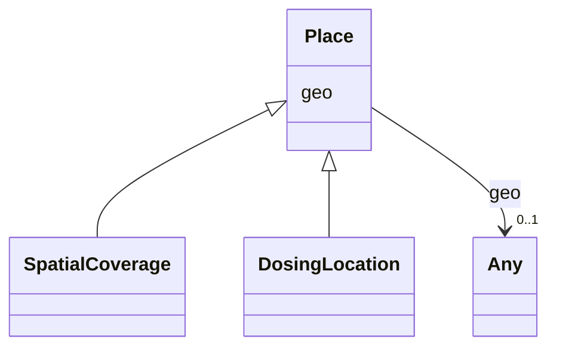

# Class: Place


_A geospatial area of interest, defined by a bounding box, polygon/line, or a point designated as a pair of geo-coordinates._


URI: [schema:Place](http://schema.org/Place)





## Inheritance
* **Place**
    * [SpatialCoverage](SpatialCoverage.md)
    * [DosingLocation](DosingLocation.md)


## Slots

| Name | Cardinality and Range | Description | Inheritance |
| ---  | --- | --- | --- |
| [geo](geo.md) | 0..1 <br/> [Any](Any.md)&nbsp;or&nbsp;<br />[GeoShape](GeoShape.md)&nbsp;or&nbsp;<br />[GeoCoordinates](GeoCoordinates.md) | Entities that have a somewhat fixed, physical extension | direct |


## Identifier and Mapping Information


### Schema Source


* from schema: https://schema.oaedata.org/OAEDataSchema


## Mappings

| Mapping Type | Mapped Value |
| ---  | ---  |
| self | schema:Place |
| native | oae:Place |


## LinkML Source

<!-- TODO: investigate https://stackoverflow.com/questions/37606292/how-to-create-tabbed-code-blocks-in-mkdocs-or-sphinx -->

### Direct

<details>
```yaml
name: Place
description: A geospatial area of interest, defined by a bounding box, polygon/line,
  or a point designated as a pair of geo-coordinates.
from_schema: https://schema.oaedata.org/OAEDataSchema
slots:
- geo
class_uri: schema:Place

```
</details>

### Induced

<details>
```yaml
name: Place
description: A geospatial area of interest, defined by a bounding box, polygon/line,
  or a point designated as a pair of geo-coordinates.
from_schema: https://schema.oaedata.org/OAEDataSchema
attributes:
  geo:
    name: geo
    description: Entities that have a somewhat fixed, physical extension. (imported
      from schema.org)
    from_schema: https://schema.oaedata.org/OAEDataSchema
    rank: 1000
    alias: geo
    owner: Place
    domain_of:
    - Place
    range: Any
    any_of:
    - range: GeoShape
    - range: GeoCoordinates
class_uri: schema:Place

```
</details>