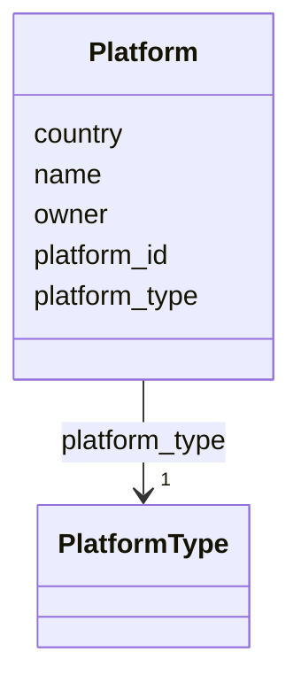

# Class: Platform


URI: [oae:Platform](https://schema.oaedata.org/Platform)





<!-- no inheritance hierarchy -->


## Slots

| Name | Cardinality and Range | Description | Inheritance |
| ---  | --- | --- | --- |
| [name](name.md) | 0..1 <br/> [String](String.md) | Name of the observing platform, e | direct |
| [platform_type](platform_type.md) | 1 <br/> [PlatformType](PlatformType.md) | For Platform Type definitions, see: https://vocab | direct |
| [platform_id](platform_id.md) | 0..1 <br/> [String](String.md) | Synonymous with glider ID, cruise ID | direct |
| [owner](owner.md) | 0..1 <br/> [String](String.md) | Institution that owns the platform | direct |
| [country](country.md) | 0..1 <br/> [String](String.md) | Country to which the platform belongs | direct |


## Usages

| used by | used in | type | used |
| ---  | --- | --- | --- |
| [FieldDataset](FieldDataset.md) | [platform_info](platform_info.md) | range | [Platform](Platform.md) |


## Identifier and Mapping Information


### Schema Source


* from schema: https://schema.oaedata.org/OAEDataSchema


## Mappings

| Mapping Type | Mapped Value |
| ---  | ---  |
| self | oae:Platform |
| native | oae:Platform |


## LinkML Source

<!-- TODO: investigate https://stackoverflow.com/questions/37606292/how-to-create-tabbed-code-blocks-in-mkdocs-or-sphinx -->

### Direct

<details>
```yaml
name: Platform
from_schema: https://schema.oaedata.org/OAEDataSchema
slots:
- name
slot_usage:
  name:
    name: name
    description: Name of the observing platform, e.g., RV Ronald Brown, Saildrone#0132,
      Mooring_First_Landing, etc.
attributes:
  platform_type:
    name: platform_type
    description: 'For Platform Type definitions, see: https://vocab.nerc.ac.uk/collection/L06/current/'
    title: Platform Type
    from_schema: Platform
    rank: 1000
    domain_of:
    - Platform
    range: PlatformType
    required: true
  platform_id:
    name: platform_id
    description: Synonymous with glider ID, cruise ID. A unique name assigned to oceanographic
      assets such as buoys, moorings, floats, drifters, towed vehicles like the Scanfish
      or StingRay. This is synonymous with the BCO-DMO “platform” parameter (https://www.bco-dmo.org/parameter/932),
      NERC “platform type” term (https://vocab.nerc.ac.uk/collection/W06/current/CLSS0001/),
      and the “platform_id” term within the Climate and Forecast (CF) metadata conventions
      (https://cfconventions.org/Data/cf-standard-names/current/build/cf-standard-name-table.html).
      e.g., ICES platform code (e.g., 33RO).
    title: Platform ID
    from_schema: Platform
    rank: 1000
    domain_of:
    - Platform
    range: string
  owner:
    name: owner
    description: Institution that owns the platform.
    title: Owner
    from_schema: Platform
    rank: 1000
    domain_of:
    - Platform
    range: string
  country:
    name: country
    description: Country to which the platform belongs.
    title: Country
    from_schema: Platform
    domain_of:
    - Organization
    - Platform
    range: string

```
</details>

### Induced

<details>
```yaml
name: Platform
from_schema: https://schema.oaedata.org/OAEDataSchema
slot_usage:
  name:
    name: name
    description: Name of the observing platform, e.g., RV Ronald Brown, Saildrone#0132,
      Mooring_First_Landing, etc.
attributes:
  platform_type:
    name: platform_type
    description: 'For Platform Type definitions, see: https://vocab.nerc.ac.uk/collection/L06/current/'
    title: Platform Type
    from_schema: Platform
    rank: 1000
    alias: platform_type
    owner: Platform
    domain_of:
    - Platform
    range: PlatformType
    required: true
  platform_id:
    name: platform_id
    description: Synonymous with glider ID, cruise ID. A unique name assigned to oceanographic
      assets such as buoys, moorings, floats, drifters, towed vehicles like the Scanfish
      or StingRay. This is synonymous with the BCO-DMO “platform” parameter (https://www.bco-dmo.org/parameter/932),
      NERC “platform type” term (https://vocab.nerc.ac.uk/collection/W06/current/CLSS0001/),
      and the “platform_id” term within the Climate and Forecast (CF) metadata conventions
      (https://cfconventions.org/Data/cf-standard-names/current/build/cf-standard-name-table.html).
      e.g., ICES platform code (e.g., 33RO).
    title: Platform ID
    from_schema: Platform
    rank: 1000
    alias: platform_id
    owner: Platform
    domain_of:
    - Platform
    range: string
  owner:
    name: owner
    description: Institution that owns the platform.
    title: Owner
    from_schema: Platform
    rank: 1000
    alias: owner
    owner: Platform
    domain_of:
    - Platform
    range: string
  country:
    name: country
    description: Country to which the platform belongs.
    title: Country
    from_schema: Platform
    alias: country
    owner: Platform
    domain_of:
    - Organization
    - Platform
    range: string
  name:
    name: name
    description: Name of the observing platform, e.g., RV Ronald Brown, Saildrone#0132,
      Mooring_First_Landing, etc.
    title: Name
    from_schema: https://schema.oaedata.org/OAEDataSchema
    rank: 1000
    slot_uri: schema:name
    alias: name
    owner: Platform
    domain_of:
    - Organization
    - Project
    - NamedLink
    - ExternalProject
    - MonetaryGrant
    - Experiment
    - Person
    - Dataset
    - Platform
    - ModelComponent
    range: string

```
</details>