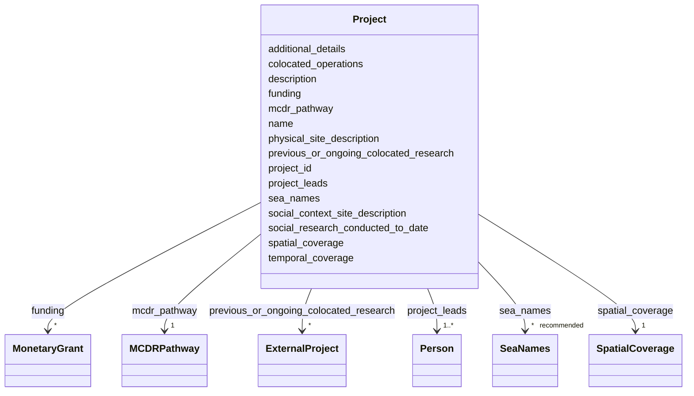

# Class: Project


_A project conducting OAE field trials or modeling._


URI: [oae:Project](https://schema.oaedata.org/Project)





<!-- no inheritance hierarchy -->


## Slots

| Name | Cardinality and Range | Description | Inheritance |
| ---  | --- | --- | --- |
| [name](name.md) | 1 <br/> [String](String.md) | Name of the project the data collection is part of | direct |
| [project_id](project_id.md) | 1 <br/> [String](String.md) | The project to which the submitted data belong | direct |
| [description](description.md) | 1 <br/> [String](String.md) | A narrative description of the project | direct |
| [temporal_coverage](temporal_coverage.md) | 1 <br/> [String](String.md) | The start and end date (optional) of the project | direct |
| [spatial_coverage](spatial_coverage.md) | 1 <br/> [SpatialCoverage](SpatialCoverage.md) | Latitude/longitude bounds of project site (e | direct |
| [project_leads](project_leads.md) | 1..* <br/> [Person](Person.md) | Provide details for each project lead / principal investigator (PI) including... | direct |
| [sea_names](sea_names.md) | * _recommended_ <br/> [SeaNames](SeaNames.md) | Names of the seas where the data collection takes place, See Controlled Vocab... | direct |
| [physical_site_description](physical_site_description.md) | 0..1 <br/> [String](String.md) | Provide information to help characterize the field site and provide context w... | direct |
| [social_context_site_description](social_context_site_description.md) | 0..1 <br/> [String](String.md) | Details may include: | direct |
| [social_research_conducted_to_date](social_research_conducted_to_date.md) | 0..1 <br/> [String](String.md) | A description of any social research conducted to date | direct |
| [mcdr_pathway](mcdr_pathway.md) | 1 <br/> [MCDRPathway](MCDRPathway.md) | The Marine Carbon Dioxide Removal (MCDR) pathway being studied | direct |
| [previous_or_ongoing_colocated_research](previous_or_ongoing_colocated_research.md) | * <br/> [ExternalProject](ExternalProject.md) | This field is required for co-located operations that potentially impact the ... | direct |
| [colocated_operations](colocated_operations.md) | 0..1 <br/> [String](String.md) | A description is required if any nearby operations exist that may influence t... | direct |
| [funding](funding.md) | * <br/> [MonetaryGrant](MonetaryGrant.md) | Include the name of the funder, funder country, project title, project ID, an... | direct |
| [additional_details](additional_details.md) | 0..1 <br/> [String](String.md) | Open text area to include additional information | direct |


## Usages

| used by | used in | type | used |
| ---  | --- | --- | --- |
| [Container](Container.md) | [project](project.md) | range | [Project](Project.md) |


## Identifier and Mapping Information


### Schema Source


* from schema: https://schema.oaedata.org/OAEDataSchema


## Mappings

| Mapping Type | Mapped Value |
| ---  | ---  |
| self | oae:Project |
| native | oae:Project |
| broad | schema:ResearchProject |


## LinkML Source

<!-- TODO: investigate https://stackoverflow.com/questions/37606292/how-to-create-tabbed-code-blocks-in-mkdocs-or-sphinx -->

### Direct

<details>
```yaml
name: Project
description: A project conducting OAE field trials or modeling.
from_schema: https://schema.oaedata.org/OAEDataSchema
broad_mappings:
- schema:ResearchProject
slots:
- name
- project_id
- description
- temporal_coverage
- spatial_coverage
slot_usage:
  name:
    name: name
    description: Name of the project the data collection is part of. For example,
      West Coast Ocean Acidification (WCOA) Project.
    title: Project Name
    required: true
  temporal_coverage:
    name: temporal_coverage
    description: The start and end date (optional) of the project
    required: true
  spatial_coverage:
    name: spatial_coverage
    required: true
  project_id:
    name: project_id
    required: true
  description:
    name: description
    description: 'A narrative description of the project. For example, what were the
      goals of the project? What were the research questions? What were the processes
      to achieve these goals and answer these questions? Who were the key stakeholders,
      organizers, project leaders? Was this building off a previous or ongoing project,
      or is this a new region/experiment/mechanistic study?

      If there are relevant regulatory parameters and/or limits to dosing trials at
      this location, these may be described here.'
    title: Project Description
    required: true
attributes:
  project_leads:
    name: project_leads
    description: 'Provide details for each project lead / principal investigator (PI)
      including: Name, institutional information (name, address), phone, email, ID
      type (e.g., ORCID, etc), researcher ID, and role.'
    title: Project Lead(s)
    from_schema: Project
    rank: 1000
    domain_of:
    - Project
    range: Person
    required: true
    multivalued: true
    inlined: true
    inlined_as_list: true
  sea_names:
    name: sea_names
    description: Names of the seas where the data collection takes place, See Controlled
      Vocabularies section for definitions.
    title: Sea Names
    from_schema: Project
    rank: 1000
    domain_of:
    - Project
    range: SeaNames
    recommended: true
    multivalued: true
  physical_site_description:
    name: physical_site_description
    description: 'Provide information to help characterize the field site and provide
      context when interpreting the data. For example, descriptions of tidal patterns,
      climatological conditions, notable geological characteristics, the geographical
      and marine setting (coastal, intertidal, island region, sheltered environment),
      and characteristic meteorological events. If possible based on the file type
      of this submission, please include useful maps or figures here.

      Links to relevant datasets, cruise reports, etc may be provided here.'
    title: Physical Site Description
    from_schema: Project
    rank: 1000
    domain_of:
    - Project
    range: string
  social_context_site_description:
    name: social_context_site_description
    description: "Details may include:\n  - Commercial, recreational, ecological,\
      \ and cultural uses of study site\n  - Industrial site history\n  - Demographics\
      \ of site area\n  - Notable events that may impact local sentiment to mCDR (for\
      \ example: site had significant toxic spill in past decade, local positive support\
      \ for offshore wind farming, frequent HAB site) -Ecologically protected species,\
      \ economically significant operations in the marine environment\n  - In study\
      \ areas with nearby state or federal jurisdiction borders, potential conflicts\
      \ with other countries or permits from foreign governments should be described.\n\
      \  - Links to relevant social science surveys, engaged community groups, etc."
    title: Social Context Site Description
    from_schema: Project
    rank: 1000
    domain_of:
    - Project
    range: string
  social_research_conducted_to_date:
    name: social_research_conducted_to_date
    description: "A description of any social research conducted to date. If provided\
      \ as a separate file, list filename here. Information may include:\n  - Description\
      \ of Community engagement research approach conducted and results\n  - Stakeholder\
      \ mapping method and link to output"
    title: Social Research Conducted to Date
    from_schema: Project
    rank: 1000
    domain_of:
    - Project
    range: string
  mcdr_pathway:
    name: mcdr_pathway
    description: The Marine Carbon Dioxide Removal (MCDR) pathway being studied.
    title: MCDR Pathway
    from_schema: Project
    rank: 1000
    domain_of:
    - Project
    range: MCDRPathway
    required: true
  previous_or_ongoing_colocated_research:
    name: previous_or_ongoing_colocated_research
    description: This field is required for co-located operations that potentially
      impact the project results. If previous or on-going mCDR field operations have
      occurred in the study domain by any project developer, they may be mentioned
      here either as a description, and/or if a reference to the study exists in the
      form of a data set, publication, etc, the DOI or other identifying information
      should be provided. Please provide direct links to data when available.
    title: Previous or Ongoing Co-located Research
    from_schema: Project
    rank: 1000
    domain_of:
    - Project
    range: ExternalProject
    multivalued: true
  colocated_operations:
    name: colocated_operations
    description: A description is required if any nearby operations exist that may
      influence the waters over the time period covered by this data. This might be
      a nearby mCDR project, a facility that discharges water with different characteristics
      than the inflow (e.g., a desalination plant), frequent boating operations, etc.
    title: Co-located Operations
    from_schema: Project
    rank: 1000
    domain_of:
    - Project
    range: string
  funding:
    name: funding
    description: Include the name of the funder, funder country, project title, project
      ID, and the project start and end dates. If there is no funding source (e.g.,
      in the case of commercial projects), leave this field empty.
    title: Funding Info
    from_schema: Project
    rank: 1000
    slot_uri: schema:funding
    domain_of:
    - Project
    range: MonetaryGrant
    multivalued: true
  additional_details:
    name: additional_details
    description: 'Open text area to include additional information. These may include
      information for sediment processes data, biological data, or any other required
      information if not included in the main metadata or data files.

      See [General Guidelines for Your Data](https://www.carbontosea.org/oae-data-protocol/1-0-0/#general-guidelines-for-your-data)
      for relevant sections of your data. Additional informational files, such as
      digitized laboratory notebooks, blogs, etc., may be linked here.'
    title: Additional Details
    from_schema: Project
    rank: 1000
    domain_of:
    - Project
    - InSituExperiment
    range: string

```
</details>

### Induced

<details>
```yaml
name: Project
description: A project conducting OAE field trials or modeling.
from_schema: https://schema.oaedata.org/OAEDataSchema
broad_mappings:
- schema:ResearchProject
slot_usage:
  name:
    name: name
    description: Name of the project the data collection is part of. For example,
      West Coast Ocean Acidification (WCOA) Project.
    title: Project Name
    required: true
  temporal_coverage:
    name: temporal_coverage
    description: The start and end date (optional) of the project
    required: true
  spatial_coverage:
    name: spatial_coverage
    required: true
  project_id:
    name: project_id
    required: true
  description:
    name: description
    description: 'A narrative description of the project. For example, what were the
      goals of the project? What were the research questions? What were the processes
      to achieve these goals and answer these questions? Who were the key stakeholders,
      organizers, project leaders? Was this building off a previous or ongoing project,
      or is this a new region/experiment/mechanistic study?

      If there are relevant regulatory parameters and/or limits to dosing trials at
      this location, these may be described here.'
    title: Project Description
    required: true
attributes:
  project_leads:
    name: project_leads
    description: 'Provide details for each project lead / principal investigator (PI)
      including: Name, institutional information (name, address), phone, email, ID
      type (e.g., ORCID, etc), researcher ID, and role.'
    title: Project Lead(s)
    from_schema: Project
    rank: 1000
    alias: project_leads
    owner: Project
    domain_of:
    - Project
    range: Person
    required: true
    multivalued: true
    inlined: true
    inlined_as_list: true
  sea_names:
    name: sea_names
    description: Names of the seas where the data collection takes place, See Controlled
      Vocabularies section for definitions.
    title: Sea Names
    from_schema: Project
    rank: 1000
    alias: sea_names
    owner: Project
    domain_of:
    - Project
    range: SeaNames
    recommended: true
    multivalued: true
  physical_site_description:
    name: physical_site_description
    description: 'Provide information to help characterize the field site and provide
      context when interpreting the data. For example, descriptions of tidal patterns,
      climatological conditions, notable geological characteristics, the geographical
      and marine setting (coastal, intertidal, island region, sheltered environment),
      and characteristic meteorological events. If possible based on the file type
      of this submission, please include useful maps or figures here.

      Links to relevant datasets, cruise reports, etc may be provided here.'
    title: Physical Site Description
    from_schema: Project
    rank: 1000
    alias: physical_site_description
    owner: Project
    domain_of:
    - Project
    range: string
  social_context_site_description:
    name: social_context_site_description
    description: "Details may include:\n  - Commercial, recreational, ecological,\
      \ and cultural uses of study site\n  - Industrial site history\n  - Demographics\
      \ of site area\n  - Notable events that may impact local sentiment to mCDR (for\
      \ example: site had significant toxic spill in past decade, local positive support\
      \ for offshore wind farming, frequent HAB site) -Ecologically protected species,\
      \ economically significant operations in the marine environment\n  - In study\
      \ areas with nearby state or federal jurisdiction borders, potential conflicts\
      \ with other countries or permits from foreign governments should be described.\n\
      \  - Links to relevant social science surveys, engaged community groups, etc."
    title: Social Context Site Description
    from_schema: Project
    rank: 1000
    alias: social_context_site_description
    owner: Project
    domain_of:
    - Project
    range: string
  social_research_conducted_to_date:
    name: social_research_conducted_to_date
    description: "A description of any social research conducted to date. If provided\
      \ as a separate file, list filename here. Information may include:\n  - Description\
      \ of Community engagement research approach conducted and results\n  - Stakeholder\
      \ mapping method and link to output"
    title: Social Research Conducted to Date
    from_schema: Project
    rank: 1000
    alias: social_research_conducted_to_date
    owner: Project
    domain_of:
    - Project
    range: string
  mcdr_pathway:
    name: mcdr_pathway
    description: The Marine Carbon Dioxide Removal (MCDR) pathway being studied.
    title: MCDR Pathway
    from_schema: Project
    rank: 1000
    alias: mcdr_pathway
    owner: Project
    domain_of:
    - Project
    range: MCDRPathway
    required: true
  previous_or_ongoing_colocated_research:
    name: previous_or_ongoing_colocated_research
    description: This field is required for co-located operations that potentially
      impact the project results. If previous or on-going mCDR field operations have
      occurred in the study domain by any project developer, they may be mentioned
      here either as a description, and/or if a reference to the study exists in the
      form of a data set, publication, etc, the DOI or other identifying information
      should be provided. Please provide direct links to data when available.
    title: Previous or Ongoing Co-located Research
    from_schema: Project
    rank: 1000
    alias: previous_or_ongoing_colocated_research
    owner: Project
    domain_of:
    - Project
    range: ExternalProject
    multivalued: true
  colocated_operations:
    name: colocated_operations
    description: A description is required if any nearby operations exist that may
      influence the waters over the time period covered by this data. This might be
      a nearby mCDR project, a facility that discharges water with different characteristics
      than the inflow (e.g., a desalination plant), frequent boating operations, etc.
    title: Co-located Operations
    from_schema: Project
    rank: 1000
    alias: colocated_operations
    owner: Project
    domain_of:
    - Project
    range: string
  funding:
    name: funding
    description: Include the name of the funder, funder country, project title, project
      ID, and the project start and end dates. If there is no funding source (e.g.,
      in the case of commercial projects), leave this field empty.
    title: Funding Info
    from_schema: Project
    rank: 1000
    slot_uri: schema:funding
    alias: funding
    owner: Project
    domain_of:
    - Project
    range: MonetaryGrant
    multivalued: true
  additional_details:
    name: additional_details
    description: 'Open text area to include additional information. These may include
      information for sediment processes data, biological data, or any other required
      information if not included in the main metadata or data files.

      See [General Guidelines for Your Data](https://www.carbontosea.org/oae-data-protocol/1-0-0/#general-guidelines-for-your-data)
      for relevant sections of your data. Additional informational files, such as
      digitized laboratory notebooks, blogs, etc., may be linked here.'
    title: Additional Details
    from_schema: Project
    rank: 1000
    alias: additional_details
    owner: Project
    domain_of:
    - Project
    - InSituExperiment
    range: string
  name:
    name: name
    description: Name of the project the data collection is part of. For example,
      West Coast Ocean Acidification (WCOA) Project.
    title: Project Name
    from_schema: https://schema.oaedata.org/OAEDataSchema
    rank: 1000
    slot_uri: schema:name
    alias: name
    owner: Project
    domain_of:
    - Organization
    - Project
    - NamedLink
    - ExternalProject
    - MonetaryGrant
    - Experiment
    - Person
    - Dataset
    - Platform
    - ModelComponent
    range: string
    required: true
  project_id:
    name: project_id
    description: 'The project to which the submitted data belong. A unique project
      identifier that can be used to link project data across data submissions, and
      link baseline data to intervention data, for example.

      If no Project ID has been assigned, one may be generated by combining: lead
      organizer surname and first initial or company, a unique date, and location.

      Any method that creates a unique ID that will link all project data is acceptable.'
    title: Project ID
    from_schema: https://schema.oaedata.org/OAEDataSchema
    rank: 1000
    alias: project_id
    owner: Project
    domain_of:
    - Project
    - Experiment
    - Dataset
    range: string
    required: true
  description:
    name: description
    description: 'A narrative description of the project. For example, what were the
      goals of the project? What were the research questions? What were the processes
      to achieve these goals and answer these questions? Who were the key stakeholders,
      organizers, project leaders? Was this building off a previous or ongoing project,
      or is this a new region/experiment/mechanistic study?

      If there are relevant regulatory parameters and/or limits to dosing trials at
      this location, these may be described here.'
    title: Project Description
    from_schema: https://schema.oaedata.org/OAEDataSchema
    rank: 1000
    slot_uri: schema:description
    alias: description
    owner: Project
    domain_of:
    - Project
    - ExternalProject
    - Experiment
    - PublicComment
    - VocabularyItemReference
    - Dataset
    - ModelComponent
    range: string
    required: true
  temporal_coverage:
    name: temporal_coverage
    description: The start and end date (optional) of the project
    title: Temporal Coverage
    from_schema: https://schema.oaedata.org/OAEDataSchema
    rank: 1000
    slot_uri: schema:temporalCoverage
    alias: temporal_coverage
    owner: Project
    domain_of:
    - Project
    - ExternalProject
    - FieldDataset
    range: string
    required: true
    pattern: ^\d{4}-\d{2}-\d{2}/(\d{4}-\d{2}-\d{2}|\.\.)$
  spatial_coverage:
    name: spatial_coverage
    description: Latitude/longitude bounds of project site (e.g., boundary domain
      of observations or relevant activities), expressed as a schema.org GeoShape
      bounding box.
    title: Spatial Coverage
    from_schema: https://schema.oaedata.org/OAEDataSchema
    rank: 1000
    slot_uri: schema:spatialCoverage
    alias: spatial_coverage
    owner: Project
    domain_of:
    - Project
    - ExternalProject
    - Experiment
    - ModelGrid
    range: SpatialCoverage
    required: true

```
</details>