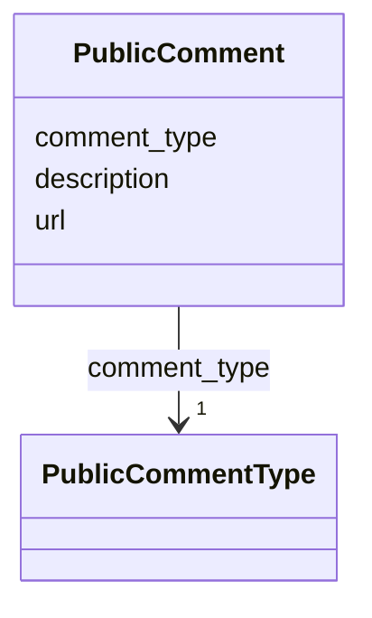

# Class: PublicComment


_A public comment document associated with a consultation for this experiment._


URI: [oae:PublicComment](https://schema.oaedata.org/PublicComment)





<!-- no inheritance hierarchy -->


## Slots

| Name | Cardinality and Range | Description | Inheritance |
| ---  | --- | --- | --- |
| [description](description.md) | 0..1 <br/> [String](String.md) | A narrative description of what this public comment contains | direct |
| [url](url.md) | 1 <br/> [uri](uri.md) | Link or DOI to access the public comment document | direct |
| [comment_type](comment_type.md) | 1 <br/> [PublicCommentType](PublicCommentType.md) | The kind of consultation these comments came from | direct |


## Usages

| used by | used in | type | used |
| ---  | --- | --- | --- |
| [Experiment](Experiment.md) | [public_comments](public_comments.md) | range | [PublicComment](PublicComment.md) |
| [InSituExperiment](InSituExperiment.md) | [public_comments](public_comments.md) | range | [PublicComment](PublicComment.md) |
| [Intervention](Intervention.md) | [public_comments](public_comments.md) | range | [PublicComment](PublicComment.md) |
| [Tracer](Tracer.md) | [public_comments](public_comments.md) | range | [PublicComment](PublicComment.md) |
| [InterventionWithTracer](InterventionWithTracer.md) | [public_comments](public_comments.md) | range | [PublicComment](PublicComment.md) |
| [Model](Model.md) | [public_comments](public_comments.md) | range | [PublicComment](PublicComment.md) |


## Identifier and Mapping Information


### Schema Source


* from schema: https://schema.oaedata.org/OAEDataSchema


## Mappings

| Mapping Type | Mapped Value |
| ---  | ---  |
| self | oae:PublicComment |
| native | oae:PublicComment |


## LinkML Source

<!-- TODO: investigate https://stackoverflow.com/questions/37606292/how-to-create-tabbed-code-blocks-in-mkdocs-or-sphinx -->

### Direct

<details>
```yaml
name: PublicComment
description: A public comment document associated with a consultation for this experiment.
from_schema: https://schema.oaedata.org/OAEDataSchema
slots:
- description
slot_usage:
  description:
    name: description
    description: A narrative description of what this public comment contains.
attributes:
  url:
    name: url
    description: Link or DOI to access the public comment document.
    title: URL
    from_schema: Experiment
    domain_of:
    - NamedLink
    - PublicComment
    range: uri
    required: true
  comment_type:
    name: comment_type
    description: The kind of consultation these comments came from.
    title: Public Comment Type
    from_schema: Experiment
    rank: 1000
    domain_of:
    - PublicComment
    range: PublicCommentType
    required: true

```
</details>

### Induced

<details>
```yaml
name: PublicComment
description: A public comment document associated with a consultation for this experiment.
from_schema: https://schema.oaedata.org/OAEDataSchema
slot_usage:
  description:
    name: description
    description: A narrative description of what this public comment contains.
attributes:
  url:
    name: url
    description: Link or DOI to access the public comment document.
    title: URL
    from_schema: Experiment
    alias: url
    owner: PublicComment
    domain_of:
    - NamedLink
    - PublicComment
    range: uri
    required: true
  comment_type:
    name: comment_type
    description: The kind of consultation these comments came from.
    title: Public Comment Type
    from_schema: Experiment
    rank: 1000
    alias: comment_type
    owner: PublicComment
    domain_of:
    - PublicComment
    range: PublicCommentType
    required: true
  description:
    name: description
    description: A narrative description of what this public comment contains.
    title: Description
    from_schema: https://schema.oaedata.org/OAEDataSchema
    rank: 1000
    slot_uri: schema:description
    alias: description
    owner: PublicComment
    domain_of:
    - Project
    - ExternalProject
    - Experiment
    - PublicComment
    - VocabularyItemReference
    - Dataset
    - ModelComponent
    range: string

```
</details>