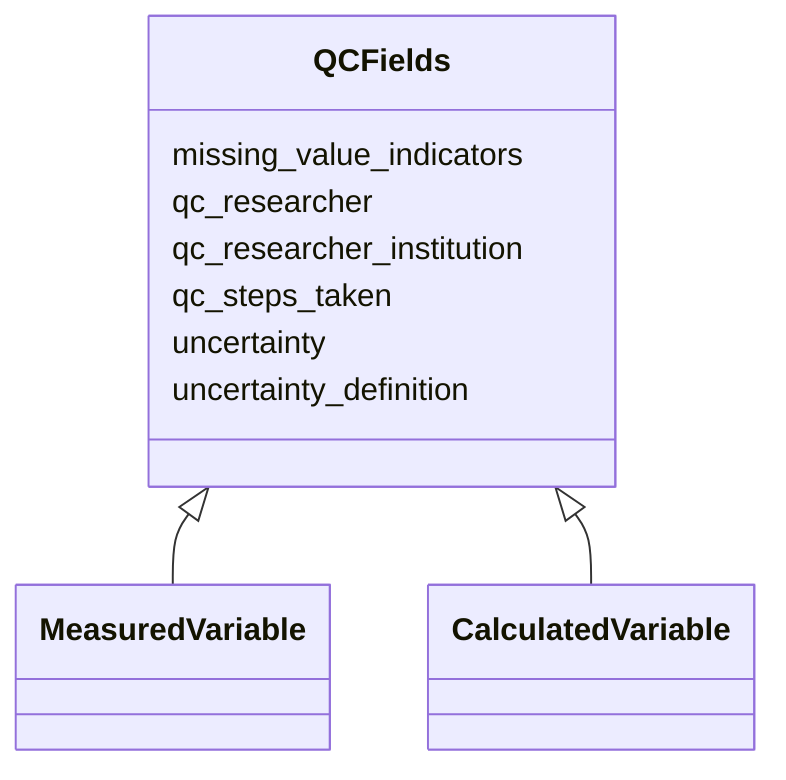

# Class: QCFields


_Quality control fields applicable to measured and calculated variables. Not applied to socioeconomic variables._


URI: [oae:QCFields](https://schema.oaedata.org/QCFields)





<!-- no inheritance hierarchy -->


## Slots

| Name | Cardinality and Range | Description | Inheritance |
| ---  | --- | --- | --- |
| [qc_steps_taken](qc_steps_taken.md) | 0..1 <br/> [String](String.md) | Describe what QC steps have been taken to improve the quality of the data (e | direct |
| [uncertainty](uncertainty.md) | 0..1 <br/> [String](String.md) | It is recommended to provide uncertainty for each data point in the data file | direct |
| [uncertainty_definition](uncertainty_definition.md) | 0..1 <br/> [String](String.md) | A description of the uncertainties involved in this method | direct |
| [missing_value_indicators](missing_value_indicators.md) | 0..1 <br/> [String](String.md) | The indicator used to represent missing values in the data file, e | direct |
| [qc_researcher](qc_researcher.md) | 0..1 <br/> [String](String.md) | The name of the PI whose research team QCed this parameter | direct |
| [qc_researcher_institution](qc_researcher_institution.md) | 0..1 <br/> [String](String.md) | The institution of the PI whose research team QCed this parameter | direct |


## Mixin Usage

| mixed into | description |
| --- | --- |
| [MeasuredVariable](MeasuredVariable.md) | Variable that is directly measured in-situ using instruments |
| [CalculatedVariable](CalculatedVariable.md) | A variable that is calculated or derived from other measured variables rather... |


## Identifier and Mapping Information


### Schema Source


* from schema: https://schema.oaedata.org/OAEDataSchema


## Mappings

| Mapping Type | Mapped Value |
| ---  | ---  |
| self | oae:QCFields |
| native | oae:QCFields |


## LinkML Source

<!-- TODO: investigate https://stackoverflow.com/questions/37606292/how-to-create-tabbed-code-blocks-in-mkdocs-or-sphinx -->

### Direct

<details>
```yaml
name: QCFields
description: Quality control fields applicable to measured and calculated variables.
  Not applied to socioeconomic variables.
from_schema: https://schema.oaedata.org/OAEDataSchema
mixin: true
slots:
- qc_steps_taken
- uncertainty
- uncertainty_definition
- missing_value_indicators
attributes:
  qc_researcher:
    name: qc_researcher
    description: The name of the PI whose research team QCed this parameter.
    title: Researcher who QCed this variable
    from_schema: Variable
    rank: 1000
    domain_of:
    - QCFields
    range: string
  qc_researcher_institution:
    name: qc_researcher_institution
    description: The institution of the PI whose research team QCed this parameter.
    title: QC Researcher Institution
    from_schema: Variable
    rank: 1000
    domain_of:
    - QCFields
    range: string

```
</details>

### Induced

<details>
```yaml
name: QCFields
description: Quality control fields applicable to measured and calculated variables.
  Not applied to socioeconomic variables.
from_schema: https://schema.oaedata.org/OAEDataSchema
mixin: true
attributes:
  qc_researcher:
    name: qc_researcher
    description: The name of the PI whose research team QCed this parameter.
    title: Researcher who QCed this variable
    from_schema: Variable
    rank: 1000
    alias: qc_researcher
    owner: QCFields
    domain_of:
    - QCFields
    range: string
  qc_researcher_institution:
    name: qc_researcher_institution
    description: The institution of the PI whose research team QCed this parameter.
    title: QC Researcher Institution
    from_schema: Variable
    rank: 1000
    alias: qc_researcher_institution
    owner: QCFields
    domain_of:
    - QCFields
    range: string
  qc_steps_taken:
    name: qc_steps_taken
    description: 'Describe what QC steps have been taken to improve the quality of
      the data (e.g., DOI, software and settings used, outlier removal, etc.).

      If quality control procedures are described in a separate document uploaded
      with the data, provide the name of the document here.'
    title: QC steps taken
    from_schema: https://schema.oaedata.org/OAEDataSchema
    rank: 1000
    alias: qc_steps_taken
    owner: QCFields
    domain_of:
    - QCFields
    range: string
  uncertainty:
    name: uncertainty
    description: 'It is recommended to provide uncertainty for each data point in
      the data file. Else provide a single value representative of the dataset.

      If uncertainty is provided as a variable, please list the column header name
      here.'
    title: Uncertainty
    from_schema: https://schema.oaedata.org/OAEDataSchema
    rank: 1000
    alias: uncertainty
    owner: QCFields
    domain_of:
    - StandardGas
    - CO2GasDetector
    - QCFields
    range: string
  uncertainty_definition:
    name: uncertainty_definition
    description: A description of the uncertainties involved in this method.
    title: How was the uncertainty defined
    from_schema: https://schema.oaedata.org/OAEDataSchema
    rank: 1000
    alias: uncertainty_definition
    owner: QCFields
    domain_of:
    - QCFields
    range: string
  missing_value_indicators:
    name: missing_value_indicators
    description: The indicator used to represent missing values in the data file,
      e.g., -999, NaN, etc.
    title: Missing value indicators
    from_schema: https://schema.oaedata.org/OAEDataSchema
    rank: 1000
    alias: missing_value_indicators
    owner: QCFields
    domain_of:
    - QCFields
    range: string

```
</details>