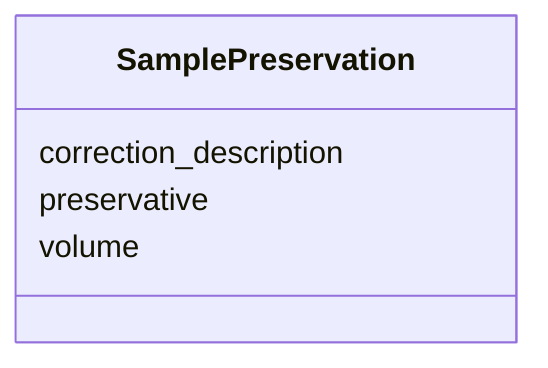

# Class: SamplePreservation


_Sample preservation information for DIC and TA measurements. Reference: OAPMetadata XSD variables.xsd - sample_preservation_


URI: [oae:SamplePreservation](https://schema.oaedata.org/SamplePreservation)





<!-- no inheritance hierarchy -->


## Slots

| Name | Cardinality and Range | Description | Inheritance |
| ---  | --- | --- | --- |
| [preservative](preservative.md) | 1 <br/> [String](String.md) | As described, e | direct |
| [volume](volume.md) | 1 <br/> [String](String.md) | The volume of preservative used | direct |
| [correction_description](correction_description.md) | 0..1 <br/> [String](String.md) | Description of how the preservative effect was corrected for | direct |


## Usages

| used by | used in | type | used |
| ---  | --- | --- | --- |
| [DiscreteTAVariable](DiscreteTAVariable.md) | [sample_preservation](sample_preservation.md) | range | [SamplePreservation](SamplePreservation.md) |
| [DiscreteDICVariable](DiscreteDICVariable.md) | [sample_preservation](sample_preservation.md) | range | [SamplePreservation](SamplePreservation.md) |


## Identifier and Mapping Information


### Schema Source


* from schema: https://schema.oaedata.org/OAEDataSchema


## Mappings

| Mapping Type | Mapped Value |
| ---  | ---  |
| self | oae:SamplePreservation |
| native | oae:SamplePreservation |


## LinkML Source

<!-- TODO: investigate https://stackoverflow.com/questions/37606292/how-to-create-tabbed-code-blocks-in-mkdocs-or-sphinx -->

### Direct

<details>
```yaml
name: SamplePreservation
description: 'Sample preservation information for DIC and TA measurements. Reference:
  OAPMetadata XSD variables.xsd - sample_preservation'
from_schema: https://schema.oaedata.org/OAEDataSchema
attributes:
  preservative:
    name: preservative
    description: As described, e.g., Mercury Chloride.
    title: Preservative used
    from_schema: Variable
    rank: 1000
    domain_of:
    - SamplePreservation
    range: string
    required: true
  volume:
    name: volume
    description: The volume of preservative used.
    title: Preservative volume
    from_schema: Variable
    domain_of:
    - CO2Equilibrator
    - SamplePreservation
    range: string
    required: true
  correction_description:
    name: correction_description
    description: Description of how the preservative effect was corrected for.
    title: Preservative correction description
    from_schema: Variable
    rank: 1000
    domain_of:
    - SamplePreservation
    range: string

```
</details>

### Induced

<details>
```yaml
name: SamplePreservation
description: 'Sample preservation information for DIC and TA measurements. Reference:
  OAPMetadata XSD variables.xsd - sample_preservation'
from_schema: https://schema.oaedata.org/OAEDataSchema
attributes:
  preservative:
    name: preservative
    description: As described, e.g., Mercury Chloride.
    title: Preservative used
    from_schema: Variable
    rank: 1000
    alias: preservative
    owner: SamplePreservation
    domain_of:
    - SamplePreservation
    range: string
    required: true
  volume:
    name: volume
    description: The volume of preservative used.
    title: Preservative volume
    from_schema: Variable
    alias: volume
    owner: SamplePreservation
    domain_of:
    - CO2Equilibrator
    - SamplePreservation
    range: string
    required: true
  correction_description:
    name: correction_description
    description: Description of how the preservative effect was corrected for.
    title: Preservative correction description
    from_schema: Variable
    rank: 1000
    alias: correction_description
    owner: SamplePreservation
    domain_of:
    - SamplePreservation
    range: string

```
</details>