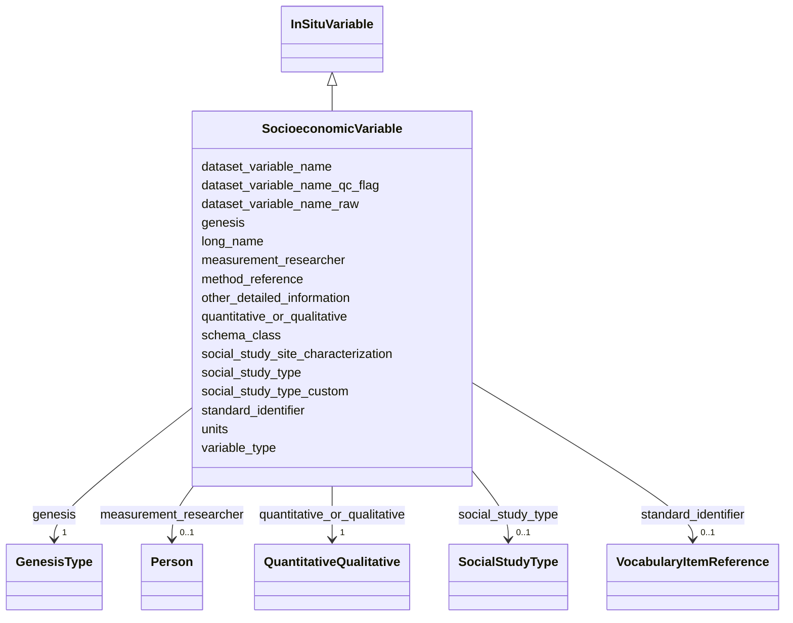

# Class: SocioeconomicVariable


_Socioeconomic variable for social and economic data such as survey responses, ecosystem service valuations, or text analysis. A field variable: includes method_reference and measurement_researcher, but does NOT include QCFields, instrument details, or calibration._


URI: [oae:SocioeconomicVariable](https://schema.oaedata.org/SocioeconomicVariable)





## Inheritance
* [Variable](Variable.md)
    * [FieldVariable](FieldVariable.md)
        * [InSituVariable](InSituVariable.md)
            * **SocioeconomicVariable**


## Slots

| Name | Cardinality and Range | Description | Inheritance |
| ---  | --- | --- | --- |
| [quantitative_or_qualitative](quantitative_or_qualitative.md) | 1 <br/> [QuantitativeQualitative](QuantitativeQualitative.md) | Whether this variable captures quantitative (numerical) or qualitative (categ... | direct |
| [social_study_type](social_study_type.md) | 0..1 <br/> [SocialStudyType](SocialStudyType.md) | The type of social science study this variable comes from | direct |
| [social_study_type_custom](social_study_type_custom.md) | 0..1 <br/> [String](String.md) | Custom study type description when "other" is selected | direct |
| [social_study_site_characterization](social_study_site_characterization.md) | 0..1 <br/> [String](String.md) | Time period and location description for the social study (e | direct |
| [genesis](genesis.md) | 1 <br/> [GenesisType](GenesisType.md) |  | [InSituVariable](InSituVariable.md) |
| [dataset_variable_name_qc_flag](dataset_variable_name_qc_flag.md) | 0..1 <br/> [String](String.md) | If applicable, the column header name used for the quality control flag corre... | [InSituVariable](InSituVariable.md) |
| [dataset_variable_name_raw](dataset_variable_name_raw.md) | 0..1 <br/> [String](String.md) | If applicable, the column header name used for the raw data corresponding to ... | [InSituVariable](InSituVariable.md) |
| [other_detailed_information](other_detailed_information.md) | 0..1 <br/> [String](String.md) | Any additional information about this variable | [InSituVariable](InSituVariable.md) |
| [method_reference](method_reference.md) | 0..1 <br/> [String](String.md) | Citation for the method used | [InSituVariable](InSituVariable.md) |
| [measurement_researcher](measurement_researcher.md) | 0..1 <br/> [Person](Person.md) | The name of the PI whose research team measured or derived this parameter | [InSituVariable](InSituVariable.md) |
| [units](units.md) | 1 <br/> [String](String.md) | Unit of measurement for this variable | [Variable](Variable.md) |
| [variable_type](variable_type.md) | 1 <br/> [String](String.md) | High-level classification of the variable | [Variable](Variable.md) |
| [schema_class](schema_class.md) | 1 <br/> [String](String.md) | The schema class name for this variable (e | [Variable](Variable.md) |
| [standard_identifier](standard_identifier.md) | 0..1 <br/> [VocabularyItemReference](VocabularyItemReference.md) | A term from a community vocabulary that identifies this variable | [Variable](Variable.md) |
| [dataset_variable_name](dataset_variable_name.md) | 1 <br/> [String](String.md) | The name for the variable as it is identified in the dataset data file | [Variable](Variable.md) |
| [long_name](long_name.md) | 1 <br/> [String](String.md) | Full descriptive name of the variable | [Variable](Variable.md) |


## Identifier and Mapping Information


### Schema Source


* from schema: https://schema.oaedata.org/OAEDataSchema


## Mappings

| Mapping Type | Mapped Value |
| ---  | ---  |
| self | oae:SocioeconomicVariable |
| native | oae:SocioeconomicVariable |


## LinkML Source

<!-- TODO: investigate https://stackoverflow.com/questions/37606292/how-to-create-tabbed-code-blocks-in-mkdocs-or-sphinx -->

### Direct

<details>
```yaml
name: SocioeconomicVariable
description: 'Socioeconomic variable for social and economic data such as survey responses,
  ecosystem service valuations, or text analysis. A field variable: includes method_reference
  and measurement_researcher, but does NOT include QCFields, instrument details, or
  calibration.'
from_schema: https://schema.oaedata.org/OAEDataSchema
is_a: InSituVariable
slot_usage:
  variable_type:
    name: variable_type
    range: string
    equals_string: socioeconomic
attributes:
  quantitative_or_qualitative:
    name: quantitative_or_qualitative
    description: Whether this variable captures quantitative (numerical) or qualitative
      (categorical/textual) data.
    title: Quantitative or Qualitative
    from_schema: Variable
    rank: 1000
    domain_of:
    - SocioeconomicVariable
    range: QuantitativeQualitative
    required: true
  social_study_type:
    name: social_study_type
    description: The type of social science study this variable comes from.
    title: Social Study Type
    from_schema: Variable
    rank: 1000
    domain_of:
    - SocioeconomicVariable
    range: SocialStudyType
  social_study_type_custom:
    name: social_study_type_custom
    description: Custom study type description when "other" is selected.
    title: Social Study Type (custom)
    from_schema: Variable
    rank: 1000
    domain_of:
    - SocioeconomicVariable
    range: string
  social_study_site_characterization:
    name: social_study_site_characterization
    description: Time period and location description for the social study (e.g.,
      "2023-2024, coastal communities in Maine, USA").
    title: Study Site Characterization
    from_schema: Variable
    rank: 1000
    domain_of:
    - SocioeconomicVariable
    range: string

```
</details>

### Induced

<details>
```yaml
name: SocioeconomicVariable
description: 'Socioeconomic variable for social and economic data such as survey responses,
  ecosystem service valuations, or text analysis. A field variable: includes method_reference
  and measurement_researcher, but does NOT include QCFields, instrument details, or
  calibration.'
from_schema: https://schema.oaedata.org/OAEDataSchema
is_a: InSituVariable
slot_usage:
  variable_type:
    name: variable_type
    range: string
    equals_string: socioeconomic
attributes:
  quantitative_or_qualitative:
    name: quantitative_or_qualitative
    description: Whether this variable captures quantitative (numerical) or qualitative
      (categorical/textual) data.
    title: Quantitative or Qualitative
    from_schema: Variable
    rank: 1000
    alias: quantitative_or_qualitative
    owner: SocioeconomicVariable
    domain_of:
    - SocioeconomicVariable
    range: QuantitativeQualitative
    required: true
  social_study_type:
    name: social_study_type
    description: The type of social science study this variable comes from.
    title: Social Study Type
    from_schema: Variable
    rank: 1000
    alias: social_study_type
    owner: SocioeconomicVariable
    domain_of:
    - SocioeconomicVariable
    range: SocialStudyType
  social_study_type_custom:
    name: social_study_type_custom
    description: Custom study type description when "other" is selected.
    title: Social Study Type (custom)
    from_schema: Variable
    rank: 1000
    alias: social_study_type_custom
    owner: SocioeconomicVariable
    domain_of:
    - SocioeconomicVariable
    range: string
  social_study_site_characterization:
    name: social_study_site_characterization
    description: Time period and location description for the social study (e.g.,
      "2023-2024, coastal communities in Maine, USA").
    title: Study Site Characterization
    from_schema: Variable
    rank: 1000
    alias: social_study_site_characterization
    owner: SocioeconomicVariable
    domain_of:
    - SocioeconomicVariable
    range: string
  genesis:
    name: genesis
    from_schema: Variable
    rank: 1000
    alias: genesis
    owner: SocioeconomicVariable
    domain_of:
    - InSituVariable
    range: GenesisType
    required: true
  dataset_variable_name_qc_flag:
    name: dataset_variable_name_qc_flag
    description: If applicable, the column header name used for the quality control
      flag corresponding to this variable.
    title: Dataset variable name (Quality Flag)
    from_schema: Variable
    rank: 1000
    alias: dataset_variable_name_qc_flag
    owner: SocioeconomicVariable
    domain_of:
    - InSituVariable
    range: string
  dataset_variable_name_raw:
    name: dataset_variable_name_raw
    description: If applicable, the column header name used for the raw data corresponding
      to this variable.
    title: Dataset variable name (raw)
    from_schema: Variable
    rank: 1000
    alias: dataset_variable_name_raw
    owner: SocioeconomicVariable
    domain_of:
    - InSituVariable
    range: string
  other_detailed_information:
    name: other_detailed_information
    description: Any additional information about this variable.
    title: Other Detailed Information
    from_schema: Variable
    rank: 1000
    alias: other_detailed_information
    owner: SocioeconomicVariable
    domain_of:
    - InSituVariable
    range: string
  method_reference:
    name: method_reference
    description: Citation for the method used.
    title: Method Reference
    from_schema: Variable
    alias: method_reference
    owner: SocioeconomicVariable
    domain_of:
    - Calibration
    - InSituVariable
    range: string
  measurement_researcher:
    name: measurement_researcher
    description: The name of the PI whose research team measured or derived this parameter.
    title: Researcher who measured the variable
    from_schema: Variable
    rank: 1000
    alias: measurement_researcher
    owner: SocioeconomicVariable
    domain_of:
    - InSituVariable
    range: Person
  units:
    name: units
    description: Unit of measurement for this variable.
    title: Unit
    from_schema: https://schema.oaedata.org/OAEDataSchema
    rank: 1000
    alias: units
    owner: SocioeconomicVariable
    domain_of:
    - Variable
    range: string
    required: true
  variable_type:
    name: variable_type
    description: High-level classification of the variable. Determines which standard
      identifiers are available and, combined with genesis and sampling, which schema
      class to use.
    title: Variable Type
    from_schema: https://schema.oaedata.org/OAEDataSchema
    rank: 1000
    alias: variable_type
    owner: SocioeconomicVariable
    domain_of:
    - Variable
    range: string
    required: true
    equals_string: socioeconomic
  schema_class:
    name: schema_class
    description: The schema class name for this variable (e.g., "DiscretePHVariable").
      Auto-populated by the metadata builder.
    from_schema: Variable
    rank: 1000
    designates_type: true
    alias: schema_class
    owner: SocioeconomicVariable
    domain_of:
    - Variable
    range: string
    required: true
  standard_identifier:
    name: standard_identifier
    description: A term from a community vocabulary that identifies this variable.
      CF standard names (NERC P07) are recommended.
    from_schema: Variable
    rank: 1000
    alias: standard_identifier
    owner: SocioeconomicVariable
    domain_of:
    - Variable
    range: VocabularyItemReference
  dataset_variable_name:
    name: dataset_variable_name
    description: The name for the variable as it is identified in the dataset data
      file. This could be the column header in a CSV or the variable name in a NetCDF
      file. Standard common recommended column header names can be found in protocol
      documentation [here](https://www.carbontosea.org/oae-data-protocol/1-0-0/#column-header-name).
    title: Dataset variable name
    from_schema: Variable
    rank: 1000
    alias: dataset_variable_name
    owner: SocioeconomicVariable
    domain_of:
    - Variable
    range: string
    required: true
  long_name:
    name: long_name
    description: Full descriptive name of the variable.
    title: Variable full name
    from_schema: Variable
    rank: 1000
    alias: long_name
    owner: SocioeconomicVariable
    domain_of:
    - Variable
    range: string
    required: true

```
</details>