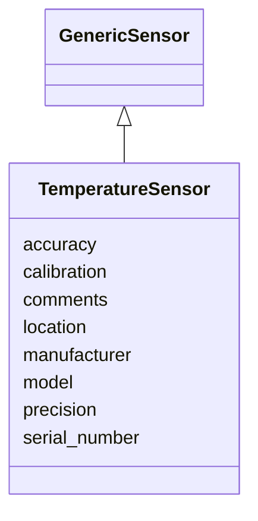

# Class: TemperatureSensor


_Temperature sensor used in continuous CO2 measurements. Accuracy and precision are reported in degrees Celsius._


URI: [oae:TemperatureSensor](https://schema.oaedata.org/TemperatureSensor)





## Inheritance
* [GenericSensor](GenericSensor.md)
    * **TemperatureSensor**


## Slots

| Name | Cardinality and Range | Description | Inheritance |
| ---  | --- | --- | --- |
| [location](location.md) | 0..1 <br/> [String](String.md) | Location of the sensor | [GenericSensor](GenericSensor.md) |
| [manufacturer](manufacturer.md) | 0..1 <br/> [String](String.md) | Manufacturer of the sensor | [GenericSensor](GenericSensor.md) |
| [model](model.md) | 0..1 <br/> [String](String.md) | Model number of the sensor | [GenericSensor](GenericSensor.md) |
| [serial_number](serial_number.md) | 0..1 <br/> [String](String.md) | Serial number of the sensor | [GenericSensor](GenericSensor.md) |
| [accuracy](accuracy.md) | 0..1 <br/> [Float](Float.md) | Accuracy of the temperature sensor in degrees Celsius | [GenericSensor](GenericSensor.md) |
| [precision](precision.md) | 0..1 <br/> [Float](Float.md) | Precision of the temperature sensor in degrees Celsius | [GenericSensor](GenericSensor.md) |
| [calibration](calibration.md) | 0..1 <br/> [String](String.md) | Calibration information for the sensor | [GenericSensor](GenericSensor.md) |
| [comments](comments.md) | 0..1 <br/> [String](String.md) | Additional comments about the sensor | [GenericSensor](GenericSensor.md) |


## Usages

| used by | used in | type | used |
| ---  | --- | --- | --- |
| [ContinuousCO2Variable](ContinuousCO2Variable.md) | [equilibrator_temperature_sensor](equilibrator_temperature_sensor.md) | range | [TemperatureSensor](TemperatureSensor.md) |


## Identifier and Mapping Information


### Schema Source


* from schema: https://schema.oaedata.org/OAEDataSchema


## Mappings

| Mapping Type | Mapped Value |
| ---  | ---  |
| self | oae:TemperatureSensor |
| native | oae:TemperatureSensor |


## LinkML Source

<!-- TODO: investigate https://stackoverflow.com/questions/37606292/how-to-create-tabbed-code-blocks-in-mkdocs-or-sphinx -->

### Direct

<details>
```yaml
name: TemperatureSensor
description: Temperature sensor used in continuous CO2 measurements. Accuracy and
  precision are reported in degrees Celsius.
from_schema: https://schema.oaedata.org/OAEDataSchema
is_a: GenericSensor
slot_usage:
  accuracy:
    name: accuracy
    description: Accuracy of the temperature sensor in degrees Celsius.
    title: Accuracy (°C)
  precision:
    name: precision
    description: Precision of the temperature sensor in degrees Celsius.
    title: Precision (°C)

```
</details>

### Induced

<details>
```yaml
name: TemperatureSensor
description: Temperature sensor used in continuous CO2 measurements. Accuracy and
  precision are reported in degrees Celsius.
from_schema: https://schema.oaedata.org/OAEDataSchema
is_a: GenericSensor
slot_usage:
  accuracy:
    name: accuracy
    description: Accuracy of the temperature sensor in degrees Celsius.
    title: Accuracy (°C)
  precision:
    name: precision
    description: Precision of the temperature sensor in degrees Celsius.
    title: Precision (°C)
attributes:
  location:
    name: location
    description: Location of the sensor.
    title: Location
    from_schema: Instrument
    rank: 1000
    alias: location
    owner: TemperatureSensor
    domain_of:
    - GenericSensor
    range: string
  manufacturer:
    name: manufacturer
    description: Manufacturer of the sensor.
    title: Manufacturer
    from_schema: Instrument
    alias: manufacturer
    owner: TemperatureSensor
    domain_of:
    - StandardGas
    - AnalyzingInstrument
    - GenericSensor
    range: string
  model:
    name: model
    description: Model number of the sensor.
    title: Model
    from_schema: Instrument
    alias: model
    owner: TemperatureSensor
    domain_of:
    - AnalyzingInstrument
    - GenericSensor
    range: string
  serial_number:
    name: serial_number
    description: Serial number of the sensor.
    title: Serial number
    from_schema: Instrument
    alias: serial_number
    owner: TemperatureSensor
    domain_of:
    - AnalyzingInstrument
    - GenericSensor
    range: string
  accuracy:
    name: accuracy
    description: Accuracy of the temperature sensor in degrees Celsius.
    title: Accuracy (°C)
    from_schema: Instrument
    alias: accuracy
    owner: TemperatureSensor
    domain_of:
    - AnalyzingInstrument
    - GenericSensor
    range: float
  precision:
    name: precision
    description: Precision of the temperature sensor in degrees Celsius.
    title: Precision (°C)
    from_schema: Instrument
    alias: precision
    owner: TemperatureSensor
    domain_of:
    - AnalyzingInstrument
    - GenericSensor
    range: float
  calibration:
    name: calibration
    description: Calibration information for the sensor.
    title: Calibration
    from_schema: Instrument
    alias: calibration
    owner: TemperatureSensor
    domain_of:
    - AnalyzingInstrument
    - PHInstrument
    - CRMInstrument
    - CO2GasDetector
    - ContinuousCO2GasDetector
    - GenericSensor
    range: string
  comments:
    name: comments
    description: Additional comments about the sensor.
    title: Comments
    from_schema: Instrument
    rank: 1000
    alias: comments
    owner: TemperatureSensor
    domain_of:
    - GenericSensor
    range: string

```
</details>