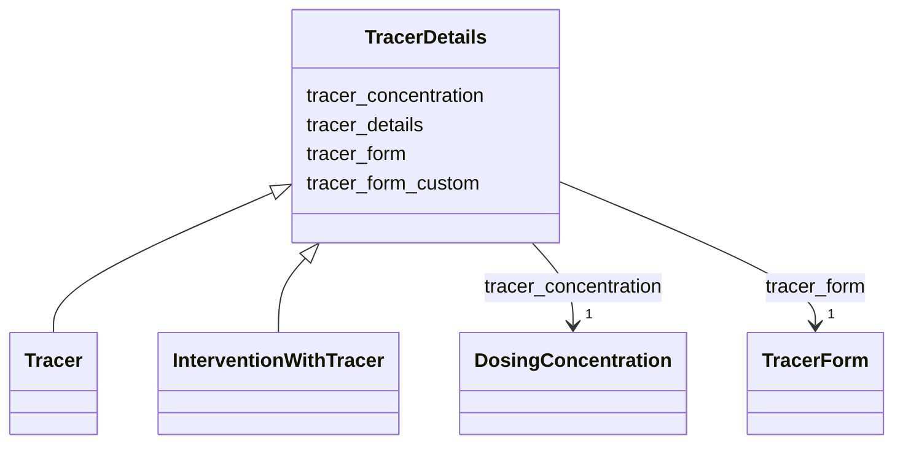

# Class: TracerDetails


_An abstract class (used as a mixin, not implemented directly) for detailing the required fields that are specific to an Experiment with type "Tracer"_


URI: [oae:TracerDetails](https://schema.oaedata.org/TracerDetails)





<!-- no inheritance hierarchy -->


## Slots

| Name | Cardinality and Range | Description | Inheritance |
| ---  | --- | --- | --- |
| [tracer_form](tracer_form.md) | 1 <br/> [TracerForm](TracerForm.md) | The form of tracer upon delivery to the ocean (e | direct |
| [tracer_form_custom](tracer_form_custom.md) | 0..1 <br/> [String](String.md) | If "other" was selected for Tracer Form, please specify the custom tracer for... | direct |
| [tracer_details](tracer_details.md) | 1 <br/> [String](String.md) | state the kind of tracer used (e | direct |
| [tracer_concentration](tracer_concentration.md) | 1 <br/> [DosingConcentration](DosingConcentration.md) | Fixed concentration or provide link/source to tracer concentration separately... | direct |


## Mixin Usage

| mixed into | description |
| --- | --- |
| [Tracer](Tracer.md) | Additional metadata that applies to experiments where a tracer study was cond... |
| [InterventionWithTracer](InterventionWithTracer.md) | Additional metadata that applies to hybrid experiments where an intervention ... |


## Identifier and Mapping Information


### Schema Source


* from schema: https://schema.oaedata.org/OAEDataSchema


## Mappings

| Mapping Type | Mapped Value |
| ---  | ---  |
| self | oae:TracerDetails |
| native | oae:TracerDetails |


## LinkML Source

<!-- TODO: investigate https://stackoverflow.com/questions/37606292/how-to-create-tabbed-code-blocks-in-mkdocs-or-sphinx -->

### Direct

<details>
```yaml
name: TracerDetails
description: An abstract class (used as a mixin, not implemented directly) for detailing
  the required fields that are specific to an Experiment with type "Tracer"
from_schema: https://schema.oaedata.org/OAEDataSchema
mixin: true
attributes:
  tracer_form:
    name: tracer_form
    description: The form of tracer upon delivery to the ocean (e.g. gas or dye-release)
    title: Tracer Form
    from_schema: Experiment
    rank: 1000
    domain_of:
    - TracerDetails
    range: TracerForm
    required: true
  tracer_form_custom:
    name: tracer_form_custom
    description: If "other" was selected for Tracer Form, please specify the custom
      tracer form here.
    title: Tracer Form (Custom)
    from_schema: Experiment
    rank: 1000
    domain_of:
    - TracerDetails
    range: string
  tracer_details:
    name: tracer_details
    description: state the kind of tracer used (e.g. rhodamine, or a specific gas)
    title: Tracer Details
    from_schema: Experiment
    rank: 1000
    domain_of:
    - TracerDetails
    range: string
    required: true
  tracer_concentration:
    name: tracer_concentration
    description: Fixed concentration or provide link/source to tracer concentration
      separately in the dosing file. Please include whether concentration is directly
      measured or a derived value. If this is a variable included with your data,
      please note so here as 'tracer concentration provided as a variable' and use
      'tracer_concentration' for your column header name.
    title: Tracer Concentration
    from_schema: Experiment
    rank: 1000
    domain_of:
    - TracerDetails
    range: DosingConcentration
    required: true

```
</details>

### Induced

<details>
```yaml
name: TracerDetails
description: An abstract class (used as a mixin, not implemented directly) for detailing
  the required fields that are specific to an Experiment with type "Tracer"
from_schema: https://schema.oaedata.org/OAEDataSchema
mixin: true
attributes:
  tracer_form:
    name: tracer_form
    description: The form of tracer upon delivery to the ocean (e.g. gas or dye-release)
    title: Tracer Form
    from_schema: Experiment
    rank: 1000
    alias: tracer_form
    owner: TracerDetails
    domain_of:
    - TracerDetails
    range: TracerForm
    required: true
  tracer_form_custom:
    name: tracer_form_custom
    description: If "other" was selected for Tracer Form, please specify the custom
      tracer form here.
    title: Tracer Form (Custom)
    from_schema: Experiment
    rank: 1000
    alias: tracer_form_custom
    owner: TracerDetails
    domain_of:
    - TracerDetails
    range: string
  tracer_details:
    name: tracer_details
    description: state the kind of tracer used (e.g. rhodamine, or a specific gas)
    title: Tracer Details
    from_schema: Experiment
    rank: 1000
    alias: tracer_details
    owner: TracerDetails
    domain_of:
    - TracerDetails
    range: string
    required: true
  tracer_concentration:
    name: tracer_concentration
    description: Fixed concentration or provide link/source to tracer concentration
      separately in the dosing file. Please include whether concentration is directly
      measured or a derived value. If this is a variable included with your data,
      please note so here as 'tracer concentration provided as a variable' and use
      'tracer_concentration' for your column header name.
    title: Tracer Concentration
    from_schema: Experiment
    rank: 1000
    alias: tracer_concentration
    owner: TracerDetails
    domain_of:
    - TracerDetails
    range: DosingConcentration
    required: true

```
</details>