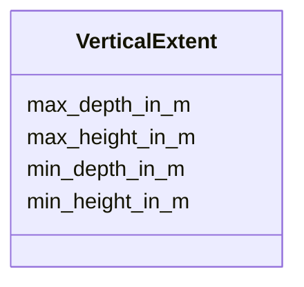

# Class: VerticalExtent


_The vertical extent of a place or structure in meters._


URI: [oae:VerticalExtent](https://schema.oaedata.org/VerticalExtent)





<!-- no inheritance hierarchy -->


## Slots

| Name | Cardinality and Range | Description | Inheritance |
| ---  | --- | --- | --- |
| [min_depth_in_m](min_depth_in_m.md) | 0..1 <br/> [Float](Float.md) | Minimum depth of observation in meters | direct |
| [max_depth_in_m](max_depth_in_m.md) | 0..1 <br/> [Float](Float.md) | Maximum depth of observation in meters | direct |
| [min_height_in_m](min_height_in_m.md) | 0..1 <br/> [Float](Float.md) | Minimum height of observation (in meters) for above ground aerial coverage | direct |
| [max_height_in_m](max_height_in_m.md) | 0..1 <br/> [Float](Float.md) | Maximum height of observation (in meters) for above ground aerial coverage | direct |


## Usages

| used by | used in | type | used |
| ---  | --- | --- | --- |
| [InSituExperiment](InSituExperiment.md) | [vertical_coverage](vertical_coverage.md) | range | [VerticalExtent](VerticalExtent.md) |
| [Intervention](Intervention.md) | [vertical_coverage](vertical_coverage.md) | range | [VerticalExtent](VerticalExtent.md) |
| [Tracer](Tracer.md) | [vertical_coverage](vertical_coverage.md) | range | [VerticalExtent](VerticalExtent.md) |
| [InterventionWithTracer](InterventionWithTracer.md) | [vertical_coverage](vertical_coverage.md) | range | [VerticalExtent](VerticalExtent.md) |


## Identifier and Mapping Information


### Schema Source


* from schema: https://schema.oaedata.org/OAEDataSchema


## Mappings

| Mapping Type | Mapped Value |
| ---  | ---  |
| self | oae:VerticalExtent |
| native | oae:VerticalExtent |


## LinkML Source

<!-- TODO: investigate https://stackoverflow.com/questions/37606292/how-to-create-tabbed-code-blocks-in-mkdocs-or-sphinx -->

### Direct

<details>
```yaml
name: VerticalExtent
description: The vertical extent of a place or structure in meters.
from_schema: https://schema.oaedata.org/OAEDataSchema
attributes:
  min_depth_in_m:
    name: min_depth_in_m
    description: Minimum depth of observation in meters. Use negative numbers for
      depths below sea level.
    title: Minimum Depth (in meters)
    from_schema: Core
    rank: 1000
    domain_of:
    - VerticalExtent
    range: float
    maximum_value: 0
  max_depth_in_m:
    name: max_depth_in_m
    description: Maximum depth of observation in meters. Use negative numbers for
      depths below sea level.
    title: Maximum Depth (in meters)
    from_schema: Core
    rank: 1000
    domain_of:
    - VerticalExtent
    range: float
    maximum_value: 0
  min_height_in_m:
    name: min_height_in_m
    description: Minimum height of observation (in meters) for above ground aerial
      coverage.
    title: Minimum Height (in meters)
    from_schema: Core
    rank: 1000
    domain_of:
    - VerticalExtent
    range: float
    minimum_value: 0
  max_height_in_m:
    name: max_height_in_m
    description: Maximum height of observation (in meters) for above ground aerial
      coverage.
    title: Maximum Height (in meters)
    from_schema: Core
    rank: 1000
    domain_of:
    - VerticalExtent
    range: float
    minimum_value: 0

```
</details>

### Induced

<details>
```yaml
name: VerticalExtent
description: The vertical extent of a place or structure in meters.
from_schema: https://schema.oaedata.org/OAEDataSchema
attributes:
  min_depth_in_m:
    name: min_depth_in_m
    description: Minimum depth of observation in meters. Use negative numbers for
      depths below sea level.
    title: Minimum Depth (in meters)
    from_schema: Core
    rank: 1000
    alias: min_depth_in_m
    owner: VerticalExtent
    domain_of:
    - VerticalExtent
    range: float
    maximum_value: 0
  max_depth_in_m:
    name: max_depth_in_m
    description: Maximum depth of observation in meters. Use negative numbers for
      depths below sea level.
    title: Maximum Depth (in meters)
    from_schema: Core
    rank: 1000
    alias: max_depth_in_m
    owner: VerticalExtent
    domain_of:
    - VerticalExtent
    range: float
    maximum_value: 0
  min_height_in_m:
    name: min_height_in_m
    description: Minimum height of observation (in meters) for above ground aerial
      coverage.
    title: Minimum Height (in meters)
    from_schema: Core
    rank: 1000
    alias: min_height_in_m
    owner: VerticalExtent
    domain_of:
    - VerticalExtent
    range: float
    minimum_value: 0
  max_height_in_m:
    name: max_height_in_m
    description: Maximum height of observation (in meters) for above ground aerial
      coverage.
    title: Maximum Height (in meters)
    from_schema: Core
    rank: 1000
    alias: max_height_in_m
    owner: VerticalExtent
    domain_of:
    - VerticalExtent
    range: float
    minimum_value: 0

```
</details>