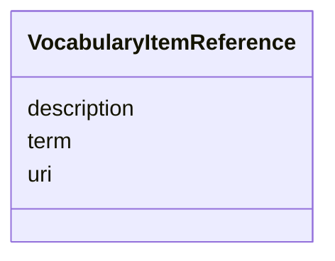

# Class: VocabularyItemReference


URI: [oae:VocabularyItemReference](https://schema.oaedata.org/VocabularyItemReference)





<!-- no inheritance hierarchy -->


## Slots

| Name | Cardinality and Range | Description | Inheritance |
| ---  | --- | --- | --- |
| [description](description.md) | 0..1 <br/> [String](String.md) | A narrative description of the thing | direct |
| [term](term.md) | 1 <br/> [String](String.md) |  | direct |
| [uri](uri.md) | 1 <br/> [Uriorcurie](Uriorcurie.md) |  | direct |


## Usages

| used by | used in | type | used |
| ---  | --- | --- | --- |
| [Variable](Variable.md) | [standard_identifier](standard_identifier.md) | range | [VocabularyItemReference](VocabularyItemReference.md) |
| [FieldVariable](FieldVariable.md) | [standard_identifier](standard_identifier.md) | range | [VocabularyItemReference](VocabularyItemReference.md) |
| [NonMeasuredVariable](NonMeasuredVariable.md) | [standard_identifier](standard_identifier.md) | range | [VocabularyItemReference](VocabularyItemReference.md) |
| [InSituVariable](InSituVariable.md) | [standard_identifier](standard_identifier.md) | range | [VocabularyItemReference](VocabularyItemReference.md) |
| [MeasuredVariable](MeasuredVariable.md) | [standard_identifier](standard_identifier.md) | range | [VocabularyItemReference](VocabularyItemReference.md) |
| [DiscreteMeasuredVariable](DiscreteMeasuredVariable.md) | [standard_identifier](standard_identifier.md) | range | [VocabularyItemReference](VocabularyItemReference.md) |
| [ContinuousMeasuredVariable](ContinuousMeasuredVariable.md) | [standard_identifier](standard_identifier.md) | range | [VocabularyItemReference](VocabularyItemReference.md) |
| [CalculatedVariable](CalculatedVariable.md) | [standard_identifier](standard_identifier.md) | range | [VocabularyItemReference](VocabularyItemReference.md) |
| [ContinuousPHVariable](ContinuousPHVariable.md) | [standard_identifier](standard_identifier.md) | range | [VocabularyItemReference](VocabularyItemReference.md) |
| [DiscretePHVariable](DiscretePHVariable.md) | [standard_identifier](standard_identifier.md) | range | [VocabularyItemReference](VocabularyItemReference.md) |
| [ContinuousTAVariable](ContinuousTAVariable.md) | [standard_identifier](standard_identifier.md) | range | [VocabularyItemReference](VocabularyItemReference.md) |
| [DiscreteTAVariable](DiscreteTAVariable.md) | [standard_identifier](standard_identifier.md) | range | [VocabularyItemReference](VocabularyItemReference.md) |
| [ContinuousDICVariable](ContinuousDICVariable.md) | [standard_identifier](standard_identifier.md) | range | [VocabularyItemReference](VocabularyItemReference.md) |
| [DiscreteDICVariable](DiscreteDICVariable.md) | [standard_identifier](standard_identifier.md) | range | [VocabularyItemReference](VocabularyItemReference.md) |
| [ContinuousSedimentVariable](ContinuousSedimentVariable.md) | [standard_identifier](standard_identifier.md) | range | [VocabularyItemReference](VocabularyItemReference.md) |
| [DiscreteSedimentVariable](DiscreteSedimentVariable.md) | [standard_identifier](standard_identifier.md) | range | [VocabularyItemReference](VocabularyItemReference.md) |
| [DiscreteCO2Variable](DiscreteCO2Variable.md) | [standard_identifier](standard_identifier.md) | range | [VocabularyItemReference](VocabularyItemReference.md) |
| [ContinuousCO2Variable](ContinuousCO2Variable.md) | [standard_identifier](standard_identifier.md) | range | [VocabularyItemReference](VocabularyItemReference.md) |
| [HPLCVariable](HPLCVariable.md) | [standard_identifier](standard_identifier.md) | range | [VocabularyItemReference](VocabularyItemReference.md) |
| [DiscretePhysiologicalVariable](DiscretePhysiologicalVariable.md) | [standard_identifier](standard_identifier.md) | range | [VocabularyItemReference](VocabularyItemReference.md) |
| [ContinuousPhysiologicalVariable](ContinuousPhysiologicalVariable.md) | [standard_identifier](standard_identifier.md) | range | [VocabularyItemReference](VocabularyItemReference.md) |
| [SocioeconomicVariable](SocioeconomicVariable.md) | [standard_identifier](standard_identifier.md) | range | [VocabularyItemReference](VocabularyItemReference.md) |
| [ModelOutputVariable](ModelOutputVariable.md) | [standard_identifier](standard_identifier.md) | range | [VocabularyItemReference](VocabularyItemReference.md) |


## Identifier and Mapping Information


### Schema Source


* from schema: https://schema.oaedata.org/OAEDataSchema


## Mappings

| Mapping Type | Mapped Value |
| ---  | ---  |
| self | oae:VocabularyItemReference |
| native | oae:VocabularyItemReference |


## LinkML Source

<!-- TODO: investigate https://stackoverflow.com/questions/37606292/how-to-create-tabbed-code-blocks-in-mkdocs-or-sphinx -->

### Direct

<details>
```yaml
name: VocabularyItemReference
from_schema: https://schema.oaedata.org/OAEDataSchema
slots:
- description
attributes:
  term:
    name: term
    from_schema: Variable
    rank: 1000
    domain_of:
    - VocabularyItemReference
    range: string
    required: true
  uri:
    name: uri
    from_schema: Variable
    rank: 1000
    domain_of:
    - VocabularyItemReference
    range: uriorcurie
    required: true

```
</details>

### Induced

<details>
```yaml
name: VocabularyItemReference
from_schema: https://schema.oaedata.org/OAEDataSchema
attributes:
  term:
    name: term
    from_schema: Variable
    rank: 1000
    alias: term
    owner: VocabularyItemReference
    domain_of:
    - VocabularyItemReference
    range: string
    required: true
  uri:
    name: uri
    from_schema: Variable
    rank: 1000
    alias: uri
    owner: VocabularyItemReference
    domain_of:
    - VocabularyItemReference
    range: uriorcurie
    required: true
  description:
    name: description
    description: A narrative description of the thing.
    title: Description
    from_schema: https://schema.oaedata.org/OAEDataSchema
    rank: 1000
    slot_uri: schema:description
    alias: description
    owner: VocabularyItemReference
    domain_of:
    - Project
    - ExternalProject
    - Experiment
    - PublicComment
    - VocabularyItemReference
    - Dataset
    - ModelComponent
    range: string

```
</details>