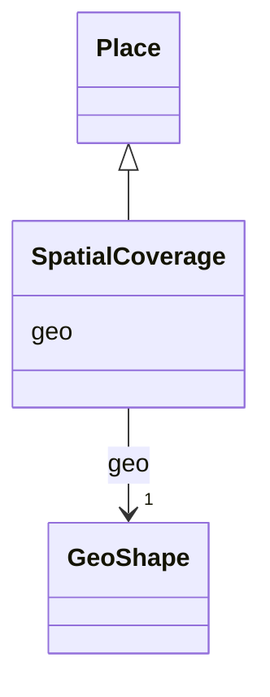

# Class: SpatialCoverage


_A bounding box defined by latitude and longitude coordinates._


URI: [oae:SpatialCoverage](https://schema.oaedata.org/SpatialCoverage)





## Inheritance
* [Place](Place.md)
    * **SpatialCoverage**


## Slots

| Name | Cardinality and Range | Description | Inheritance |
| ---  | --- | --- | --- |
| [geo](geo.md) | 1 <br/> [GeoShape](GeoShape.md)&nbsp;or&nbsp;<br />[GeoShape](GeoShape.md)&nbsp;or&nbsp;<br />[GeoCoordinates](GeoCoordinates.md) | Entities that have a somewhat fixed, physical extension | [Place](Place.md) |


## Usages

| used by | used in | type | used |
| ---  | --- | --- | --- |
| [Project](Project.md) | [spatial_coverage](spatial_coverage.md) | range | [SpatialCoverage](SpatialCoverage.md) |
| [ExternalProject](ExternalProject.md) | [spatial_coverage](spatial_coverage.md) | range | [SpatialCoverage](SpatialCoverage.md) |
| [Experiment](Experiment.md) | [spatial_coverage](spatial_coverage.md) | range | [SpatialCoverage](SpatialCoverage.md) |
| [InSituExperiment](InSituExperiment.md) | [spatial_coverage](spatial_coverage.md) | range | [SpatialCoverage](SpatialCoverage.md) |
| [Intervention](Intervention.md) | [spatial_coverage](spatial_coverage.md) | range | [SpatialCoverage](SpatialCoverage.md) |
| [Tracer](Tracer.md) | [spatial_coverage](spatial_coverage.md) | range | [SpatialCoverage](SpatialCoverage.md) |
| [InterventionWithTracer](InterventionWithTracer.md) | [spatial_coverage](spatial_coverage.md) | range | [SpatialCoverage](SpatialCoverage.md) |
| [Model](Model.md) | [spatial_coverage](spatial_coverage.md) | range | [SpatialCoverage](SpatialCoverage.md) |
| [ModelGrid](ModelGrid.md) | [spatial_coverage](spatial_coverage.md) | range | [SpatialCoverage](SpatialCoverage.md) |


## Identifier and Mapping Information


### Schema Source


* from schema: https://schema.oaedata.org/OAEDataSchema


## Mappings

| Mapping Type | Mapped Value |
| ---  | ---  |
| self | oae:SpatialCoverage |
| native | oae:SpatialCoverage |


## LinkML Source

<!-- TODO: investigate https://stackoverflow.com/questions/37606292/how-to-create-tabbed-code-blocks-in-mkdocs-or-sphinx -->

### Direct

<details>
```yaml
name: SpatialCoverage
description: A bounding box defined by latitude and longitude coordinates.
from_schema: https://schema.oaedata.org/OAEDataSchema
is_a: Place
slot_usage:
  geo:
    name: geo
    range: GeoShape
    required: true

```
</details>

### Induced

<details>
```yaml
name: SpatialCoverage
description: A bounding box defined by latitude and longitude coordinates.
from_schema: https://schema.oaedata.org/OAEDataSchema
is_a: Place
slot_usage:
  geo:
    name: geo
    range: GeoShape
    required: true
attributes:
  geo:
    name: geo
    description: Entities that have a somewhat fixed, physical extension. (imported
      from schema.org)
    from_schema: https://schema.oaedata.org/OAEDataSchema
    rank: 1000
    alias: geo
    owner: SpatialCoverage
    domain_of:
    - Place
    range: GeoShape
    required: true
    any_of:
    - range: GeoShape
    - range: GeoCoordinates

```
</details>