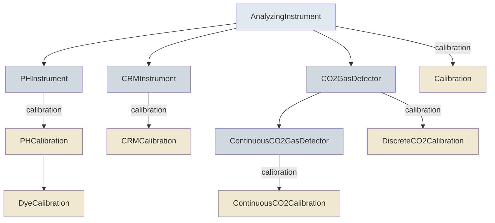

# Instruments & Calibration

Measured variables describe the instrument that analyzed them, in `analyzing_instrument`, and how that
instrument was calibrated. Some variable classes require a specific instrument type, and each
instrument type requires its own calibration type, so the right calibration fields come with the
variable.

## Instrument Hierarchy



## Which Instrument Each Variable Uses

| Variable class | Instrument | Calibration |
|----------------|------------|-------------|
| [DiscretePHVariable](https://schema.oaedata.org/DiscretePHVariable.md) | [PHInstrument](https://schema.oaedata.org/PHInstrument.md) | [DyeCalibration](https://schema.oaedata.org/DyeCalibration.md) when `standard_used` is dye, otherwise [PHCalibration](https://schema.oaedata.org/PHCalibration.md) for TRIS or other standards |
| [DiscreteTAVariable](https://schema.oaedata.org/DiscreteTAVariable.md), [DiscreteDICVariable](https://schema.oaedata.org/DiscreteDICVariable.md) | [CRMInstrument](https://schema.oaedata.org/CRMInstrument.md) | [CRMCalibration](https://schema.oaedata.org/CRMCalibration.md): certified reference material |
| [DiscreteCO2Variable](https://schema.oaedata.org/DiscreteCO2Variable.md) | [CO2GasDetector](https://schema.oaedata.org/CO2GasDetector.md) | [DiscreteCO2Calibration](https://schema.oaedata.org/DiscreteCO2Calibration.md): standard gases |
| [ContinuousCO2Variable](https://schema.oaedata.org/ContinuousCO2Variable.md) | [ContinuousCO2GasDetector](https://schema.oaedata.org/ContinuousCO2GasDetector.md) | [ContinuousCO2Calibration](https://schema.oaedata.org/ContinuousCO2Calibration.md): standard gases |
| All other measured variables, including continuous pH, TA and DIC | [AnalyzingInstrument](https://schema.oaedata.org/AnalyzingInstrument.md) | [Calibration](https://schema.oaedata.org/Calibration.md) |

## Example

A discrete pH variable's `analyzing_instrument`:

<!-- validate: PHInstrument -->
```json
{
  "instrument_type": "spectrophotometer",
  "manufacturer": "Agilent",
  "accuracy": "0.001 pH units",
  "calibration": {
    "technique_description": "Spectrophotometric pH with purified m-cresol purple",
    "calibration_location": "lab",
    "standard_used": "dye",
    "standard_type_and_production": "Purified m-cresol purple, MCR Inc.",
    "dye_purified": true
  }
}
```
